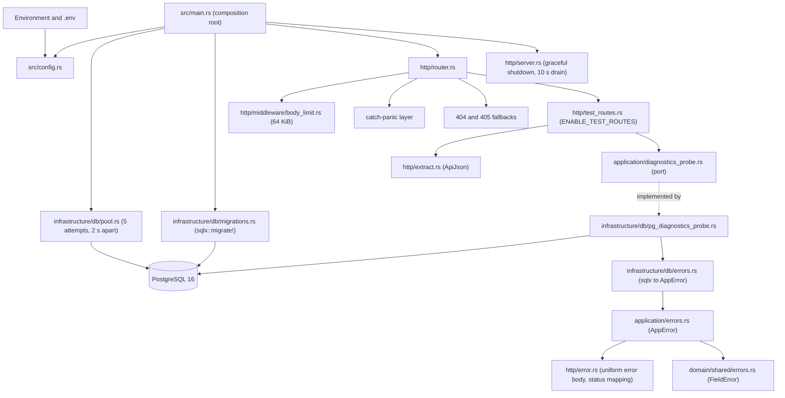

# Spec: Project Foundation and Database Setup

## 1. Technical Overview

**What:** Bootstrap the Task API as a single Cargo package (`task-api`, library + binary) laid out in clean-architecture layers (`domain`, `application`, `infrastructure`, `http`) with `main.rs` as the composition root. F01 delivers environment-driven configuration, a PostgreSQL connection pool with bounded startup retries, embedded sqlx migrations that create the `tasks` table with its `CHECK` constraints and indexes, the uniform JSON error body and its single status-code mapping point, request-body limits and a JSON extractor, the unknown-route and method-not-allowed fallbacks, panic containment, graceful shutdown with a 10-second drain window, committed `.sqlx/` offline metadata, a `#[sqlx::test]` integration-test harness, and a README.

**Why:** Every later feature (F02–F10) plugs into the same router, error type, state, pool, and test harness. Fixing these cross-cutting concerns once — and proving them with F01-owned diagnostic routes — keeps each business feature down to its own domain logic, SQL, and handlers, and guarantees that the error contract, body limits, and shutdown semantics are identical across every endpoint.

**Scope:**

**Included:**
- Cargo package `task-api` (edition 2024, `rust-version = "1.100"`) with the stack pinned by `CLAUDE.md` (axum 0.8.9, sqlx 0.9.1 with `postgres`, `runtime-tokio`, `tls-rustls`, `uuid`, `chrono`, `migrate`, `macros`; tokio, serde, thiserror, tracing).
- Layer skeleton: `src/domain` (shared field-error type), `src/application` (application error type and the diagnostics port), `src/infrastructure` (pool, migrations, sqlx error mapping, diagnostics adapter), `src/http` (router, state, uniform error, JSON extractor, body-limit middleware, diagnostic routes, server lifecycle), `src/config.rs` (the only environment reader), `src/main.rs` (composition root).
- Configuration from environment variables with `.env` loading: `DATABASE_URL`, `HOST`, `PORT`, `DATABASE_MAX_CONNECTIONS`, `DATABASE_ACQUIRE_TIMEOUT_SECS`, plus the F01-scoped `ENABLE_TEST_ROUTES` flag.
- Startup: configuration validation → database connection (5 attempts, 2 s apart) → migrations → bind → serve; every failure exits with code `1` and a named cause.
- Migration `create_tasks_table` with the 8 PRD columns, defaults, 4 `CHECK` constraints, and 4 secondary indexes.
- Uniform error body and the full PRD error-code catalog (10 codes), with status codes chosen in exactly one place.
- Request limits: 64 KiB JSON body cap (413) enforced before routing and while buffering; `Content-Type: application/json` required on JSON routes (415); malformed or mistyped JSON (400 `invalid_json`).
- Unknown routes (404 `not_found`, `"Route not found"`), wrong method on a known route (405 `method_not_allowed`), panics (500 `internal_error`), unexpected SQL errors (500 `internal_error`), pool exhaustion / database loss (503 `service_unavailable`).
- F01-scoped diagnostic routes under `/__test/*`, mounted only when `ENABLE_TEST_ROUTES=true`, used to exercise the cross-cutting behaviors before any business endpoint exists (Preparation Pattern).
- Graceful shutdown on SIGTERM/SIGINT: stop accepting, drain in-flight requests for up to 10 s, close the pool, exit `0`.
- A minimal stdout `tracing` subscriber so startup/shutdown messages are visible (replaced by F02's configurable subscriber).
- Compile-time-checked queries only; `.sqlx/` committed; `SQLX_OFFLINE=true cargo build` works without a database.
- Integration-test harness in `tests/` (helpers in `tests/common/`), `.env.test`, `.env.example` (F01 variables), and `README.md`.

**Excluded (owned elsewhere):**
- Task entity, value objects, validation rules, repository trait/implementation, and `/tasks` handlers (F04–F08).
- Configurable log format/level, request IDs, per-request log lines (F02).
- `GET /health` (F03).
- Docker Compose, Dockerfile, `.dockerignore` (F09).
- OpenAPI document and Swagger UI (F10).

**Input contracts (Consumes):** none — F01 has no dependencies.

**Output contracts (Provides, informal — the PRD declares no Provides block for F01):** the router builder and `AppState` that later features extend; the `ApiError`/`AppError` types and error-code catalog; the `ApiJson` extractor; the pool and migration runner; the `tasks` table; the `tests/common/` helpers.

## 2. Architecture Impact

**Affected components (all new):**
- `Cargo.toml`, `Cargo.lock`, `.gitignore`, `.env.example`, `.env.test`, `README.md`
- `migrations/20261121000001_create_tasks_table.sql`
- `.sqlx/` (offline query metadata)
- `src/lib.rs`, `src/main.rs`, `src/config.rs`
- `src/domain/**`, `src/application/**`, `src/infrastructure/**`, `src/http/**`
- `tests/common/mod.rs`, `tests/http_errors.rs`, `tests/http_limits.rs`, `tests/schema.rs`, `tests/startup.rs`, `tests/shutdown.rs`, `tests/architecture.rs`



**Request flow:** catch-panic layer → body-limit middleware (Content-Length check) → route match (or 404/405 fallback) → extractor (`ApiJson` enforces content type, buffered size, JSON shape) → handler → port → infrastructure → `AppError` → `ApiError` → uniform JSON response.

**Startup flow:** load `.env` (if present) → install stdout subscriber → parse/validate `Config` (exit 1 on error) → connect pool with retries (exit 1 after 5 failures) → run migrations (exit 1 on failure, listener never bound) → bind `HOST:PORT` (exit 1 on bind error) → log `listening on <addr>` → serve until signal → drain ≤ 10 s → close pool → log `server stopped` → exit 0.

## 3. Technical Decisions

| Decision | Chosen Approach | Alternative Considered | Trade-off |
|----------|----------------|----------------------|-----------|
| Package layout | Single Cargo package `task-api` (lib + bin) with layer modules `src/domain`, `src/application`, `src/infrastructure`, `src/http` named exactly as in `CLAUDE.md` | Cargo workspace with one crate per layer (the `ironclad:clean-arch` default `crates/domain|usecase|infra|app`) | Layer direction is enforced by an architecture test (source scan) instead of by Cargo; in exchange `tests/` integration tests, `.sqlx/`, and `cargo test` stay at the repository root as `CLAUDE.md` prescribes |
| Exercising cross-cutting behavior before business routes exist | F01-scoped diagnostic routes under `/__test/*`, mounted only when `ENABLE_TEST_ROUTES=true` (default `false`) | Wait for F04 routes; compile-time feature flag; test-only router merged from `tests/common/` | One mechanism serves both in-process and spawned-binary tests (needed for the SIGTERM in-flight scenario); routes ship in the binary but are inert unless explicitly enabled |
| Body-size enforcement | Custom middleware rejects `Content-Length > 65,536` before routing with the uniform 413; `ApiJson` buffers with a 65,536-byte cap (covers chunked bodies) and maps overflow to the same 413 | `tower_http::limit::RequestBodyLimitLayer` | Two small checks instead of one layer, but every 413 carries the uniform body, and the cap applies to every path (including `POST /tasks` before F04 exists) |
| Error mapping | `sqlx::Error` → `AppError` in `infrastructure/db/errors.rs`; `AppError` and extractor rejections → `ApiError` in `http/error.rs`, the only place that chooses HTTP status codes | `IntoResponse` on many error types | One more conversion hop, but a single auditable table for status codes and guaranteed non-leakage of SQL text |
| Startup logging | Minimal `tracing-subscriber` fmt layer to stdout at `info`, installed first in `main.rs` | Defer all logging to F02 | F02 must replace the initializer (single call site) — accepted so F01 messages (`connecting to database`, `listening on …`) exist now |
| Shutdown drain | `axum::serve(..).with_graceful_shutdown(signal)` raced against a 10 s deadline that starts when the signal arrives; on deadline, remaining connections are dropped and shutdown proceeds | Unbounded graceful drain | Requests longer than 10 s after the signal are cut, matching the PRD's "waits up to 10 seconds" and still exiting `0` |

### 3.1 Assumptions and Auto-Accept Decisions

Every entry below was applied without an interview (Batch Mode). The policy row that produced it is named in brackets; review and override as needed.

1. **Scope = full feature** — F01 has no Core/Full split in the PRD. [Scope row — not applicable; full scope assumed]
2. **Stack taken from `CLAUDE.md`**; Rust/axum/sqlx best practice fills only what `CLAUDE.md` and the PRD leave open. [Empty codebase bootstrap]
3. **Single package, `CLAUDE.md` layer names** (`domain`/`application`/`infrastructure`/`http`) override the `ironclad:clean-arch` skill's `usecase`/`infra`/`app` naming; clean-arch rules still apply (env read only in `config.rs`, status codes chosen in one place, entities never serialized, ports as `Send + Sync` traits behind `Arc<dyn …>`). [Multiple conflicting patterns → `CLAUDE.md` is authoritative]
4. **Domain isolation verified by an architecture test** that scans `src/domain` (and `src/application`) for `axum`/`sqlx` references, since a single package cannot be compiled per module. [Technical decision with clear recommendation]
5. **Crate and binary name `task-api`.** [Empty codebase bootstrap]
6. **Persistent-state seeding convention:** each DB test receives an isolated database from `#[sqlx::test]` (migrations applied unless `migrations = false`); extra rows/state are created inside the test with compile-time-checked statements; shared helpers live in `tests/common/`. [Empty codebase bootstrap — from `CLAUDE.md` Testing]
7. **Fixture path convention:** `tests/fixtures/` (from `CLAUDE.md`). F01 needs no static files — oversized and boundary payloads are generated in-test — so the directory is created empty (with a `.gitkeep`). [Empty codebase bootstrap]
8. **Test configuration convention:** `.env.test` at the repo root holds `DATABASE_URL`; its variables are exported into the environment of `cargo test` (README documents `set -a; . ./.env.test; set +a`). The test binary does not rely on `.env`. [Empty codebase bootstrap]
9. **Mock convention:** none — F01 has no external dependencies besides PostgreSQL. [Empty codebase bootstrap]
10. **`ENABLE_TEST_ROUTES`** (values `true`/`false`, default `false`; any other value aborts startup with exit 1 naming the variable) gates the diagnostic routes. Added beyond the PRD's variable list as the F01 Preparation-Pattern mechanism. [Technical decision with clear recommendation]
11. **"64 KB" = 64 KiB = 65,536 bytes**; 65,536 accepted, 65,537 rejected. The pre-routing Content-Length check means `POST /tasks` returns 413 for oversized bodies even before F04 registers the route. [Partial PRD specifications]
12. **Shared extractor messages adopted from PRD F04 Error Handling:** `invalid_json` → `"Request body is not valid JSON for this endpoint"`, `unsupported_media_type` → `"Content-Type must be application/json"`, `payload_too_large` → `"Request body exceeds 64 KB"`. `method_not_allowed` → `"Method not allowed"` (no PRD text). [Partial PRD specifications]
13. **Accepted content types** for JSON routes: media type `application/json`, parameters (e.g. `charset=utf-8`) allowed; anything else or a missing header → 415. [Partial PRD specifications]
14. **`DATABASE_ACQUIRE_TIMEOUT_SECS` range 1–300** (PRD gives only the default 5). [Partial PRD specifications]
15. **`HOST` must parse as an IP address** (IPv4 or IPv6); otherwise exit 1 naming `HOST`. [Partial PRD specifications]
16. **Log wording** beyond the PRD: per-attempt line `connecting to database (attempt k/5)`, per-failure warning `database connection attempt k/5 failed: <cause>`, `applied N migrations`, `listening on <host>:<port>`, `shutdown signal received`, `shutdown deadline exceeded; dropping in-flight requests`, `server stopped`. Configuration errors are logged as `configuration error: <VAR> …`. The database URL (and its password) is never logged. [Partial PRD specifications]
17. **Connection retry semantics:** each attempt is a full pool connect bounded by `DATABASE_ACQUIRE_TIMEOUT_SECS`; 2 s sleep between attempts (4 sleeps for 5 attempts). [Partial PRD specifications]
18. **Migration naming:** `migrations/<YYYYMMDDHHMMSS>_<description>.sql` (sqlx-cli simple migrations, non-reversible); F01 ships exactly one. [Empty codebase bootstrap]
19. **PRD inconsistency — 201-character title:** the PRD fixes `title VARCHAR(200)`, so PostgreSQL rejects a 201-character value with SQLSTATE `22001` (length check on the column type) before the `CHECK` constraint runs. The column type is kept exactly as specified; the contract asserts that the direct `INSERT` is rejected by the database's declared column constraints, and separately asserts that the `CHECK` rejects whitespace-only titles (`23514`). Flagged for PRD review. [Description too vague / PRD conflict — documented, not silently inferred]
20. **sqlx error classification:** `PoolTimedOut`, `PoolClosed`, `Io`, `Tls`, and connection-class SQLSTATEs (`08xxx`, `57P01`–`57P03`) → `AppError::Unavailable` (503); everything else → `AppError::Internal` (500). [Technical decision with clear recommendation]
21. **Panics** are caught by tower-http's catch-panic layer and mapped to the uniform 500 `internal_error`; the panic payload is logged, never returned. [Technical decision with clear recommendation]
22. **Shutdown deadline:** after 10 s, outstanding connections are dropped, the pool is closed, and the process still exits `0`. [Partial PRD specifications]
23. **`/__test/slow` `ms` is capped at 30,000**; values outside 0–30,000 return 400 `invalid_query`. [Partial PRD specifications]
24. **Offline metadata** is generated with `cargo sqlx prepare -- --all-targets` so test-target queries are covered too. [Technical decision with clear recommendation]
25. **AC "each against an isolated `#[sqlx::test]` database"** is interpreted as: every integration test that touches PostgreSQL is a `#[sqlx::test]`; process-level tests obtain their database from `#[sqlx::test(migrations = false)]` and derive its URL; tests that need no database (config rejection, architecture scan) are plain `#[test]`/`#[tokio::test]`. [Partial PRD specifications]
26. **New dependencies beyond the `CLAUDE.md` list:** `dotenvy` (`.env` loading required by the PRD), `async-trait` (object-safe async ports), `http-body-util` (bounded body buffering); dev-only `reqwest` (rustls, black-box HTTP against the spawned binary), `nix` (`signal` feature, delivering SIGTERM/SIGINT), `futures-util` (streamed request bodies). tower-http is enabled with the `catch-panic` feature. [Feature requires new technology not present in the codebase]
27. **Quality gates auto-included from `CLAUDE.md`:** `cargo fmt --check`, `cargo clippy --all-targets -- -D warnings`, `cargo test`, `SQLX_OFFLINE=true cargo build`. No wrapper script exists in the project; the clean-arch skill's `run-gates.mjs` is not adopted because it targets the workspace layout. [Quality gates clarification — detected gates]
28. **Contract surfaces:** `HTTP API` (error body, limits, fallbacks), `CLI` (process start/stop, config, exit codes, logs), `E2E` (SIGTERM with a request in flight), plus two documented catalog extensions — `Database` (schema and `CHECK` constraints via direct SQL) and `Build` (offline build, lint, test harness, layering). `Service` is not emitted: the PRD declares no Consumes entry on an F01 programmatic interface, so the Service Admission Rule is not met. No UI/Worker/Event signals. [Contract surface set ambiguous]
29. **Toolchain pin** via `rust-version = "1.100"` in `Cargo.toml`; no `rust-toolchain.toml`. [Empty codebase bootstrap]

## 4. Component Overview

**Project files:**

| File Path | New/Modified | Purpose | Key Responsibilities |
|-----------|--------------|---------|---------------------|
| `Cargo.toml` | New | Package manifest | edition 2024, `rust-version = "1.100"`, `[lib]` + `[[bin]] task-api`, pinned stack versions/features, `[lints]` (`unsafe_code = "forbid"`, clippy `unwrap_used`/`expect_used` = deny outside tests) |
| `.gitignore` | Modified | Ignore rules | add `/target` and `.env` (keep `.env.example`, `.env.test`) |
| `.env.example` | New | Config documentation | every F01 variable with its default; `ENABLE_TEST_ROUTES=false` |
| `.env.test` | New | Test configuration | `DATABASE_URL` for a local PostgreSQL 16 whose role can create databases |
| `README.md` | New | Developer docs | prerequisites, configuration table, `cargo run`, running tests with `.env.test`, quality gates, `cargo sqlx prepare -- --all-targets` |
| `migrations/20261121000001_create_tasks_table.sql` | New | Schema | `tasks` table, constraints, indexes (Section 6) |
| `.sqlx/query-*.json` | New | Offline metadata | generated by `cargo sqlx prepare -- --all-targets`; committed |
| `tests/fixtures/.gitkeep` | New | Fixture folder | establishes the project fixture path convention |

**Backend (src):**

| File Path | New/Modified | Purpose | Key Responsibilities |
|-----------|--------------|---------|---------------------|
| `src/lib.rs` | New | Library facade | declares `config`, `domain`, `application`, `infrastructure`, `http`; named re-exports only |
| `src/main.rs` | New | Composition root | `.env` load, subscriber install, `Config::from_env`, pool + migrations, construct `PgDiagnosticsProbe`, build `AppState`/router, bind, serve with shutdown, close pool, map every startup failure to exit code 1 |
| `src/config.rs` | New | Configuration (only env reader) | `Config` (database URL redacted in `Debug`, host, port, max connections, acquire timeout, test-routes flag); `from_env` and `from_lookup(closure)` for unit tests; `ConfigError` naming the variable |
| `src/domain/mod.rs` | New | Domain facade | declares `shared`; no `axum`/`sqlx` |
| `src/domain/shared/mod.rs` | New | Shared facade | declares `errors` |
| `src/domain/shared/errors.rs` | New | Domain error primitives | `FieldError { field, message }`; `DomainError::Validation(Vec<FieldError>)` reporting all invalid fields at once (used by F04/F07) |
| `src/application/mod.rs` | New | Application facade | declares `errors`, `diagnostics_probe` |
| `src/application/errors.rs` | New | Application error | `AppError` variants `Validation(Vec<FieldError>)`, `NotFound(String)`, `Unavailable(source)`, `Internal(source)`; `From<DomainError>` |
| `src/application/diagnostics_probe.rs` | New | Diagnostics port | `DiagnosticsProbe: Send + Sync` with `ping`, `induce_sql_error`, `hold_connection(duration)` returning `Result<_, AppError>` |
| `src/infrastructure/mod.rs` | New | Infrastructure facade | declares `db` |
| `src/infrastructure/db/mod.rs` | New | DB facade | declares `pool`, `migrations`, `errors`, `pg_diagnostics_probe` |
| `src/infrastructure/db/pool.rs` | New | Pool construction | `connect_with_retry(&DbSettings)`: 5 attempts, 2 s apart, per-attempt and final log lines, never logs the URL |
| `src/infrastructure/db/migrations.rs` | New | Embedded migrations | `MIGRATOR` via `sqlx::migrate!("./migrations")`; `run_migrations(&PgPool) -> Result<usize, MigrationFailure>` returning the number newly applied; failure carries version + cause |
| `src/infrastructure/db/errors.rs` | New | sqlx mapping | `map_sqlx_error(sqlx::Error) -> AppError` per Assumption 20 |
| `src/infrastructure/db/pg_diagnostics_probe.rs` | New | Diagnostics adapter | `PgDiagnosticsProbe { pool }` implementing the port with compile-time-checked `SELECT 1` and `SELECT 1 / $1::int4` (bound to 0) queries; `hold_connection` acquires and holds one pooled connection |
| `src/http/mod.rs` | New | HTTP facade | declares `error`, `extract`, `middleware`, `router`, `server`, `state`, `test_routes` |
| `src/http/state.rs` | New | Shared state | `AppState { diagnostics: Arc<dyn DiagnosticsProbe> }`, `Clone`; later features add use cases |
| `src/http/error.rs` | New | Uniform error | `ErrorCode` (10 codes, snake_case serialization), `ApiError { status, code, message, details }`, constructors per code, `IntoResponse` producing `{"error":{…}}` with `Content-Type: application/json`, `From<AppError>` (logs internal/unavailable causes at `error`/`warn`, never returns them) — the only place HTTP status codes for errors are chosen |
| `src/http/extract.rs` | New | JSON extractor | `ApiJson<T>`: content-type check (415), buffered read with 65,536-byte cap (413), `serde_json` deserialize (400 `invalid_json`, `details[0].field` from the serde path when known) |
| `src/http/middleware/mod.rs` | New | Middleware facade | declares `body_limit` |
| `src/http/middleware/body_limit.rs` | New | Body cap | `enforce_body_limit`: rejects declared `Content-Length > 65,536` with 413 before routing; sets `DefaultBodyLimit` consistently |
| `src/http/router.rs` | New | Router composition | `build_router(state, RouterOptions { test_routes })`: merges diagnostic routes when enabled, `fallback` → 404 `"Route not found"`, `method_not_allowed_fallback` → 405, layers: catch-panic (outermost) → body limit |
| `src/http/test_routes.rs` | New | Diagnostic routes | handlers for `/__test/db-ping`, `/__test/sql-error`, `/__test/panic`, `/__test/slow`, `/__test/echo` (Section 5) |
| `src/http/server.rs` | New | Lifecycle | `shutdown_signal()` (SIGTERM or SIGINT, logs `shutdown signal received`); `serve(listener, router, grace = 10 s)` racing graceful drain against the deadline |

**Database:**

| Migration File | Tables Affected | Operation | Notes |
|----------------|-----------------|-----------|-------|
| `20261121000001_create_tasks_table.sql` | `tasks` | CREATE TABLE, CREATE INDEX ×4 | Named `CHECK` constraints mirror the domain rules F04 will implement |

## 5. API Contracts

F01 owns no business endpoints. It owns the error contract every endpoint uses, the fallbacks, the body/content-type limits, and a set of diagnostic routes that exist only when `ENABLE_TEST_ROUTES=true`.

### 5.1 Uniform error body

Every non-2xx response has `Content-Type: application/json` and this body:

| Field | Type | Description |
|-------|------|-------------|
| `error.code` | `string` | Stable machine code (table 5.2) |
| `error.message` | `string` | Human-readable text; clients must not branch on it |
| `error.details` | `array` | `[{ "field": string, "message": string }]`; empty array when not applicable |

```json
{
  "error": {
    "code": "not_found",
    "message": "Route not found",
    "details": []
  }
}
```

### 5.2 Error code catalog

| Code | HTTP Status | Default message (F01-owned where stated) | Raised by |
|------|-------------|------------------------------------------|-----------|
| `invalid_json` | 400 | `"Request body is not valid JSON for this endpoint"` | `ApiJson` (F01) |
| `invalid_id` | 400 | set by caller (F05/F07/F08: `"Task id must be a valid UUID"`) | path extractors in later features |
| `invalid_query` | 400 | set by caller | query extractors (F06); `/__test/slow` (F01) |
| `not_found` | 404 | `"Route not found"` for the fallback | fallback (F01); `AppError::NotFound` (F05+) |
| `method_not_allowed` | 405 | `"Method not allowed"` | method fallback (F01) |
| `payload_too_large` | 413 | `"Request body exceeds 64 KB"` | body-limit middleware and `ApiJson` (F01) |
| `unsupported_media_type` | 415 | `"Content-Type must be application/json"` | `ApiJson` (F01) |
| `validation_error` | 422 | set by caller (e.g. `"Request validation failed"`) | `AppError::Validation` (F04/F07) |
| `service_unavailable` | 503 | `"Database temporarily unavailable, please retry"` | `AppError::Unavailable` (F01 mapping) |
| `internal_error` | 500 | `"An unexpected error occurred"` | `AppError::Internal`, panics (F01) |

### 5.3 Fallbacks and limits

- **Unknown route** (any method, any unmatched path): `404`, body exactly `{"error":{"code":"not_found","message":"Route not found","details":[]}}`.
- **Known path, wrong method:** `405`, `{"error":{"code":"method_not_allowed","message":"Method not allowed","details":[]}}`.
- **Declared `Content-Length` > 65,536** on any request, matched or not: `413 payload_too_large` before routing.
- **Streamed body exceeding 65,536 bytes** on a route using `ApiJson`: `413 payload_too_large`.
- **JSON route without `Content-Type: application/json`:** `415 unsupported_media_type`.

### 5.4 Diagnostic routes (only when `ENABLE_TEST_ROUTES=true`; otherwise they are unknown routes → 404)

**Endpoint: Database ping**
- **Method:** GET · **Path:** `/__test/db-ping` · **Authentication:** none

| Field | Type | Description |
|-------|------|-------------|
| `database` | `string` | Always `"up"` on success |

```json
{ "database": "up" }
```

| Code | HTTP Status | Description |
|------|-------------|-------------|
| `service_unavailable` | 503 | No pooled connection within the acquire timeout, or database unreachable |

**Endpoint: Induced SQL error**
- **Method:** GET · **Path:** `/__test/sql-error` · **Authentication:** none
- Executes a compile-time-checked statement that fails at runtime (integer division by zero) and propagates the sqlx error through the standard mapping.

| Code | HTTP Status | Description |
|------|-------------|-------------|
| `internal_error` | 500 | Always; cause logged server-side only |

**Endpoint: Induced panic**
- **Method:** GET · **Path:** `/__test/panic` · **Authentication:** none

| Code | HTTP Status | Description |
|------|-------------|-------------|
| `internal_error` | 500 | Always; panic payload logged server-side only |

**Endpoint: Slow request**
- **Method:** GET · **Path:** `/__test/slow` · **Authentication:** none

**Request (query):**

| Field | Type | Required | Validation | Description |
|-------|------|----------|------------|-------------|
| `ms` | `integer` | Yes | 0–30,000 | Milliseconds to wait before responding |
| `hold_db` | `boolean` | No | `true`/`false`, default `false` | Hold one pooled connection for the whole wait |

**Response (200):**

| Field | Type | Description |
|-------|------|-------------|
| `slept_ms` | `integer` | Echo of `ms` |

```json
{ "slept_ms": 3000 }
```

| Code | HTTP Status | Description |
|------|-------------|-------------|
| `invalid_query` | 400 | `ms` missing, non-integer, or out of range; `details` names the parameter |
| `service_unavailable` | 503 | `hold_db=true` and no connection could be acquired |

**Endpoint: JSON echo**
- **Method:** POST · **Path:** `/__test/echo` · **Authentication:** none · uses `ApiJson`

**Request:**

| Field | Type | Required | Validation | Description |
|-------|------|----------|------------|-------------|
| `value` | `string` | Yes | JSON string | Echoed back |

```json
{ "value": "hello" }
```

**Response (200):**

```json
{ "value": "hello" }
```

| Code | HTTP Status | Description |
|------|-------------|-------------|
| `invalid_json` | 400 | Malformed JSON; wrong type for `value` (with `details[0].field = "value"`) |
| `payload_too_large` | 413 | Body > 65,536 bytes |
| `unsupported_media_type` | 415 | Missing/non-JSON `Content-Type` |
| `method_not_allowed` | 405 | Any method other than POST |

## 6. Data Model

**Table: `tasks`**

| Column | Type | Nullable | Default | Description |
|--------|------|----------|---------|-------------|
| `id` | `uuid` | No | `gen_random_uuid()` | Primary key |
| `title` | `varchar(200)` | No | - | Trimmed title, 1–200 chars |
| `description` | `text` | Yes | - | ≤ 5,000 chars |
| `status` | `text` | No | `'todo'` | `todo` / `in_progress` / `done` |
| `priority` | `text` | No | `'medium'` | `low` / `medium` / `high` |
| `due_date` | `date` | Yes | - | Calendar date |
| `created_at` | `timestamptz` | No | `now()` | Creation instant |
| `updated_at` | `timestamptz` | No | `now()` | Last modification instant |

**Indexes:**

| Index Name | Columns | Type | Purpose |
|------------|---------|------|---------|
| `tasks_pkey` | `id` | btree (unique) | Primary key lookup (F05/F07/F08) |
| `idx_tasks_status` | `status` | btree | Status filter (F06) |
| `idx_tasks_priority` | `priority` | btree | Priority filter (F06) |
| `idx_tasks_due_date` | `due_date` | btree | Due-date sort (F06) |
| `idx_tasks_created_at` | `created_at` | btree | Default sort (F06) |

**Constraints:**

| Constraint | Type | Definition | Purpose |
|------------|------|------------|---------|
| `tasks_pkey` | PRIMARY KEY | `id` | Unique identifier |
| `tasks_title_check` | CHECK | `char_length(btrim(title)) BETWEEN 1 AND 200` | No blank titles |
| `tasks_description_check` | CHECK | `description IS NULL OR char_length(description) <= 5000` | Description length |
| `tasks_status_check` | CHECK | `status IN ('todo','in_progress','done')` | Status enum |
| `tasks_priority_check` | CHECK | `priority IN ('low','medium','high')` | Priority enum |

**Notes:**
- `gen_random_uuid()` is built into PostgreSQL ≥ 13; no extension required.
- The `varchar(200)` length limit rejects > 200 characters with SQLSTATE `22001` before `tasks_title_check` is evaluated (Assumption 19).
- `updated_at` refresh is application-driven (F07), not a trigger.

**Migration Example:**
```sql
CREATE TABLE tasks (
    id          UUID         PRIMARY KEY DEFAULT gen_random_uuid(),
    title       VARCHAR(200) NOT NULL,
    description TEXT         NULL,
    status      TEXT         NOT NULL DEFAULT 'todo',
    priority    TEXT         NOT NULL DEFAULT 'medium',
    due_date    DATE         NULL,
    created_at  TIMESTAMPTZ  NOT NULL DEFAULT now(),
    updated_at  TIMESTAMPTZ  NOT NULL DEFAULT now(),
    CONSTRAINT tasks_title_check       CHECK (char_length(btrim(title)) BETWEEN 1 AND 200),
    CONSTRAINT tasks_description_check CHECK (description IS NULL OR char_length(description) <= 5000),
    CONSTRAINT tasks_status_check      CHECK (status IN ('todo', 'in_progress', 'done')),
    CONSTRAINT tasks_priority_check    CHECK (priority IN ('low', 'medium', 'high'))
);

CREATE INDEX idx_tasks_status     ON tasks (status);
CREATE INDEX idx_tasks_priority   ON tasks (priority);
CREATE INDEX idx_tasks_due_date   ON tasks (due_date);
CREATE INDEX idx_tasks_created_at ON tasks (created_at);
```

## 7. Testing Strategy

**Test File Structure:**

| Test File | Test Type | Target | Coverage Goal |
|-----------|-----------|--------|---------------|
| `src/config.rs` (`#[cfg(test)]`) | Unit | defaults, ranges, missing/invalid values, error messages | every variable × valid/invalid |
| `src/http/error.rs` (`#[cfg(test)]`) | Unit | code → status mapping, body serialization, `AppError` conversion | all 10 codes |
| `src/infrastructure/db/errors.rs` (`#[cfg(test)]`) | Unit | sqlx error classification | 503 vs 500 classes |
| `tests/common/mod.rs` | Helpers | `test_router(pool, opts)`, `send(router, request)` → (status, headers, JSON), `assert_uniform_error(json, code, message)`, `json_body_of_len(n)`, `database_url_for(&PgConnectOptions)`, `free_port()`, `ServiceProcess::spawn(env, cwd)` (captures stdout/stderr, waits for `listening on`), `signal(pid, SIGTERM/SIGINT)` | — |
| `tests/http_errors.rs` | Integration (in-process router, `#[sqlx::test]`) | fallbacks, 405, 500, panic, 503, disabled test routes | every error path F01 owns |
| `tests/http_limits.rs` | Integration (in-process router, `#[sqlx::test]`) | 413 (declared and streamed), boundary 65,536, 415, 400 | every limit |
| `tests/schema.rs` | Integration (`#[sqlx::test]`, direct SQL) | columns, defaults, indexes, CHECK constraints | full schema |
| `tests/startup.rs` | Integration (spawned binary) | config rejection, retries, migrations, listen, idle shutdown | every exit path |
| `tests/shutdown.rs` | Integration (spawned binary) | in-flight drain and 10 s deadline | both shutdown outcomes |
| `tests/architecture.rs` | Static (source scan) | layer isolation, compile-time macros only | `src/domain`, `src/application`, all `query(` calls |

**`tests/http_errors.rs`:**

| Test Function | Description | Assertions |
|---------------|-------------|------------|
| `unknown_route_returns_uniform_404` | `GET /does-not-exist` | 404, exact body, JSON content type |
| `unknown_route_post_returns_404_not_405` | `POST /does-not-exist` with small JSON | 404, exact body |
| `wrong_method_returns_uniform_405` | `DELETE /__test/echo` | 405, `method_not_allowed` body |
| `sql_error_returns_500_without_leaking` | `GET /__test/sql-error` | 500, exact body, no `division`/`SELECT`/`sqlx`/`22012` substrings |
| `panic_returns_500_without_trace` | `GET /__test/panic` | 500, exact body, no `panicked`/`.rs` substrings |
| `pool_exhaustion_returns_503` | pool max 1, acquire 1 s, connection held by `/__test/slow?hold_db=true` | 503, exact body, latency < 2.5 s |
| `test_routes_absent_when_disabled` | router built with `test_routes = false` | `/__test/sql-error` → uniform 404 |

**`tests/http_limits.rs`:**

| Test Function | Description | Assertions |
|---------------|-------------|------------|
| `post_tasks_over_64kib_returns_413` | `POST /tasks`, `Content-Length: 65537` | 413, exact body |
| `streamed_body_over_limit_returns_413` | `POST /__test/echo`, streamed body without Content-Length, 65,537 bytes | 413, exact body |
| `body_of_exactly_64kib_is_accepted` | 65,536-byte valid JSON | 200, echoed value |
| `missing_content_type_returns_415` | no header | 415, exact body |
| `text_plain_content_type_returns_415` | `text/plain` | 415, exact body |
| `malformed_json_returns_400` | `{"value":` | 400, `invalid_json`, details `[]` |
| `wrong_json_type_returns_400_with_field` | `{"value":5}` | 400, `invalid_json`, detail field `value` |

**`tests/schema.rs`:**

| Test Function | Description | Assertions |
|---------------|-------------|------------|
| `tasks_table_has_expected_columns` | `information_schema.columns` | 8 columns, types, nullability, PK |
| `tasks_table_has_expected_defaults` | `column_default` | uuid/todo/medium/now() defaults |
| `tasks_table_has_expected_indexes` | `pg_indexes` | 4 secondary btree indexes |
| `insert_with_title_only_applies_defaults` | `INSERT … RETURNING` | defaults, `created_at = updated_at` |
| `rejects_archived_status` | direct insert | SQLSTATE `23514`, `tasks_status_check`, 0 rows |
| `rejects_urgent_priority` | direct insert | SQLSTATE `23514`, `tasks_priority_check`, 0 rows |
| `rejects_201_char_title` | direct insert | rejected (`22001`), 0 rows |
| `rejects_blank_title` | `'   '` | SQLSTATE `23514`, `tasks_title_check` |
| `rejects_5001_char_description` | direct insert | SQLSTATE `23514`, `tasks_description_check` |

**`tests/startup.rs`:**

| Test Function | Description | Assertions |
|---------------|-------------|------------|
| `fresh_database_applies_migrations_and_listens` | `#[sqlx::test(migrations = false)]` DB, free port | log lines in order, TCP accept, process alive |
| `already_migrated_database_applies_zero` | migrated DB | `applied 0 migrations`, listening |
| `defaults_bind_0_0_0_0_8080` | HOST/PORT unset | `listening on 0.0.0.0:8080` |
| `missing_database_url_exits_1` | empty env, no `.env` | exit 1, message |
| `port_out_of_range_exits_1` | `PORT=70000` | exit 1, names `PORT`, no connect line |
| `port_zero_exits_1` | `PORT=0` | exit 1, names `PORT` |
| `max_connections_out_of_range_exits_1` | `DATABASE_MAX_CONNECTIONS=101` | exit 1, names variable |
| `acquire_timeout_not_integer_exits_1` | `DATABASE_ACQUIRE_TIMEOUT_SECS=abc` | exit 1, names variable |
| `unreachable_database_retries_5_times_then_exits_1` | `127.0.0.1:1` | 5 attempt lines, final line, exit 1, elapsed ≥ 8 s, no password in output |
| `migration_checksum_mismatch_exits_1_without_listener` | checksum altered | exit 1, `migration failed:` + version, port never accepts |
| `sigint_when_idle_exits_0` | SIGINT | logs, exit 0 |
| `sigterm_when_idle_exits_0` | SIGTERM | exit 0 within 10 s |

**`tests/shutdown.rs`:**

| Test Function | Description | Assertions |
|---------------|-------------|------------|
| `sigterm_lets_in_flight_request_complete` | `/__test/slow?ms=3000`, SIGTERM at ~500 ms | 200 `{"slept_ms":3000}`, new connection refused, exit 0 < 10 s |
| `sigterm_deadline_cuts_requests_after_10s` | `/__test/slow?ms=20000` | exit 0 between 10 s and 12 s, no 200 received |

**`tests/architecture.rs`:**

| Test Function | Description | Assertions |
|---------------|-------------|------------|
| `domain_does_not_reference_axum_or_sqlx` | scan `src/domain/**/*.rs` | no `axum`/`sqlx` path or `use` |
| `application_does_not_reference_axum_or_sqlx` | scan `src/application/**/*.rs` | same |
| `sql_uses_compile_time_macros_only` | scan `src/` and `tests/` | no runtime `sqlx::query(`/`query_as(`/`query_scalar(` calls |

**Harness rules:** every DB-touching test is `#[sqlx::test]`; process tests run the binary (`env!("CARGO_BIN_EXE_task-api")`) with `env_clear()` plus only the stated variables and a temporary working directory that contains no `.env`; spawned processes are killed on drop to avoid leaks; the `0.0.0.0:8080` test requires that port to be free.
