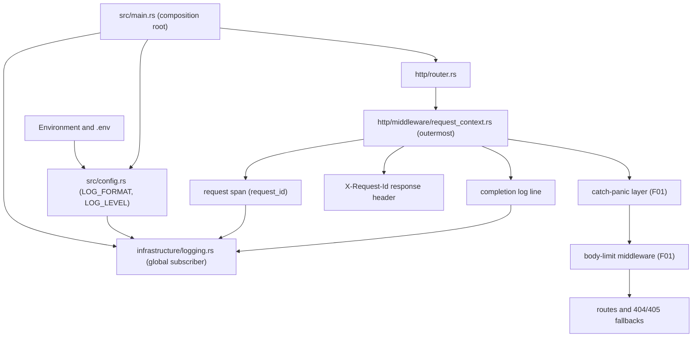

# Spec: Structured Logging and Request IDs

## 1. Technical Overview

**What:** Replace F01's minimal startup subscriber with a configurable `tracing` subscriber (`LOG_FORMAT` = `json` | `pretty`, `LOG_LEVEL` = an `EnvFilter` directive) and add one outermost HTTP middleware that gives every request a request ID, echoes it in the `X-Request-Id` response header, runs the request inside a `request` span carrying that ID, and emits exactly one completion log line (`timestamp`, `level`, `request_id`, `method`, `path`, `status`, `latency_ms`) with a level derived from the status code. Invalid `LOG_FORMAT` / `LOG_LEVEL` values abort startup with exit code `1`.

**Why:** Every later feature (F03–F08, F10) inherits one correlation mechanism: a client can quote the `X-Request-Id` of any response, including 4xx/5xx, unknown routes, panics and early 413 rejections, and an operator can find every server-side event for that request. Doing this once in the outermost layer guarantees no route or error path can escape it.

**Scope:**

**Included:**
- `LOG_FORMAT` (`json` default, `pretty`) and `LOG_LEVEL` (`EnvFilter` directive, default `info`), parsed and validated in `src/config.rs`; invalid values exit `1` naming the variable.
- A logging initializer (`src/infrastructure/logging.rs`) that installs the global subscriber once; JSON events are flattened, and the current request span is nested under `span`.
- Request-ID middleware: reuse a valid incoming `X-Request-Id` (1–128 characters of `[A-Za-z0-9._-]`), otherwise generate a UUID v4; echo it on the response; expose it to handlers as a request extension; attach it to a `request` span for the whole request.
- Completion log line per request with the level mapping `5xx → error`, `4xx → warn`, otherwise `info`; `GET /health` is logged at `debug` when its status is below 400.
- Never logging query strings, request bodies, or response bodies.
- `.env.example` and `README.md` entries for the two variables; `CLAUDE.md` stack/convention update.
- Tests: unit tests (ID rules, level mapping, config), in-process header tests, process-level log tests.

**Excluded (owned elsewhere):**
- The `/health` route itself (F03); only the log-level rule keyed on its path ships here.
- Task endpoints and any business logging (F04–F08).
- Log shipping, log rotation, sampling, metrics, distributed tracing export (out of PRD scope).
- Changing F01's message wording (`listening on …`, `applied N migrations`, …); only the rendering format changes.

**Input contracts (Consumes):** none declared in the PRD. F02 depends on F01's router builder (`build_router`), `Config`, and the `/__test/*` diagnostic routes (used only by tests).

**Output contracts (Provides, informal):** the `RequestId` request extension, the `X-Request-Id` header contract, the completion-line shape, and the `request` span that later features' log events inherit automatically.

## 2. Architecture Impact

**Affected components:**
- Modified: `Cargo.toml`, `Cargo.lock`, `.env.example`, `README.md`, `CLAUDE.md`
- Modified: `src/config.rs`, `src/main.rs`, `src/infrastructure/mod.rs`, `src/http/router.rs`, `src/http/middleware/mod.rs`, `tests/common/mod.rs`
- New: `src/infrastructure/logging.rs`, `src/http/middleware/request_context.rs`
- New tests: `tests/request_id.rs`, `tests/request_logging.rs`, `tests/log_config.rs`



**Request flow:** client → `request_context` (resolve or generate ID, open `request` span, insert `RequestId` extension) → catch-panic → body limit → route or fallback → response bubbles back through the same layers → `request_context` sets `X-Request-Id`, emits the completion line inside the span, returns the response. Because `request_context` is the outermost layer, panics (already converted to 500 by the inner layer) and 413 rejections are logged and carry the header.

**Startup flow:** load `.env` → `Config::from_env` (on error: print `configuration error: …` through a throwaway plain-text subscriber and exit `1`) → `logging::init(&config.log)` → connect pool → migrations → bind → serve (unchanged from F01).

## 3. Technical Decisions

| Decision | Chosen Approach | Alternative Considered | Trade-off |
|----------|----------------|----------------------|-----------|
| Request ID on non-completion events | Every request runs inside a `request` span with `request_id`; the JSON formatter nests the current span under `"span"` (`{"request_id": "…", "name": "request"}`); the completion event also carries `request_id` as a top-level field (interview answer) | Custom formatter flattening the span to top level; completion line only | Standard formatter, no custom code; non-completion events expose the ID at `span.request_id` instead of the top level |
| Where the middleware sits | `axum::middleware::from_fn` added as the last (outermost) `.layer(...)` in `build_router` | `tower_http::trace::TraceLayer` | Slightly more code than `TraceLayer`, but exact control of fields, levels, header echo, and the guarantee that panic/413 responses are covered |
| Config errors before the subscriber exists | `Config::from_env` runs first; its error is printed via `tracing::subscriber::with_default` using a plain-text subscriber; the configured subscriber is installed only after a valid config | Parse `LOG_*` separately and install a fallback subscriber globally first | Config errors are always plain text regardless of `LOG_FORMAT`; keeps `config.rs` the only environment reader and the global subscriber set exactly once |
| JSON timestamp and field shape | `tracing-subscriber` JSON formatter, `flatten_event(true)`, `with_current_span(true)`, `with_span_list(false)`; default `SystemTime` timer (RFC 3339 UTC with `Z`); level rendered upper-case (`INFO`) | Custom timer/format | Matches the PRD example line; no extra crates |
| `pretty` format | Default full formatter with ANSI colors enabled only when stdout is a terminal | `.pretty()` multi-line formatter | Single-line human-readable output; colors never pollute redirected output |
| Request-ID generation | `uuid` v4, hyphenated lowercase | Random hex of custom length | Verifiable against the PRD's "parses as a UUID v4" criterion |

### 3.1 Assumptions and Decisions

Items 1–3 are interview answers; the rest are assumptions for review.

1. **Quality gates confirmed** (interview): `cargo fmt --check`, `cargo clippy --all-targets -- -D warnings`, `cargo test`, `SQLX_OFFLINE=true cargo build`. No wrapper script exists in the project or in the available skills that consolidates them.
2. **Nested request span** for events other than the completion line (interview) — see the first Technical Decision.
3. **New dependencies confirmed** (interview): direct `uuid` crate (`v4`); `tracing-subscriber` features `json` and `env-filter` added to the existing `fmt`, `ansi`, `std`. No new `tower-http` features.
4. **Scope:** full feature (F02 has no Core/Full split).
5. **`LOG_FORMAT`** accepts exactly `json` or `pretty` (lower-case); an empty or unset value means the default `json`; anything else (including `xml` and `JSON`) exits `1` with `configuration error: LOG_FORMAT must be "json" or "pretty" (got "…")`.
6. **`LOG_LEVEL`** is any string accepted by `EnvFilter::try_new` (for example `warn` or `info,sqlx=warn`); an empty or unset value means `info`. A bare word that is not a level (for example `banana`) is a valid *target* directive and is therefore accepted; only strings `EnvFilter` itself rejects (for example `info,sqlx=loud`) exit `1`.
7. **Config errors are always plain text** (see the third Technical Decision); the F01 wording `configuration error: <VAR> …` is unchanged.
8. **F01 startup messages keep their wording**; with the default JSON format they become the `message` field of a JSON object, so substring checks on the raw output lines still hold.
9. **Request-ID validation** applies to the first `X-Request-Id` header; additional duplicates are ignored. A header value that is not valid UTF-8, is empty, is longer than 128 characters, or contains any character outside `[A-Za-z0-9._-]` is replaced (never rejected).
10. **Response header** is always set (overwriting any value a handler may have set) on every response the middleware sees.
11. **`path`** in the completion line is the raw request path (`uri.path()`), never the query string and never the matched route template.
12. **`latency_ms`** is an integer number of whole milliseconds measured from middleware entry to response return (floor).
13. **Completion message text** is `request completed`; JSON consumers should rely on the structured fields, not the message.
14. **`GET /health` rule:** for the exact path `/health` with method `GET`, a status below 400 is logged at `debug`; 4xx/5xx statuses keep their normal levels (`warn`/`error`) so a failing probe stays visible. The route is delivered by F03; F02 verifies the rule with a unit test on the level-mapping function.
15. **Process-level log tests** capture the binary's stdout (stdout and stderr merged), because the global subscriber can only be installed once per process; in-process router tests install no subscriber.
16. **Test fixtures/config conventions** are inherited from F01: `tests/fixtures/` (unused), `.env.test` for `DATABASE_URL`, per-test databases from `#[sqlx::test]`, no mocks.
17. **Contract surfaces:** `HTTP API` (header behavior), `CLI` (log configuration and startup rendering), `E2E` (HTTP traffic correlated with log output). `Service`, `UI`, `Worker`, `Event` are not emitted.

## 4. Component Overview

**Project files:**

| File Path | New/Modified | Purpose | Key Responsibilities |
|-----------|--------------|---------|---------------------|
| `Cargo.toml` | Modified | Manifest | add `uuid` (`v4`); add `json`, `env-filter` to the `tracing-subscriber` features |
| `.env.example` | Modified | Config documentation | add `LOG_FORMAT=json`, `LOG_LEVEL=info` with their defaults and valid values |
| `README.md` | Modified | Developer docs | configuration table rows, a Logging section (formats, level directive, request ID header, example line) |
| `CLAUDE.md` | Modified | Project guidance | stack list (`uuid`, subscriber features), logging convention, status line |

**Backend (src):**

| File Path | New/Modified | Purpose | Key Responsibilities |
|-----------|--------------|---------|---------------------|
| `src/config.rs` | Modified | Configuration | `LogFormat` enum; `LogConfig { format, level }` on `Config`; parse and validate `LOG_FORMAT`, `LOG_LEVEL` (the level is validated with `EnvFilter::try_new`); errors name the variable |
| `src/infrastructure/mod.rs` | Modified | Infrastructure facade | declare `logging` |
| `src/infrastructure/logging.rs` | New | Subscriber setup | `init(&LogConfig)` installs the global subscriber (JSON flattened + nested span, or full ANSI-when-terminal); `report_startup_error(&str)` prints one plain-text `ERROR` line through a throwaway subscriber |
| `src/http/middleware/mod.rs` | Modified | Middleware facade | declare and re-export `request_context` |
| `src/http/middleware/request_context.rs` | New | Request ID and request logging | `RequestId` extension type; `resolve_request_id(&HeaderMap)`; `is_valid_request_id(&str)`; `completion_level(method, path, status)`; `request_context` middleware (span, header echo, completion event) |
| `src/http/router.rs` | Modified | Router composition | add `request_context` as the outermost layer; update the documented layer order |
| `src/main.rs` | Modified | Composition root | remove the F01 `init_logging`; parse config first, report config errors via `report_startup_error`, then `logging::init` |

**Tests:**

| File Path | New/Modified | Purpose | Key Responsibilities |
|-----------|--------------|---------|---------------------|
| `tests/common/mod.rs` | Modified | Shared helpers | blocking raw HTTP helper returning status, headers, body; `uuid_v4` assertion; extraction of JSON completion lines from captured output; wait-for-line helper for a given request ID |
| `tests/request_id.rs` | New | In-process header tests | generated and reused IDs on success and error responses |
| `tests/request_logging.rs` | New | Process-level log tests | completion-line shape, levels, correlation, body/query exclusion, `LOG_LEVEL` filtering |
| `tests/log_config.rs` | New | Process-level config tests | invalid `LOG_FORMAT`/`LOG_LEVEL`, `pretty` and default rendering of startup lines |

**Database:** no migrations.

## 5. API Contracts

F02 adds no endpoints. It adds one response header to every response and one log record shape.

### 5.1 `X-Request-Id` header

| Aspect | Rule |
|--------|------|
| Direction | Request (optional), response (always) |
| Accepted incoming value | 1–128 characters, each in `[A-Za-z0-9._-]` |
| Otherwise | A new UUID v4 (hyphenated, lower-case) replaces the value; the request still succeeds |
| Response | Always present on every response, including 4xx/5xx, unknown routes (404), wrong method (405), 413 and 415 rejections, and panics (500) |

```http
GET /does-not-exist HTTP/1.1
X-Request-Id: client-abc-123

HTTP/1.1 404 Not Found
x-request-id: client-abc-123
content-type: application/json
```

### 5.2 Completion log record (JSON format)

One line per request, emitted after the response is produced:

| Field | Type | Description |
|-------|------|-------------|
| `timestamp` | `string` | RFC 3339 UTC, e.g. `2026-11-21T18:11:00.123456Z` |
| `level` | `string` | `ERROR` for 5xx, `WARN` for 4xx, `INFO` otherwise (`DEBUG` for a successful `GET /health`) |
| `request_id` | `string` | Equals the response `X-Request-Id` |
| `method` | `string` | HTTP method |
| `path` | `string` | Request path without query string |
| `status` | `integer` | Response status code |
| `latency_ms` | `integer` | Whole milliseconds |
| `message` | `string` | `request completed` |
| `target` | `string` | Logging target |
| `span` | `object` | `{ "request_id": "…", "name": "request" }` |

```json
{"timestamp":"2026-11-21T18:11:00.123456Z","level":"INFO","request_id":"3f2b6f0e-6d4a-4c8e-9a0f-1b2c3d4e5f60","method":"GET","path":"/__test/db-ping","status":200,"latency_ms":4,"message":"request completed","target":"task_api::http::middleware::request_context","span":{"request_id":"3f2b6f0e-6d4a-4c8e-9a0f-1b2c3d4e5f60","name":"request"}}
```

Any other event emitted while a request is handled (for example the logged cause of a 500) carries the same ID at `span.request_id`:

```json
{"timestamp":"…","level":"ERROR","message":"internal error: error returned from database: division by zero","target":"task_api::http::error","span":{"request_id":"3f2b6f0e-…","name":"request"}}
```

Never present in any log line: query strings, request bodies, response bodies.

**`pretty` format:** the same events in the default human-readable single-line layout (ANSI colors only when stdout is a terminal).

## 6. Data Model

No database changes. F02 adds no tables, columns, indexes, or migrations.

## 7. Testing Strategy

**Test File Structure:**

| Test File | Test Type | Target | Coverage Goal |
|-----------|-----------|--------|---------------|
| `src/http/middleware/request_context.rs` (`#[cfg(test)]`) | Unit | ID validation and resolution, level mapping | every rule and boundary |
| `src/config.rs` (`#[cfg(test)]`) | Unit | `LOG_FORMAT` / `LOG_LEVEL` parsing | defaults, valid, invalid |
| `tests/request_id.rs` | Integration (in-process router, `#[sqlx::test]`) | header behavior on every response class | success, 404, 405, 413, 415, 500, panic |
| `tests/request_logging.rs` | Integration (spawned binary) | completion line, levels, correlation, exclusions | every logging rule |
| `tests/log_config.rs` | Integration (spawned binary) | startup rendering and config rejection | both formats and both variables |

**`src/http/middleware/request_context.rs` unit tests:**

| Test Function | Description | Assertions |
|---------------|-------------|------------|
| `valid_ids_are_reused` | `client-abc-123`, `a`, 128 × `a`, `A.b_c-1` | resolved value equals the input |
| `invalid_ids_are_replaced` | empty, 129 chars, 200 chars, space inside, `bad/id`, `bad!`, non-ASCII | resolved value is a UUID v4 and differs from the input |
| `first_header_wins` | two `X-Request-Id` headers, first valid | first value used |
| `generated_ids_are_unique_uuid_v4` | 100 generations | all parse as v4, all distinct |
| `level_mapping_by_status` | 200, 301, 404, 405, 413, 422, 500, 503 | `info`, `info`, `warn`, `warn`, `warn`, `warn`, `error`, `error` |
| `health_success_is_debug` | `GET /health` with 200 | `debug` |
| `health_failure_keeps_normal_level` | `GET /health` with 503 | `error` |
| `health_rule_is_exact_and_get_only` | `GET /healthz`, `POST /health`, `GET /health/x` with 200 | `info` |

**`src/config.rs` additional unit tests:**

| Test Function | Description | Assertions |
|---------------|-------------|------------|
| `log_defaults` | neither variable set | format `json`, level `info` |
| `log_format_values` | `json`, `pretty` | parsed |
| `log_format_rejects_other_values` | `xml`, `JSON`, `text` | error names `LOG_FORMAT` |
| `log_level_accepts_directives` | `warn`, `debug`, `info,sqlx=warn` | accepted |
| `log_level_rejects_invalid_directive` | `info,sqlx=loud` | error names `LOG_LEVEL` |
| `empty_log_variables_use_defaults` | both set to empty/blank | defaults |

**`tests/request_id.rs`:**

| Test Function | Description | Assertions |
|---------------|-------------|------------|
| `success_response_has_generated_uuid_v4` | `GET /__test/db-ping` | 200, header non-empty, parses as UUID v4 |
| `unknown_route_has_request_id` | `GET /does-not-exist` | 404, header non-empty |
| `sql_error_500_has_request_id` | `GET /__test/sql-error` | 500, header non-empty |
| `panic_500_has_request_id` | `GET /__test/panic` | 500, header non-empty |
| `oversized_declared_body_413_has_request_id` | `POST /tasks`, `Content-Length: 65537` | 413, header non-empty |
| `unsupported_media_type_415_has_request_id` | `POST /__test/echo` without content type | 415, header non-empty |
| `wrong_method_405_has_request_id` | `DELETE /__test/echo` | 405, header non-empty |
| `consecutive_requests_get_distinct_ids` | two `GET /__test/db-ping` | IDs differ |
| `valid_client_id_is_echoed` | `X-Request-Id: client-abc-123` | header equals input |
| `boundary_128_char_id_is_echoed` | 128 × `a` | header equals input |
| `valid_client_id_is_echoed_on_error_response` | 404 with `client-abc-123` | 404, header equals input |
| `overlong_id_is_replaced` | 200 × `a` | 200, header is UUID v4, differs |
| `id_with_space_is_replaced` | `has space` | 200, header is UUID v4 |
| `empty_id_is_replaced` | empty value | 200, header is UUID v4 |
| `id_with_disallowed_character_is_replaced` | `bad/id!` | 200, header is UUID v4 |

**`tests/request_logging.rs`** (spawned binary, `ENABLE_TEST_ROUTES=true`, `LOG_FORMAT=json`):

| Test Function | Description | Assertions |
|---------------|-------------|------------|
| `completion_line_has_required_fields` | `GET /__test/db-ping` | exactly one JSON line for that request ID; 7 fields present with the documented types; `level` `INFO`; `method`, `path`, `status` values |
| `completion_line_request_id_matches_header` | generated ID | log `request_id` equals header |
| `client_request_id_appears_in_log_line` | `client-abc-123` | log `request_id` equals `client-abc-123` |
| `unknown_route_is_logged_at_warn` | `GET /does-not-exist` | `WARN`, status 404 |
| `induced_500_is_logged_at_error` | `GET /__test/sql-error` | `ERROR`, status 500 |
| `bodies_and_query_strings_are_never_logged` | `POST /__test/echo?token=query-marker-91c2` with `body-marker-7f3a` | markers absent from all output; `path` is `/__test/echo` |
| `events_during_a_request_carry_the_request_id` | `GET /__test/sql-error` | a non-completion event has `span.request_id` equal to the header |
| `log_level_warn_suppresses_info_lines` | `LOG_LEVEL=warn`, `GET /__test/db-ping` | no `INFO` line in the output after 1 s |
| `log_level_warn_still_logs_warn_completions` | `LOG_LEVEL=warn`, `GET /does-not-exist` | `WARN` completion line present |

**`tests/log_config.rs`** (spawned binary):

| Test Function | Description | Assertions |
|---------------|-------------|------------|
| `invalid_log_format_exits_1` | `LOG_FORMAT=xml` | exit 1, `configuration error` line names `LOG_FORMAT`, no `connecting to database` |
| `invalid_log_level_exits_1` | `LOG_LEVEL=info,sqlx=loud` | exit 1, names `LOG_LEVEL` |
| `pretty_format_is_not_json` | `LOG_FORMAT=pretty` | `listening on …` line present and not parseable as JSON |
| `default_format_is_json` | `LOG_FORMAT` unset | `listening on …` line is a JSON object with `timestamp`, `level`, `message` |

**Harness rules:** DB-touching tests are `#[sqlx::test]` (per-test database); process tests use `ServiceProcess` (cleared environment, `.env`-free working directory, killed on drop); log assertions identify a request's completion line by its `request_id`, never by line position.
