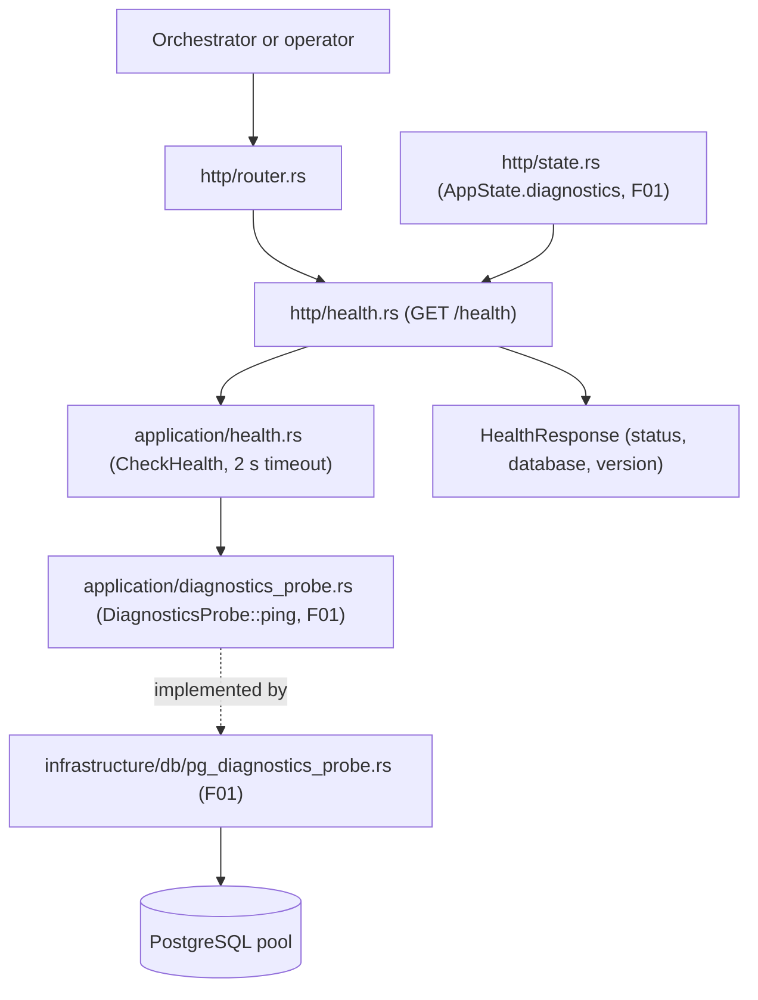

# Spec: Health Check

## 1. Technical Overview

**What:** Add `GET /health`, an unauthenticated endpoint that runs the database round trip (`SELECT 1`) with a 2-second timeout and reports `200 {"status":"ok","database":"up","version":"<crate version>"}` when it succeeds, or `503 {"status":"degraded","database":"down","version":"<crate version>"}` when it fails or times out. Both responses carry `Cache-Control: no-store`. The 503 body is a health payload, not the uniform error body, so probes can parse both outcomes identically. A `CheckHealth` use case in the application layer owns the timeout and the up/down decision; the handler in the HTTP layer maps the result to the payload. F03 reuses F01's `DiagnosticsProbe::ping` port, so it adds no new port, no `AppState` field and no `main.rs` change.

**Why:** Operators and orchestrators need to tell "API up but database down" from "API down", and to see recovery without restarting the process. Reusing the existing probe keeps the feature to three small files and avoids editing the shared wiring files that other wave-2 features also change.

**Scope:**

**Included:**
- `CheckHealth` use case (`ping` bounded by a 2-second timeout; any error or timeout means `down`).
- `GET /health` handler, `HealthResponse` payload (`status`, `database`, `version`), `Cache-Control: no-store` on every response, `routes()` merged into the router unconditionally (not behind `ENABLE_TEST_ROUTES`).
- Recovery without restart (relies on the connection pool reconnecting; no application code beyond calling `ping` on every request).
- Unit tests (use case, payload) and in-process HTTP tests, including a simulated database outage and recovery.
- README and CLAUDE.md updates.

**Excluded (owned elsewhere):**
- Per-request logging, request IDs and the `debug` log level for `/health` (F02).
- OpenAPI description of the endpoint (F10, which consumes the endpoint definition below).
- Container health checks and Compose wiring (F09).
- Any other health detail (versions of dependencies, pool statistics, readiness vs liveness split).

**Input contracts (Consumes):** none declared in the PRD. F03 relies on F01's `DiagnosticsProbe` port and `PgDiagnosticsProbe` adapter, `AppState.diagnostics`, `build_router`, and the F01 test harness.

**Output contracts (Provides):** the health endpoint definition used by F10: path `GET /health`, response fields `status`, `database`, `version`, status codes 200 and 503.

## 2. Architecture Impact

**Affected components:**
- New: `src/application/health.rs`, `src/http/health.rs`, `tests/health.rs`
- Modified: `src/application/mod.rs`, `src/http/mod.rs`, `src/http/router.rs`, `README.md`, `CLAUDE.md`
- Unchanged on purpose: `src/http/state.rs`, `src/main.rs`, `Cargo.toml`, `.sqlx/`



**Request flow:** router → (F01 middleware: panic containment, body limit) → `health` handler → `CheckHealth::execute` runs `ping` under a 2-second timeout → `up` or `down` → handler builds `HealthResponse` with the crate version → `200` or `503`, `Content-Type: application/json`, `Cache-Control: no-store`.

## 3. Technical Decisions

| Decision | Chosen Approach | Alternative Considered | Trade-off |
|----------|----------------|----------------------|-----------|
| Database access | Reuse `DiagnosticsProbe::ping` from F01 (interview answer) | New dedicated `HealthProbe` port, adapter and `AppState` field | No edits to `state.rs`/`main.rs` (conflict-free with F04 and F02 in the same wave); a port named "diagnostics" now backs a production endpoint |
| Timeout location | `CheckHealth` wraps `ping` in `tokio::time::timeout(2 s)` | Rely on the pool's acquire timeout (5 s by default) | Response time is bounded by the PRD's 2 s regardless of pool settings |
| Failure classification | Any `ping` error (unavailable or internal) and any timeout means `down` | Map only connection-class errors to `down` | A probe must never answer 200 when `SELECT 1` did not succeed; the cause is only logged, never returned |
| Error body | Health payload on 503, not `ApiError` | Uniform error envelope | Probes parse one shape for both outcomes (PRD requirement) |
| Version source | `env!("CARGO_PKG_VERSION")` | Runtime lookup | Resolved at compile time; always equals the manifest version |
| Mounting | `health::routes()` merged in `build_router` unconditionally | Behind a flag | The endpoint is a production feature, unlike the `/__test/*` routes |

### 3.1 Assumptions and Decisions

Items 1–2 are interview answers; the rest are assumptions for review.

1. **Quality gates confirmed** (interview): `cargo fmt --check`, `cargo clippy --all-targets -- -D warnings`, `cargo test`, `SQLX_OFFLINE=true cargo build`. No wrapper script exists.
2. **Probe reuse** (interview): `DiagnosticsProbe::ping`.
3. **Scope:** full feature; no Core/Full split. Foundation state: F02 is still pending; the user accepted the parallel wave-2 conflict risk.
4. **Payload:** exactly three string fields in the order `status`, `database`, `version`; `status` is `ok` or `degraded`; `database` is `up` or `down`; no other fields on either outcome.
5. **Headers:** `Cache-Control: no-store` and `Content-Type: application/json` on both outcomes.
6. **Methods:** only `GET` is routed; other methods on `/health` get F01's uniform `405`. A query string is ignored (not rejected).
7. **Timeout:** 2 seconds, fixed (not configurable); on timeout the in-flight `ping` future is dropped.
8. **Concurrency:** every request performs its own `ping`; there is no caching, so a probe always reflects the current state.
9. **Logging:** a failed or timed-out check is logged once at `warn` with the cause (`health check failed: …`); the cause is never put in the response. F02's per-request line and level rule are separate.
10. **Pool recovery:** relies on sqlx replacing dead connections on acquire; F03 adds no reconnect logic.
11. **Outage simulation in tests** (implementation guidance): the in-process test makes the per-test database refuse new connections (disallow connections on that database and terminate its other sessions), asserts `503`, re-allows connections and asserts `200`, all on the `#[sqlx::test]` database and without touching the server-level database; if this proves unreliable, a lazily connected pool pointed at an unreachable address covers the failure path and a terminated-session scenario covers recovery.
12. **Test conventions** are inherited from F01 (`#[sqlx::test]`, `tests/common/`, `.env.test`, `tests/fixtures/` unused, no mocks); no new dependencies are added.

## 4. Component Overview

**Backend (src):**

| File Path | New/Modified | Purpose | Key Responsibilities |
|-----------|--------------|---------|---------------------|
| `src/application/health.rs` | New | Use case | `HEALTH_TIMEOUT` (2 s); `HealthStatus { database_up }`; `CheckHealth::new(Arc<dyn DiagnosticsProbe>, Duration)` and `execute()` running `ping` under the timeout; logs failures at `warn` |
| `src/application/mod.rs` | Modified | Application facade | declare and re-export `health` |
| `src/http/health.rs` | New | Endpoint | `HealthResponse`; `GET /health` handler building `CheckHealth` from `AppState.diagnostics`; `Cache-Control: no-store`; `routes() -> Router<AppState>` |
| `src/http/mod.rs` | Modified | HTTP facade | declare `health` |
| `src/http/router.rs` | Modified | Router composition | merge `health::routes()` unconditionally |

**Project files:**

| File Path | New/Modified | Purpose | Key Responsibilities |
|-----------|--------------|---------|---------------------|
| `README.md` | Modified | Developer docs | document `GET /health`, the 200/503 payloads and an example `curl` |
| `CLAUDE.md` | Modified | Project guidance | status line and a note that `/health` reuses `DiagnosticsProbe` |

**Tests:**

| File Path | New/Modified | Purpose | Key Responsibilities |
|-----------|--------------|---------|---------------------|
| `tests/health.rs` | New | HTTP tests | healthy, degraded, timeout, recovery, headers, latency |

**Database:** no migrations, no new queries, no `.sqlx/` changes.

## 5. API Contracts

**Endpoint: Health check**
- **Method:** GET
- **Path:** `/health`
- **Authentication:** none
- **Request:** no body, no parameters (a query string is ignored)

**Response (healthy, 200):**

| Field | Type | Description |
|-------|------|-------------|
| `status` | `string` | `"ok"` |
| `database` | `string` | `"up"` |
| `version` | `string` | The crate version (`Cargo.toml` `version`) |

```json
{ "status": "ok", "database": "up", "version": "0.1.0" }
```

**Response (degraded, 503):**

| Field | Type | Description |
|-------|------|-------------|
| `status` | `string` | `"degraded"` |
| `database` | `string` | `"down"` |
| `version` | `string` | The crate version |

```json
{ "status": "degraded", "database": "down", "version": "0.1.0" }
```

**Headers (both responses):** `Content-Type: application/json`, `Cache-Control: no-store`.

**Status codes:**

| Code | HTTP Status | Description |
|------|-------------|-------------|
| healthy | 200 | `SELECT 1` succeeded within 2 seconds |
| degraded | 503 | `SELECT 1` failed (any error) or did not finish within 2 seconds |
| `method_not_allowed` | 405 | Any method other than `GET` (F01 uniform error body) |

## 6. Data Model

No database changes: no tables, columns, indexes or migrations, and no new queries.

## 7. Testing Strategy

**Test File Structure:**

| Test File | Test Type | Target | Coverage Goal |
|-----------|-----------|--------|---------------|
| `src/application/health.rs` (`#[cfg(test)]`) | Unit (fake probe) | up/down decision and timeout | success, error, hang |
| `src/http/health.rs` (`#[cfg(test)]`) | Unit | payload serialization | field order, both outcomes |
| `tests/health.rs` | Integration (in-process router, `#[sqlx::test]`) | `GET /health` | every outcome and header |

**`src/application/health.rs` unit tests:**

| Test Function | Description | Assertions |
|---------------|-------------|------------|
| `reachable_database_is_up` | fake probe returning `Ok` | `database_up == true` |
| `probe_error_is_down` | fake returning `Unavailable` and `Internal` | `database_up == false` for both |
| `hung_probe_is_down_after_the_timeout` | fake sleeping 5 s, use case timeout 50 ms | `database_up == false`, elapsed well under 1 s |
| `default_timeout_is_two_seconds` | constant | `HEALTH_TIMEOUT == 2 s` |

**`src/http/health.rs` unit tests:**

| Test Function | Description | Assertions |
|---------------|-------------|------------|
| `healthy_payload_serializes_in_order` | up | exact JSON text with fields in order `status`, `database`, `version` |
| `degraded_payload_serializes_in_order` | down | exact JSON text |
| `version_is_the_crate_version` | payload version | equals `CARGO_PKG_VERSION` |

**`tests/health.rs`:**

| Test Function | Description | Assertions |
|---------------|-------------|------------|
| `healthy_returns_200_with_payload` | `GET /health` | 200, exact body, `Content-Type: application/json` |
| `healthy_response_has_no_store_cache_control` | `GET /health` | `Cache-Control: no-store` |
| `health_is_fast_when_database_is_up` | 100 sequential requests | p95 under 50 ms |
| `non_get_method_returns_405` | `POST /health` | 405, uniform `method_not_allowed` body |
| `query_string_is_ignored` | `GET /health?x=1` | 200, same body |
| `unreachable_database_returns_503_quickly` | database refusing connections | 503, exact degraded body, no `error` field, under 2.5 s |
| `degraded_response_has_no_store_cache_control` | same | `Cache-Control: no-store` |
| `exhausted_pool_returns_503_within_the_timeout` | pool of 1 held by `/__test/slow?hold_db=true`, acquire timeout 5 s | 503 degraded, under 2.5 s |
| `service_recovers_without_restart` | outage, then database accepts connections again | 503 then 200 on the same router and pool |

**Harness rules:** every database test is `#[sqlx::test]` and uses only the per-test database; the outage is simulated on that database, never on the server-level database named by `DATABASE_URL`.
