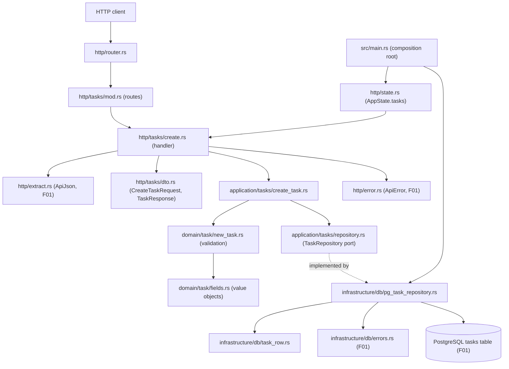

# Spec: Create Task

## 1. Technical Overview

**What:** Deliver `POST /tasks` end to end and the task building blocks every later task feature reuses. The domain layer gets the `Task` entity, its validated value objects and the `NewTask` validator (all invalid fields reported at once). The application layer gets the `TaskRepository` port (create, find, list, update, delete) and the `CreateTask` use case. The infrastructure layer gets `PgTaskRepository`, implementing all five operations with compile-time-checked queries. The HTTP layer gets the `CreateTaskRequest` / `TaskResponse` DTOs, the create handler returning `201` with a `Location` header, and a `tasks` route module that later features extend. No migration: the `tasks` table, its defaults, `CHECK` constraints and indexes already exist (F01).

**Why:** F05–F08 and F10 each plug into the same entity, validation rules, repository, response shape and route module. Delivering the whole repository and one shared `TaskResponse` here means those features add only a use case, a handler and a route, which keeps four parallel wave-3 features from editing the same trait and adapter files and guarantees byte-identical task representations across endpoints.

**Scope:**

**Included:**
- Domain: `TaskId`, `Task`, `NewTask`, value objects `TaskTitle`, `TaskDescription`, `TaskStatus`, `TaskPriority`, `DueDate`, and `NewTask::parse` aggregating every field error.
- Application: `TaskRepository` port with `create`, `find_by_id`, `list`, `update`, `delete`; supporting types `TaskQuery`, `TaskFilters`, `SortField`, `SortOrder`, `TaskPatch`, `TaskPage`; `CreateTask` use case.
- Infrastructure: `PgTaskRepository` implementing all five operations and the row-to-entity mapping.
- HTTP: `POST /tasks` with `ApiJson`, `201` + `Location: /tasks/{id}`, the shared `TaskResponse` (millisecond RFC 3339 UTC timestamps), the `src/http/tasks/` route module, `AppState` gaining the repository.
- Validation rules and messages reusable by F07 (title 1–200 characters after trimming, description ≤ 5,000, enums, strict `YYYY-MM-DD`).
- Repository-level integration tests for all five operations (these also lay the groundwork F05–F08 build on).
- `.sqlx/` offline metadata regenerated; `CLAUDE.md` / `README.md` updates.

**Excluded (owned elsewhere):**
- `GET /tasks/{id}`, `GET /tasks`, `PATCH /tasks/{id}`, `DELETE /tasks/{id}` handlers, DTOs for list/patch, path/query extractors (F05–F08). F04 delivers only the repository operations they will call.
- Request IDs and per-request logging (F02), `/health` (F03), OpenAPI documentation (F10), Docker (F09).
- Migrations (none needed), authentication, bulk operations.

**Input contracts (Consumes):** none declared in the PRD; F04 relies on F01's `tasks` table, `ApiJson`, `ApiError`, `AppError`, `build_router` and test harness.

**Output contracts (Provides):**
- The persisted task record (`id`, `title`, `description`, `status`, `priority`, `due_date`, `created_at`, `updated_at`) and the repository operations to store, load, query, update and remove it (used by F05, F06, F07, F08).
- The task validation rules (used by F07).
- The `POST /tasks` endpoint definition: payload fields with defaults, task representation fields, statuses 201/400/413/415/422/503 (used by F10).

## 2. Architecture Impact

**Affected components:**
- Modified: `Cargo.toml`, `Cargo.lock`, `README.md`, `CLAUDE.md`, `src/domain/mod.rs`, `src/application/mod.rs`, `src/infrastructure/db/mod.rs`, `src/http/mod.rs`, `src/http/state.rs`, `src/http/router.rs`, `src/main.rs`, `tests/common/mod.rs`
- New: `src/domain/task/**`, `src/application/tasks/**`, `src/infrastructure/db/pg_task_repository.rs`, `src/infrastructure/db/task_row.rs`, `src/http/tasks/**`
- New tests: `tests/task_repository.rs`, `tests/tasks_create.rs`
- Regenerated: `.sqlx/query-*.json`



**Request flow (`POST /tasks`):** router → body-limit middleware and `ApiJson` (F01: 413, 415, 400) → handler maps `CreateTaskRequest` to `RawNewTask` → `CreateTask::execute` → `NewTask::parse` (422 with every invalid field) → `TaskRepository::create` (single `INSERT … RETURNING`) → `Task` → `TaskResponse` → `201` with `Location: /tasks/{id}`. Database errors map through `map_sqlx_error` (503 when unavailable, otherwise 500).

## 3. Technical Decisions

| Decision | Chosen Approach | Alternative Considered | Trade-off |
|----------|----------------|----------------------|-----------|
| Repository scope in F04 | All five operations (`create`, `find_by_id`, `list`, `update`, `delete`) delivered now, tested at repository level (interview answer) | Create only; each of F05–F08 extends the port | F04 fixes the `list` and `update` signatures that F06/F07 adopt; in exchange the four wave-3 features do not edit the same port and adapter |
| Dependencies | Direct `chrono` (default features off, `std` + `clock`) and `uuid` (`serde`) crates (interview answer) | Strings/integers in the domain, conversion in infrastructure | Typed domain at the cost of two direct dependencies (already in the build via sqlx); F02 also adds `uuid` (`v4`), so the manifest line overlaps trivially |
| Contract surfaces | `HTTP API` only; no `Service` surface (interview answer) | Service items calling the repository in-process | Repository operations other than `create` are covered by `tests/task_repository.rs` (run by the `cargo test` gate) and later by F05–F08 contracts, not by this contract |
| Validation placement | `NewTask::parse` in the domain aggregates `FieldError`s; the extractor handles transport-level errors | Validate in the handler/DTO | Single rule set reusable by F07; the HTTP layer never contains business rules |
| Required vs wrongly typed fields | DTO fields are `Option<String>` so a missing or `null` title is a domain `422`, while a wrong JSON type (e.g. `"title": 5`) is the extractor's `400 invalid_json` naming the field | Deserialize into a strict struct and fail with 400 on missing fields | Matches the PRD error table exactly |
| Id and timestamps | Generated by PostgreSQL (`gen_random_uuid()`, `now()`) in the same `INSERT`, so `created_at = updated_at` | Generate in the application | Equality is guaranteed by one statement; client-supplied values are never read |
| Wiring | `AppState` gains one field, `tasks: Arc<dyn TaskRepository>`; use cases are cheap structs built in handlers | One `AppState` field per use case | F05–F08 add no `AppState` fields, keeping parallel features from conflicting on `state.rs` and `main.rs` |
| `list` SQL | Eight static `query_as!` statements (4 sort fields × 2 directions) plus one count statement, generated by a private macro in the adapter | Dynamic SQL built at runtime | The project forbids runtime `sqlx::query(…)`; static statements keep compile-time checking and offline metadata |

### 3.1 Assumptions and Decisions

Items 1–4 are interview answers; the rest are assumptions for review.

1. **Quality gates confirmed** (interview): `cargo fmt --check`, `cargo clippy --all-targets -- -D warnings`, `cargo test`, `SQLX_OFFLINE=true cargo build`. No wrapper script exists.
2. **Repository scope** (interview): all five operations in F04.
3. **Dependencies** (interview): direct `chrono` and `uuid` (`serde`).
4. **Surfaces** (interview): `HTTP API` only.
5. **Scope:** full feature; F04 has no Core/Full split. Foundation state: F02 is still pending; the user chose to implement wave 2 in parallel and accepted the conflict risk.
6. **Validation messages** (single source, reused by F07): title missing or `null`: `is required`; title blank or outside 1–200 characters: `must be between 1 and 200 characters`; description over 5,000 characters: `must be at most 5000 characters`; status: `must be one of: todo, in_progress, done`; priority: `must be one of: low, medium, high`; due date: `must be a valid date in YYYY-MM-DD format`. Field order in `details` is `title`, `description`, `status`, `priority`, `due_date`.
7. **Trimming and length:** `str::trim` (Unicode whitespace) before validation; lengths are counted in Unicode scalar values (`chars().count()`), matching PostgreSQL `char_length` for the `VARCHAR(200)` column and the `CHECK` constraints.
8. **Description:** `null`, or blank after trimming, is stored as `NULL`; otherwise the trimmed value is stored.
9. **Enums** are matched exactly and case-sensitively (`DONE`, `Todo`, `HIGH` are rejected); omitted or `null` `status`/`priority` take `todo`/`medium`.
10. **Due date:** exactly 10 characters shaped `dddd-dd-dd`, then calendar validity (leap years honoured); `2026-1-5`, `12/01/2026`, `2026-02-30` are rejected; past and future dates are allowed; omitted or `null` means no due date.
11. **Unknown request fields are ignored** (no `deny_unknown_fields`); `id`, `created_at`, `updated_at` in the body are never read.
12. **Timestamps in responses** are RFC 3339 UTC with exactly three fractional digits and a `Z` suffix, truncating (not rounding) the stored microseconds.
13. **`TaskResponse`** is the single response DTO for every task endpoint (field order: `id`, `title`, `description`, `status`, `priority`, `due_date`, `created_at`, `updated_at`); entities are never serialized directly.
14. **`Location`** is the relative path `/tasks/{id}`.
15. **Repository semantics:** `find_by_id` returns `None` for an unknown id; `delete` returns `false` when no row was deleted; `update` is one `UPDATE … RETURNING` that sets `updated_at = now()` and returns `None` when the id is unknown; `list` returns items for the requested page and `total` counting all rows matching the filters, in two statements (not a transactional snapshot).
16. **`list` ordering:** `priority` sorts semantically (`low` < `medium` < `high`); `due_date` always places `NULL` last in both directions; `id ASC` is the final tiebreaker (rules taken from PRD F06 so F06 can adopt the port unchanged).
17. **Partial updates:** `TaskPatch` models each field as absent, set, or (for `description` and `due_date`) cleared; F07 validates that at least one field is present before calling the port.
18. **Row mapping** trusts the database but returns `AppError::Internal` if a stored enum value is unknown; domain objects that pass validation can still hit a `CHECK`/length violation only through a bug, which maps to `500`.
19. **Routes:** `src/http/tasks/mod.rs` merges one `routes()` function per endpoint file; endpoints that share a path (`/tasks` for `POST` and the later `GET`) rely on axum merging method routers for the same path, to be confirmed at implementation.
20. **Test conventions** are inherited from F01 (`#[sqlx::test]` per-test databases, `tests/common/`, `.env.test`, `tests/fixtures/` unused, no mocks).

## 4. Component Overview

**Project files:**

| File Path | New/Modified | Purpose | Key Responsibilities |
|-----------|--------------|---------|---------------------|
| `Cargo.toml` | Modified | Manifest | add `chrono` (default features off, `std`, `clock`) and `uuid` (`serde`) |
| `README.md` | Modified | Developer docs | document `POST /tasks` with an example request and response |
| `CLAUDE.md` | Modified | Project guidance | stack list, status line, task-feature layout and conventions |
| `.sqlx/query-*.json` | New | Offline metadata | regenerated by `cargo sqlx prepare -- --all-targets` |

**Domain (src/domain/task):**

| File Path | New/Modified | Purpose | Key Responsibilities |
|-----------|--------------|---------|---------------------|
| `src/domain/mod.rs` | Modified | Domain facade | declare `task` |
| `src/domain/task/mod.rs` | New | Task facade | re-export entity, value objects, `NewTask` |
| `src/domain/task/task.rs` | New | Entity | `TaskId`, `Task` (persisted record, constructed from stored parts) |
| `src/domain/task/fields.rs` | New | Value objects | `TaskTitle`, `TaskDescription`, `TaskStatus`, `TaskPriority`, `DueDate`: `parse` with trimming and the messages in Section 3.1, `as_str`/accessors, `restore` for trusted persisted values |
| `src/domain/task/new_task.rs` | New | Creation aggregate | `RawNewTask` (optional text fields), `NewTask::parse` applying defaults and collecting every `FieldError` into `DomainError::Validation` |

**Application (src/application):**

| File Path | New/Modified | Purpose | Key Responsibilities |
|-----------|--------------|---------|---------------------|
| `src/application/mod.rs` | Modified | Application facade | declare `tasks` |
| `src/application/tasks/mod.rs` | New | Tasks facade | re-exports |
| `src/application/tasks/repository.rs` | New | Port | `TaskRepository: Send + Sync` (`create`, `find_by_id`, `list`, `update`, `delete`); `TaskQuery`, `TaskFilters`, `SortField`, `SortOrder`, `TaskPatch`, `TaskPage` |
| `src/application/tasks/create_task.rs` | New | Use case | `CreateTask::new(Arc<dyn TaskRepository>)`, `execute(RawNewTask)`: parse, then persist; no repository call when validation fails |

**Infrastructure (src/infrastructure/db):**

| File Path | New/Modified | Purpose | Key Responsibilities |
|-----------|--------------|---------|---------------------|
| `src/infrastructure/db/mod.rs` | Modified | DB facade | declare and re-export `PgTaskRepository` |
| `src/infrastructure/db/task_row.rs` | New | Row mapping | `TaskRow` to `Task`; unknown enum values map to `AppError::Internal` |
| `src/infrastructure/db/pg_task_repository.rs` | New | Adapter | all five operations with `query!`/`query_as!`/`query_scalar!`; errors through `map_sqlx_error` |

**HTTP (src/http):**

| File Path | New/Modified | Purpose | Key Responsibilities |
|-----------|--------------|---------|---------------------|
| `src/http/mod.rs` | Modified | HTTP facade | declare `tasks` |
| `src/http/state.rs` | Modified | Shared state | add `tasks: Arc<dyn TaskRepository>`; `AppState::new(diagnostics, tasks)` |
| `src/http/tasks/mod.rs` | New | Route module | `routes() -> Router<AppState>` merging each endpoint's routes; re-export `TaskResponse` |
| `src/http/tasks/dto.rs` | New | DTOs | `CreateTaskRequest` (all fields optional, strings), `TaskResponse` (+ `From<&Task>`, millisecond timestamps) |
| `src/http/tasks/create.rs` | New | Handler | `POST /tasks`: `ApiJson<CreateTaskRequest>` → `CreateTask` → `201` + `Location`; its own `routes()` |
| `src/http/router.rs` | Modified | Router composition | merge `tasks::routes()` |
| `src/main.rs` | Modified | Composition root | construct `PgTaskRepository` from the pool and pass it into `AppState` |

**Tests:**

| File Path | New/Modified | Purpose | Key Responsibilities |
|-----------|--------------|---------|---------------------|
| `tests/common/mod.rs` | Modified | Shared helpers | `test_router` builds `AppState` with the Postgres repository; helpers to count rows and read a stored task directly |
| `tests/task_repository.rs` | New | Repository tests | all five operations against a per-test database |
| `tests/tasks_create.rs` | New | HTTP tests | every `POST /tasks` success and failure path in-process |

**Database:** no migrations. The `tasks` table is used as created by `20261121000001_create_tasks_table.sql`.

## 5. API Contracts

**Endpoint: Create task**
- **Method:** POST
- **Path:** `/tasks`
- **Authentication:** none

**Request** (`Content-Type: application/json`, body ≤ 65,536 bytes):

| Field | Type | Required | Validation | Description |
|-------|------|----------|------------|-------------|
| `title` | `string` | Yes | trimmed; 1–200 characters | Task title |
| `description` | `string` or `null` | No | trimmed; ≤ 5,000 characters; blank becomes `null` | Free text |
| `status` | `string` | No | `todo` \| `in_progress` \| `done`; default `todo`; case-sensitive | Workflow status |
| `priority` | `string` | No | `low` \| `medium` \| `high`; default `medium`; case-sensitive | Priority |
| `due_date` | `string` or `null` | No | `YYYY-MM-DD`, a real calendar date; past dates allowed | Due date |

Unknown fields are ignored; `id`, `created_at`, `updated_at` are server-generated.

**Request Example:**
```json
{
  "title": "Write PRD",
  "priority": "high",
  "due_date": "2026-12-01"
}
```

**Response (Success, 201)** with header `Location: /tasks/{id}`:

| Field | Type | Description |
|-------|------|-------------|
| `id` | `string` (uuid) | Generated by the database |
| `title` | `string` | Trimmed title |
| `description` | `string` or `null` | Trimmed description or `null` |
| `status` | `string` | Stored status |
| `priority` | `string` | Stored priority |
| `due_date` | `string` or `null` | `YYYY-MM-DD` or `null` |
| `created_at` | `string` | RFC 3339 UTC, millisecond precision |
| `updated_at` | `string` | RFC 3339 UTC, millisecond precision; equals `created_at` on creation |

**Response Example:**
```json
{
  "id": "3f2b6f0e-6d4a-4c8e-9a0f-1b2c3d4e5f60",
  "title": "Write PRD",
  "description": null,
  "status": "todo",
  "priority": "high",
  "due_date": "2026-12-01",
  "created_at": "2026-11-21T18:11:00.123Z",
  "updated_at": "2026-11-21T18:11:00.123Z"
}
```

**Validation failure example (422):**
```json
{
  "error": {
    "code": "validation_error",
    "message": "Request validation failed",
    "details": [
      { "field": "title", "message": "must be between 1 and 200 characters" },
      { "field": "priority", "message": "must be one of: low, medium, high" }
    ]
  }
}
```

**Error Codes:**

| Code | HTTP Status | Description |
|------|-------------|-------------|
| `invalid_json` | 400 | Malformed JSON or a wrongly typed field (e.g. `"title": 5`); `details` names the field when known (F01 extractor) |
| `unsupported_media_type` | 415 | Missing or non-JSON `Content-Type` (F01 extractor) |
| `payload_too_large` | 413 | Body larger than 65,536 bytes (F01 middleware/extractor) |
| `validation_error` | 422 | One or more fields violate the rules; one `details` entry per invalid field |
| `service_unavailable` | 503 | Database unreachable or no pooled connection in time; nothing is persisted |
| `internal_error` | 500 | Unexpected failure; cause logged server-side only |

**Repository port (internal contract used by F05–F08):**

| Operation | Input | Output |
|-----------|-------|--------|
| `create` | validated `NewTask` | persisted `Task` |
| `find_by_id` | `TaskId` | `Option<Task>` |
| `list` | `TaskQuery` (status/priority filters, sort field and direction, limit, offset) | `TaskPage { items, total }` |
| `update` | `TaskId`, `TaskPatch` | `Option<Task>` (`None` when unknown) |
| `delete` | `TaskId` | `bool` (`true` when a row was removed) |

## 6. Data Model

No schema changes. F04 reads and writes the existing table:

**Table: `tasks`** (created by F01)

| Column | Type | Nullable | Default | Description |
|--------|------|----------|---------|-------------|
| `id` | `uuid` | No | `gen_random_uuid()` | Primary key |
| `title` | `varchar(200)` | No | - | Trimmed title |
| `description` | `text` | Yes | - | ≤ 5,000 characters |
| `status` | `text` | No | `'todo'` | `todo` / `in_progress` / `done` |
| `priority` | `text` | No | `'medium'` | `low` / `medium` / `high` |
| `due_date` | `date` | Yes | - | Calendar date |
| `created_at` | `timestamptz` | No | `now()` | Creation instant |
| `updated_at` | `timestamptz` | No | `now()` | Last modification instant |

The domain rules mirror the existing `CHECK` constraints (`tasks_title_check`, `tasks_description_check`, `tasks_status_check`, `tasks_priority_check`); a value that passes domain validation never violates them.

## 7. Testing Strategy

**Test File Structure:**

| Test File | Test Type | Target | Coverage Goal |
|-----------|-----------|--------|---------------|
| `src/domain/task/fields.rs` (`#[cfg(test)]`) | Unit | value-object parsing | every rule and boundary |
| `src/domain/task/new_task.rs` (`#[cfg(test)]`) | Unit | defaults and error aggregation | all fields, combined errors |
| `src/application/tasks/create_task.rs` (`#[cfg(test)]`) | Unit (in-memory fake repository) | use-case flow | validation short-circuit, persistence call |
| `src/http/tasks/dto.rs` (`#[cfg(test)]`) | Unit | response serialization | field order, timestamp format |
| `tests/task_repository.rs` | Integration (`#[sqlx::test]`) | `PgTaskRepository` | all five operations |
| `tests/tasks_create.rs` | Integration (in-process router, `#[sqlx::test]`) | `POST /tasks` | every success and failure path |

**`src/domain/task/fields.rs` unit tests:**

| Test Function | Description | Assertions |
|---------------|-------------|------------|
| `title_is_trimmed` | `"  Trim me  "` | `"Trim me"` |
| `title_length_bounds` | 1, 200 characters ok; 201 and 0 rejected | message `must be between 1 and 200 characters` |
| `title_blank_is_rejected` | `""`, `"   "`, tab/newline only | rejected |
| `title_counts_characters_not_bytes` | 200 × `é` | accepted |
| `description_blank_becomes_none` | `"   "` | `None` |
| `description_length_bounds` | 5000 ok, 5001 rejected | message `must be at most 5000 characters` |
| `status_values_are_case_sensitive` | `todo`, `in_progress`, `done` ok; `DONE`, `Todo`, `""` rejected | message lists the three values |
| `priority_values_are_case_sensitive` | `low`, `medium`, `high` ok; `urgent`, `HIGH` rejected | message lists the three values |
| `due_date_accepts_valid_dates` | `2026-12-01`, `2024-02-29`, `2000-01-01` | parsed |
| `due_date_rejects_invalid_dates` | `2026-02-30`, `2026-02-29`, `12/01/2026`, `2026-1-5`, `2026-13-01`, `""` | rejected |

**`src/domain/task/new_task.rs` unit tests:**

| Test Function | Description | Assertions |
|---------------|-------------|------------|
| `minimal_payload_applies_defaults` | title only | status `todo`, priority `medium`, no description, no due date |
| `all_fields_are_kept` | all five fields | values preserved |
| `missing_and_null_title_report_required` | no title; `null` title | `title`: `is required` |
| `all_invalid_fields_are_reported_together` | blank title + `urgent` priority + bad date | three entries in field order |
| `errors_follow_field_order` | every field invalid | `title`, `description`, `status`, `priority`, `due_date` |

**`src/application/tasks/create_task.rs` unit tests:**

| Test Function | Description | Assertions |
|---------------|-------------|------------|
| `invalid_input_never_reaches_the_repository` | fake repository counting calls | validation error, zero calls |
| `valid_input_is_persisted_once` | valid raw input | one `create` call with the trimmed values; returned task passed through |
| `repository_errors_are_propagated` | fake returning `Unavailable` | same variant returned |

**`src/http/tasks/dto.rs` unit tests:**

| Test Function | Description | Assertions |
|---------------|-------------|------------|
| `response_field_order_and_nulls` | task with null description/due date | exact JSON text, fields in PRD order |
| `timestamps_use_millisecond_utc_format` | microsecond timestamp | three fractional digits, `Z`, truncated |

**`tests/task_repository.rs`:**

| Test Function | Description | Assertions |
|---------------|-------------|------------|
| `create_applies_defaults_and_equal_timestamps` | minimal `NewTask` | id set, defaults, `created_at == updated_at` |
| `create_persists_given_values` | all fields | stored row equals input |
| `find_by_id_returns_task_or_none` | existing and unknown id | `Some` equals created; `None` |
| `list_returns_all_with_total` | 25 tasks, default query | page of requested size, `total == 25` |
| `list_filters_by_status_and_priority` | mixed tasks | OR within a filter, AND across, `total` matches filter |
| `list_sorts_priority_semantically` | low/medium/high | `low < medium < high`, both directions |
| `list_places_null_due_dates_last` | dated and undated tasks | undated last for asc and desc |
| `list_breaks_ties_by_id` | identical sort values, page size 7 | every task exactly once across pages |
| `list_offset_beyond_total` | offset 1000 | empty items, correct `total` |
| `update_changes_only_given_fields` | patch with one field | others unchanged |
| `update_can_clear_nullable_fields` | clear description and due date | stored `NULL` |
| `update_refreshes_updated_at_only` | patch status | `updated_at` greater, `created_at` and `id` unchanged |
| `update_unknown_id_returns_none` | random id | `None` |
| `delete_removes_the_row` | existing id | `true`, then `find_by_id` is `None` |
| `delete_unknown_id_returns_false` | random id | `false` |

**`tests/tasks_create.rs`** (in-process router against a per-test database):

| Test Function | Description | Assertions |
|---------------|-------------|------------|
| `minimal_payload_returns_201_with_defaults` | `{"title":"Write PRD"}` | 201, defaults, UUID id, `created_at == updated_at` |
| `response_has_location_header` | create | `Location: /tasks/{id}` equals body id |
| `all_fields_are_persisted_and_returned` | five fields | body and stored row match |
| `title_is_trimmed_in_response_and_row` | `"  Trim me  "` | `"Trim me"` both |
| `blank_description_is_stored_as_null` | `"   "` | body `null`, row `NULL` |
| `client_supplied_id_and_created_at_are_ignored` | body with `id`, `created_at` | server values returned |
| `title_of_200_characters_is_accepted` | 200 characters | 201 |
| `description_of_5000_characters_is_accepted` | 5,000 characters | 201 |
| `past_due_date_is_accepted` | `2000-01-01` | 201 |
| `unknown_fields_are_ignored` | extra property | 201 |
| `invalid_fields_return_422_and_insert_nothing` | each invalid case from the validation list | 422, `details` entry for the field, zero rows |
| `multiple_invalid_fields_return_one_422` | blank title + `urgent` priority | exact PRD example body |
| `malformed_json_returns_400` | `{"title":` | 400 `invalid_json`, zero rows |
| `wrong_json_type_returns_400_naming_the_field` | `"title": 5` | 400, detail field `title` |
| `missing_content_type_returns_415` | no header | 415, zero rows |
| `oversized_body_returns_413` | 65,537 bytes | 413, zero rows |
| `unavailable_database_returns_503_and_inserts_nothing` | pool of 1 held by `/__test/slow?hold_db=true` | 503, zero rows |

**Harness rules:** every database test is `#[sqlx::test]`; row counts and stored values are read with compile-time-checked statements on the per-test database; after adding queries run `cargo sqlx prepare -- --all-targets` and commit `.sqlx/`.
