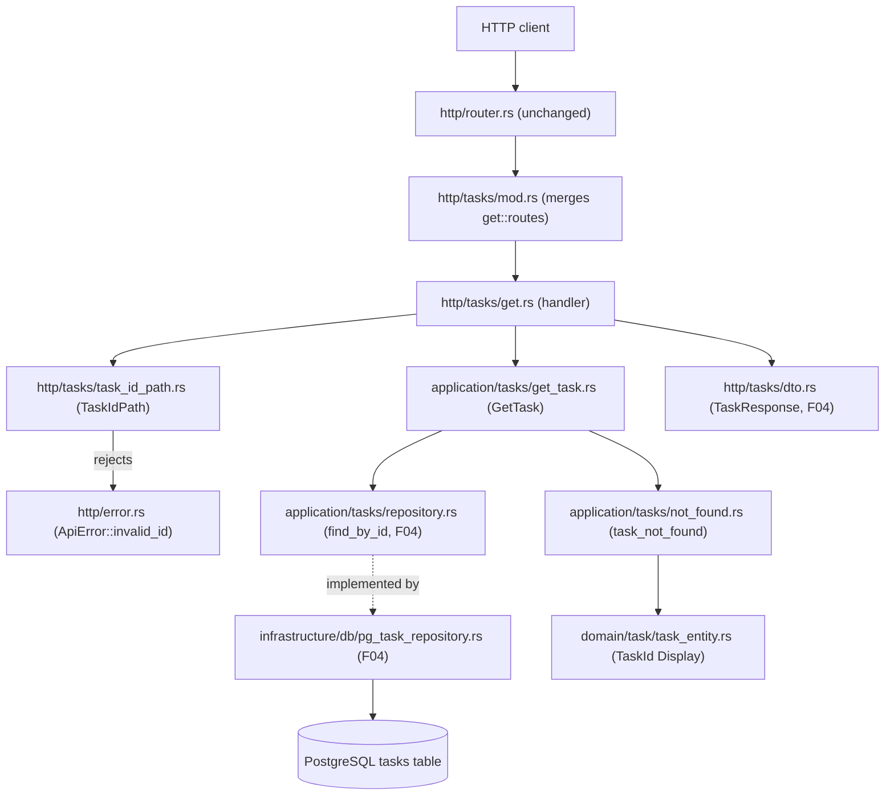

# Spec: Get Task by ID

## 1. Technical Overview

**What:** Add `GET /tasks/{id}`, which returns one stored task in the shared F04 `TaskResponse` representation. The HTTP layer gets a reusable `TaskIdPath` extractor. It accepts only the 36-character hyphenated UUID form and rejects anything else with the uniform `400 invalid_id` body. The application layer gets a `GetTask` use case and a `task_not_found` helper that builds the `404` message `Task <id> not found`. Persistence is unchanged: the use case calls the existing `TaskRepository::find_by_id`, which is a single primary-key lookup.

**Why:** F05 is the first endpoint with a path parameter. axum's default `Path` rejection is a plain-text 400, which breaks the uniform error contract. So the id parsing that F07 (`PATCH /tasks/{id}`) and F08 (`DELETE /tasks/{id}`) also need is built once, here, as an extractor. The not-found message helper is shared for the same reason, so all three endpoints return the same 400 and 404 bodies.

**Scope:**

**Included:**
- HTTP: `GET /tasks/{id}` returning `200` with `TaskResponse`; `TaskIdPath` extractor (hyphenated UUID only, any version, case-insensitive hex, uniform `400 invalid_id` on every rejection including invalid UTF-8); a `get` route file merged into `src/http/tasks/mod.rs`.
- Application: `GetTask` use case (`execute(TaskId) -> Result<Task, AppError>`) and the shared `task_not_found(TaskId) -> AppError` helper.
- Domain: `Display` for `TaskId` (lowercase hyphenated), used by the not-found message.
- Database errors on the lookup map through the existing classification (`503 service_unavailable` when the pool cannot provide a connection, `500 internal_error` otherwise).
- Tests: extractor unit tests, use-case unit tests with an in-memory fake repository, and `tests/tasks_get.rs` in-process integration tests, including a p95 latency check over 10,000 seeded rows.

**Excluded (owned elsewhere):**
- `PATCH /tasks/{id}` (F07) and `DELETE /tasks/{id}` (F08). They reuse `TaskIdPath` and `task_not_found` but are not built here. Until they land, those methods on `/tasks/{id}` return `405`.
- `GET /tasks` (F06), OpenAPI documentation of this endpoint (F10).
- Repository or schema changes (none needed), caching headers, conditional requests (ETags).

**Input contracts (Consumes):**
- F04: the persisted task record (`id`, `title`, `description`, `status`, `priority`, `due_date`, `created_at`, `updated_at`), `TaskRepository::find_by_id`, the `Task` entity and `TaskId`, and the single `TaskResponse` DTO (millisecond UTC timestamps).
- F01: `ApiError::invalid_id` / `ApiError::not_found` constructors, `AppError::NotFound`, `map_sqlx_error`, `build_router`, the `/__test/slow?hold_db=true` diagnostic route and the `#[sqlx::test]` harness.

**Output contracts (Provides):**
- Get endpoint definition for F10: `GET /tasks/{id}`, path parameter `id` (`string`, `format: uuid`, hyphenated), responses `200` (`Task`), `400` (`invalid_id`), `404` (`not_found`), plus the cross-cutting `503`/`500`.
- `TaskIdPath` and `task_not_found`, for reuse by F07 and F08.

## 2. Architecture Impact

**Affected components:**
- Modified: `src/domain/task/task_entity.rs`, `src/application/tasks/mod.rs`, `src/http/tasks/mod.rs`, `README.md`, `CLAUDE.md`
- New: `src/http/tasks/task_id_path.rs`, `src/http/tasks/get.rs`, `src/application/tasks/get_task.rs`, `src/application/tasks/not_found.rs`
- New tests: `tests/tasks_get.rs`
- Regenerated: `.sqlx/query-*.json` (the seeding statement in `tests/tasks_get.rs`)
- Unchanged: `AppState`, `build_router`, `main.rs`, `TaskRepository`, `PgTaskRepository`, migrations



**Request flow (`GET /tasks/{id}`):**
1. The router's outer layers run first: request context, panic containment, body limit.
2. `TaskIdPath` runs before any database access. If the segment is not a 36-character hyphenated UUID, it returns `400 invalid_id` and no query is executed.
3. `GetTask::execute(id)` calls `TaskRepository::find_by_id`, a single `SELECT … WHERE id = $1`.
4. If no row is found, `task_not_found(id)` produces `AppError::NotFound("Task <id> not found")`, which becomes `404 not_found`. If a row is found, it becomes `Task`, then `TaskResponse`, and the endpoint returns `200`.
5. Pool or connection failures become `503`. Anything else becomes `500`.

## 3. Technical Decisions

| Decision | Chosen Approach | Alternative Considered | Trade-off |
|----------|----------------|----------------------|-----------|
| Where id parsing lives | Shared `TaskIdPath` extractor (`FromRequestParts`, rejection `ApiError`) in `src/http/tasks/task_id_path.rs` (interview answer) | Inline `Path<String>` parsing per handler; a domain `TaskId::parse` | One implementation for GET/PATCH/DELETE. If F07/F08 are built in parallel, each may add an identical file, and the merge keeps one copy |
| Accepted UUID form | Exactly 36 characters in the 8-4-4-4-12 hyphenated layout, hex case-insensitive, any version/variant including nil (interview answer) | Everything `Uuid::try_parse` accepts (simple, braced, URN) | Matches the PRD wording "hyphenated form". Lenient clients sending the simple form get a 400 |
| Not-found message | `task_not_found(TaskId)` in the application layer returns `AppError::NotFound(format "Task <id> not found")` with the id in lowercase canonical form | Build the message in the HTTP handler | Keeps handlers free of message text, reused by F07/F08, and passes through the existing `AppError::NotFound(String)` mapping unchanged |
| Use case | `GetTask` struct built in the handler from `state.tasks` (same pattern as `CreateTask`) | Call the repository from the handler | Keeps the dependency direction `http → application`. No new `AppState` field |
| Latency verification | `#[sqlx::test]` in the normal suite: seed 10,000 rows with one compile-checked `INSERT … SELECT generate_series`, run 1,000 sequential in-process GETs, assert p95 < 50 ms (interview answer) | `#[ignore]` test run only with `--release` | Runs on every `cargo test` under the debug profile, which is stricter than the release build the PRD names. Adds a few seconds to the suite |
| Contract surfaces | `HTTP API` only | Service items for `GetTask` | No consumer outside this feature calls `GetTask`. `TaskIdPath` reuse is a code-level concern, not a contract surface |

### 3.1 Assumptions and Decisions

Items 1–4 are interview answers. The rest are assumptions for review.

1. **Quality gates confirmed** (interview): `cargo fmt --check`, `cargo clippy --all-targets -- -D warnings`, `cargo test`, `SQLX_OFFLINE=true cargo build`. No wrapper script exists.
2. **Shared extractor** (interview): `TaskIdPath(pub TaskId)` in `src/http/tasks/task_id_path.rs`, generic over the router state.
3. **Hyphenated UUID only** (interview): a segment is accepted when it is exactly 36 bytes long and parses as a UUID. At that length the `uuid` crate only accepts the hyphenated layout, so `Uuid::try_parse` after a length check is enough. Simple (32), braced (38) and URN (45) forms, and anything else, are rejected.
4. **Latency test in the normal suite** (interview): see Section 7. The seeding helper stays local to `tests/tasks_get.rs` so wave-3 features do not collide on `tests/common/mod.rs`. F06 may promote it to `tests/common` later.
5. **Scope:** full feature. F05 has no Core/Full split. Foundation complete and F04 merged, so there are no dependency warnings.
6. **Every extractor failure is `invalid_id`.** This covers a malformed segment, invalid percent-encoded UTF-8 (e.g. `/tasks/%FF`), and any other `Path` rejection. The body is exactly `{"error":{"code":"invalid_id","message":"Task id must be a valid UUID","details":[]}}`.
7. **The id is checked before any database access.** `TaskIdPath` is a parts extractor, so a malformed id never reaches the repository. For F07 `PATCH`, a parts extractor also runs before `ApiJson`, so a malformed id takes precedence over body errors.
8. **Message constant:** `MSG_INVALID_TASK_ID = "Task id must be a valid UUID"` lives next to the extractor. `src/http/error.rs` keeps choosing the status through `ErrorCode::InvalidId`.
9. **Not-found message:** `Task <id> not found`, where `<id>` is the parsed UUID in lowercase hyphenated form. For example, a request for `/tasks/A1B2…` reports the lowercase form.
10. **Response:** `200` with `Content-Type: application/json` and the `TaskResponse` from F04: the same field order and the same millisecond-truncated `Z` timestamps. No extra headers (no `Location`, no `Cache-Control`).
11. **Reads have no side effects:** `GET` never writes. `updated_at` and every other column stay unchanged.
12. **Routing edges come from the framework:** `/tasks/` and `/tasks/{id}/anything` fall through to the existing `404 Route not found` fallback. A method with no handler on `/tasks/{id}` (e.g. `PUT`) gets the existing `405 method_not_allowed`. `HEAD` is answered by axum's GET routing.
13. **Path merging:** F05's `GET` and the later `PATCH`/`DELETE` on `/tasks/{id}` are merged by axum 0.8.9's `PathRouter::merge`, which merges method routers for an identical path (verified in the axum source). Only a duplicate method on the same path would panic at startup.
14. **Test conventions** come from F01/F04: `#[sqlx::test]` per-test databases, the `tests/common` helpers (`test_router`, `send`, `get`, `request_with`, `assert_uniform_error`, `count_tasks`, `stored_task`), `.env.test`. `tests/fixtures/` is not used and there are no mocks.

## 4. Component Overview

**Domain:**

| File Path | New/Modified | Purpose | Key Responsibilities |
|-----------|--------------|---------|---------------------|
| `src/domain/task/task_entity.rs` | Modified | Entity | implement `Display` for `TaskId` (lowercase hyphenated UUID) |

**Application:**

| File Path | New/Modified | Purpose | Key Responsibilities |
|-----------|--------------|---------|---------------------|
| `src/application/tasks/not_found.rs` | New | Shared error helper | `task_not_found(TaskId) -> AppError::NotFound("Task <id> not found")`, reused by F07/F08 |
| `src/application/tasks/get_task.rs` | New | Use case | `GetTask::new(Arc<dyn TaskRepository>)`, `execute(TaskId)`: `find_by_id`, `None` to `task_not_found`, repository errors propagated unchanged |
| `src/application/tasks/mod.rs` | Modified | Tasks facade | declare and re-export `GetTask` and `task_not_found` |

**HTTP:**

| File Path | New/Modified | Purpose | Key Responsibilities |
|-----------|--------------|---------|---------------------|
| `src/http/tasks/task_id_path.rs` | New | Path extractor | `TaskIdPath(pub TaskId)`. Extracts the single `{id}` segment as a string, enforces the 36-character hyphenated form, and maps every failure to `ApiError::invalid_id(MSG_INVALID_TASK_ID)` |
| `src/http/tasks/get.rs` | New | Handler | `GET /tasks/{id}`: `TaskIdPath` → `GetTask` → `200 Json<TaskResponse>`. Has its own `routes()` |
| `src/http/tasks/mod.rs` | Modified | Route module | declare `get` and `task_id_path`, re-export `TaskIdPath`, merge `get::routes()` |

**Project files:**

| File Path | New/Modified | Purpose | Key Responsibilities |
|-----------|--------------|---------|---------------------|
| `README.md` | Modified | Developer docs | document `GET /tasks/{id}` with example 200/400/404 responses |
| `CLAUDE.md` | Modified | Project guidance | status line (F05 done) and a note that `TaskIdPath` / `task_not_found` are the shared id-parsing and 404 helpers |
| `.sqlx/query-*.json` | New | Offline metadata | regenerated by `cargo sqlx prepare -- --all-targets` after adding the test seeding statement |

**Tests:**

| File Path | New/Modified | Purpose | Key Responsibilities |
|-----------|--------------|---------|---------------------|
| `tests/tasks_get.rs` | New | HTTP integration tests | every `GET /tasks/{id}` success, rejection and latency path in-process |

**Database:** no migrations. The lookup uses the primary key of the `tasks` table from `20261121000001_create_tasks_table.sql`.

## 5. API Contracts

**Endpoint: Get task by id**
- **Method:** GET
- **Path:** `/tasks/{id}`
- **Authentication:** none

**Path parameter:**

| Field | Type | Required | Validation | Description |
|-------|------|----------|------------|-------------|
| `id` | `string` (uuid) | Yes | exactly 36 characters, hyphenated 8-4-4-4-12, hex case-insensitive, any version | Task identifier |

No query parameters are read. No request body is read.

**Request Example:**
```
GET /tasks/3f2b6f0e-6d4a-4c8e-9a0f-1b2c3d4e5f60
```

**Response (Success, 200):**

| Field | Type | Description |
|-------|------|-------------|
| `id` | `string` (uuid) | Lowercase hyphenated |
| `title` | `string` | Stored title |
| `description` | `string` or `null` | Stored description |
| `status` | `string` | `todo` / `in_progress` / `done` |
| `priority` | `string` | `low` / `medium` / `high` |
| `due_date` | `string` or `null` | `YYYY-MM-DD` |
| `created_at` | `string` | RFC 3339 UTC, millisecond precision |
| `updated_at` | `string` | RFC 3339 UTC, millisecond precision |

**Response Example:**
```json
{
  "id": "3f2b6f0e-6d4a-4c8e-9a0f-1b2c3d4e5f60",
  "title": "Write PRD",
  "description": null,
  "status": "todo",
  "priority": "high",
  "due_date": "2026-12-01",
  "created_at": "2026-11-21T18:11:00.123Z",
  "updated_at": "2026-11-21T18:11:00.123Z"
}
```

**Malformed id (400):**
```json
{
  "error": {
    "code": "invalid_id",
    "message": "Task id must be a valid UUID",
    "details": []
  }
}
```

**Unknown id (404):**
```json
{
  "error": {
    "code": "not_found",
    "message": "Task 0b7d2c1e-5f3a-4e8b-9c6d-7a1f2e3d4c5b not found",
    "details": []
  }
}
```

**Error Codes:**

| Code | HTTP Status | Description |
|------|-------------|-------------|
| `invalid_id` | 400 | `{id}` is not a 36-character hyphenated UUID (including invalid UTF-8); no database access |
| `not_found` | 404 | No task with that id; message `Task <id> not found` |
| `method_not_allowed` | 405 | Method without a handler on `/tasks/{id}` (F01 fallback) |
| `service_unavailable` | 503 | No pooled connection within the acquire timeout / database unreachable |
| `internal_error` | 500 | Unexpected failure (e.g. an unknown stored enum value); cause logged server-side only |

## 6. Data Model

No schema changes. F05 performs a primary-key lookup on the existing `tasks` table (F01) through `PgTaskRepository::find_by_id` (F04). The `id UUID PRIMARY KEY` index makes the lookup cost independent of table size, which supports the latency target.

## 7. Testing Strategy

**Test File Structure:**

| Test File | Test Type | Target | Coverage Goal |
|-----------|-----------|--------|---------------|
| `src/http/tasks/task_id_path.rs` (`#[cfg(test)]`) | Unit (extractor driven with a minimal request) | id acceptance and rejection | every accepted and rejected form |
| `src/application/tasks/get_task.rs` (`#[cfg(test)]`) | Unit (in-memory fake repository) | use-case flow | found, not found, error propagation |
| `src/application/tasks/not_found.rs` (`#[cfg(test)]`) | Unit | message text | exact format |
| `tests/tasks_get.rs` | Integration (in-process router, `#[sqlx::test]`) | `GET /tasks/{id}` | every success, rejection and latency path |

**`src/http/tasks/task_id_path.rs` unit tests:**

| Test Function | Description | Assertions |
|---------------|-------------|------------|
| `accepts_lowercase_hyphenated_uuid` | v4 lowercase | `TaskId` with that value |
| `accepts_uppercase_hex` | same UUID uppercased | parsed, equals the lowercase value |
| `accepts_any_version_and_nil` | v1, v7, nil | parsed |
| `rejects_non_uuid_text` | `not-a-uuid`, `abc`, `""` | `invalid_id` with the exact message |
| `rejects_other_uuid_forms` | simple 32-hex, braced, `urn:uuid:` | `invalid_id` |
| `rejects_near_misses` | 35 and 37 characters, a `g` in place of a hex digit, hyphens misplaced | `invalid_id` |

**`src/application/tasks/get_task.rs` unit tests:**

| Test Function | Description | Assertions |
|---------------|-------------|------------|
| `returns_the_stored_task` | fake holds the task | same task returned, one `find_by_id` call |
| `unknown_id_is_not_found_with_message` | fake returns `None` | `AppError::NotFound("Task <id> not found")` |
| `repository_errors_are_propagated` | fake returns `Unavailable` | same variant |

**`src/application/tasks/not_found.rs` unit tests:**

| Test Function | Description | Assertions |
|---------------|-------------|------------|
| `message_uses_lowercase_canonical_id` | id built from an uppercase UUID string | `Task <lowercase id> not found` |

**`tests/tasks_get.rs`** (in-process router against a per-test database):

| Test Function | Description | Assertions |
|---------------|-------------|------------|
| `existing_task_returns_200_with_all_fields` | row with every field set | 200, exactly the 8 keys in order, values equal the stored row |
| `null_optional_fields_are_returned_as_null` | row without description/due date | keys present with `null` |
| `get_matches_create_response` | POST then GET | GET body byte-identical to the 201 body |
| `uppercase_id_returns_the_task` | id uppercased in the path | 200, body `id` lowercase |
| `get_does_not_modify_the_row` | GET twice | stored row unchanged, row count unchanged |
| `malformed_ids_return_400_invalid_id` | `not-a-uuid`, simple form, `urn:uuid:` form, 35 characters, non-hex, `%FF` | exact `invalid_id` body for each |
| `malformed_id_does_not_touch_the_database` | pool of 1 held by `/__test/slow?hold_db=true`, then `/tasks/abc` | 400 well before the 1 s acquire timeout |
| `unknown_id_returns_404_with_id_in_message` | random v4 | exact `not_found` body with that id |
| `unknown_uppercase_id_reports_lowercase` | random v4 uppercased | message uses lowercase |
| `nil_uuid_is_a_valid_id` | `00000000-0000-0000-0000-000000000000` | 404, not 400 |
| `unavailable_database_returns_503` | pool of 1 held by the slow route | exact `service_unavailable` body within 2.5 s |
| `unsupported_method_returns_405` | `PUT /tasks/{id}` | uniform `method_not_allowed` |
| `nested_path_is_an_unknown_route` | `GET /tasks/{id}/extra` | uniform `404 Route not found` |
| `get_is_fast_with_10000_tasks` | 10,000 seeded rows, 1,000 sequential GETs over seeded ids | all 200, p95 < 50 ms |

**Seeding for the latency test:**
- One compile-checked statement: an `INSERT INTO tasks … SELECT … FROM generate_series(1, $1)` that cycles statuses and priorities and leaves about a third of due dates `NULL`.
- A second compile-checked statement reads the generated ids to request.
- Both live in `tests/tasks_get.rs`. Run `cargo sqlx prepare -- --all-targets` afterwards and commit `.sqlx/`.

**Harness rules:** every database test is `#[sqlx::test]`. Pool-holding tests use `(PgPoolOptions, PgConnectOptions)` arguments to build a 1-connection pool with a 1 s acquire timeout, as in the F04 503 test.
