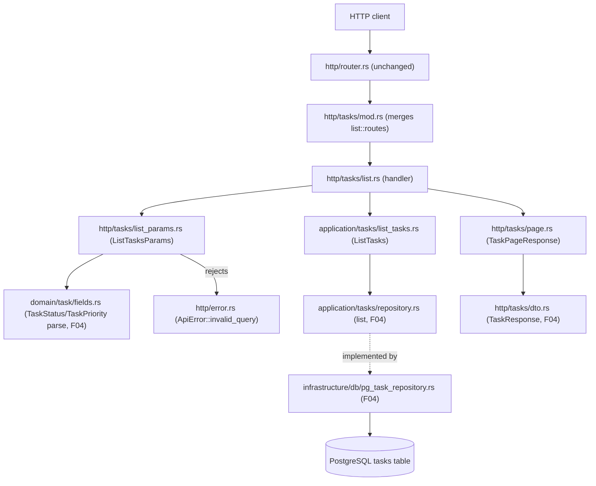

# Spec: List Tasks

## 1. Technical Overview

**What:** Add `GET /tasks`, which returns one page of tasks in the envelope `{"items","total","limit","offset"}`. It supports filtering by `status` and `priority`, sorting by `created_at`, `updated_at`, `due_date` or `priority` in either direction, and `limit`/`offset` pagination.

Most of the work is HTTP-side: a `ListTasksParams` extractor turns the raw query string into the existing `TaskQuery`. It reports every invalid parameter at once as `400 invalid_query`. The application layer gets a thin `ListTasks` use case. Persistence is unchanged: `TaskRepository::list` and `PgTaskRepository::list` (F04) already implement the filters, the eight static sort statements (NULLS LAST for `due_date`, semantic priority, `id ASC` tiebreaker), and the filtered `COUNT`.

**Why:** F04 fixed the `list` port and its SQL so the wave-3 features would not edit the same adapter. F06 supplies the transport rules the PRD defines: allowed values, defaults, bounds, strict rejection, unknown-parameter tolerance. It also supplies the page envelope that F10 documents as `TaskPage`.

**Scope:**

**Included:**
- HTTP: `GET /tasks` returning `200` with the page envelope; `ListTasksParams` extractor (strict parsing, all errors at once, fixed detail order); `TaskPageResponse` DTO built from `TaskPage` and the effective `limit`/`offset`; a `list` route file merged into `src/http/tasks/mod.rs` alongside `POST /tasks`.
- Application: `ListTasks` use case (`execute(&TaskQuery) -> Result<TaskPage, AppError>`).
- Database errors on the list map through the existing classification (`503` when the pool cannot provide a connection, `500` otherwise).
- Tests: extractor unit tests, a use-case unit test, and `tests/tasks_list.rs` in-process integration tests, including a p95 latency check over 10,000 seeded rows.

**Excluded (owned elsewhere):**
- Repository, SQL and schema changes (F04 delivered them; none are needed).
- `GET /tasks/{id}` (F05), `PATCH` (F07), `DELETE` (F08), OpenAPI documentation of the list operation and `TaskPage` (F10).
- Cursor pagination, full-text search, filtering by due date, and sorting by title (PRD §7).

**Input contracts (Consumes):**
- F04: persisted task records, `TaskRepository::list`, `TaskQuery` / `TaskFilters` / `SortField` / `SortOrder` / `TaskPage`, the domain `TaskStatus::parse` / `TaskPriority::parse` with their messages, and the shared `TaskResponse` DTO.
- F01: `ApiError::invalid_query`, `ErrorCode::InvalidQuery`, `map_sqlx_error`, router fallbacks, `/__test/slow?hold_db=true`, the `#[sqlx::test]` harness.

**Output contracts (Provides):**
- List endpoint definition for F10: `GET /tasks`; query parameters `status`, `priority`, `sort`, `order`, `limit`, `offset` with the allowed values, defaults and bounds in Section 5; page envelope fields `items`, `total`, `limit`, `offset`; responses `200` and `400` (`invalid_query`), plus the cross-cutting `503`/`500`.

## 2. Architecture Impact

**Affected components:**
- Modified: `src/application/tasks/mod.rs`, `src/http/tasks/mod.rs`, `README.md`, `CLAUDE.md`
- New: `src/http/tasks/list_params.rs`, `src/http/tasks/list.rs`, `src/http/tasks/page.rs`, `src/application/tasks/list_tasks.rs`
- New tests: `tests/tasks_list.rs`
- Regenerated: `.sqlx/query-*.json` (seeding statements in `tests/tasks_list.rs`)
- Unchanged: `AppState`, `build_router`, `main.rs`, `TaskRepository`, `PgTaskRepository`, `AppError`, `src/http/error.rs`, migrations



**Request flow (`GET /tasks`):**
1. The router's outer layers run first.
2. `ListTasksParams` reads the query string as ordered key/value pairs (form-urlencoded, lossy UTF-8 decoding). It ignores unknown names and validates the six known ones. It returns either a `TaskQuery` or `400 invalid_query` with one detail per invalid parameter, and on that path no query is executed.
3. `ListTasks::execute` calls `TaskRepository::list`: one page statement plus one `COUNT`.
4. The handler builds a `TaskPageResponse` from `TaskPage` (items rendered with `TaskResponse`) and the effective `limit`/`offset`, then returns `200`.
5. Pool failures become `503`. Anything else becomes `500`.

## 3. Technical Decisions

| Decision | Chosen Approach | Alternative Considered | Trade-off |
|----------|----------------|----------------------|-----------|
| Where query parsing lives | HTTP extractor `ListTasksParams` (`FromRequestParts`), reusing the domain enum parsers and producing `TaskQuery` or `ApiError::invalid_query` (interview answer) | `TaskQuery::parse` in the application layer plus a new `AppError::InvalidQuery` variant | Query strings are transport input, like `ApiJson` bodies. No edits to the shared `AppError` / `error.rs`. The bounds (1–100, 0–10,000) live in the HTTP layer next to their messages |
| Repeated and empty parameters | Strict (interview answer): a known parameter given more than once is rejected with `must not be repeated`; an empty value or an empty list item is invalid; values are case-sensitive and not trimmed; duplicate items within a list are allowed | Merge/last-wins, treat empty as absent | Typos never silently widen a result set. Clients must send each parameter once |
| Error messages | Fixed set in Section 3.1 with top-level message `Query parameters are invalid` (interview answer) | Free-form messages | Stable, testable bodies. `status`/`priority` reuse the F04 domain messages verbatim |
| Raw query access | axum `Query<Vec<(String, String)>>` (form-urlencoded pairs, order and duplicates preserved) | `Query<HashMap>` (loses duplicates); a hand-written percent decoder | Detects repetition without a new crate. Invalid percent-encoded UTF-8 decodes to U+FFFD and then fails as an invalid value of the named parameter |
| Envelope `limit`/`offset` | Echo the effective values (defaults applied) | Echo only what the client sent | Clients can page with `offset + limit` without knowing the defaults |
| Envelope DTO location | New `src/http/tasks/page.rs` | Add to `dto.rs` | Avoids a merge conflict with F07, which may extend `dto.rs` in the same wave |
| Latency verification | `#[sqlx::test]` in the normal suite: 10,000 rows seeded in one compile-checked statement, 1,000 sequential in-process `GET /tasks?status=todo&sort=due_date&limit=100`, p95 < 100 ms (precedent set by F05) | `#[ignore]` release-only test | Always runs, and the debug build makes it stricter than the PRD's release-build condition |
| Contract surfaces | `HTTP API` only | Service items for `ListTasks` | No consumer outside this feature calls the use case |

### 3.1 Assumptions and Decisions

Items 1–4 are interview answers. The rest are assumptions for review.

1. **Quality gates confirmed** (interview): `cargo fmt --check`, `cargo clippy --all-targets -- -D warnings`, `cargo test`, `SQLX_OFFLINE=true cargo build`.
2. **HTTP extractor** (interview): `ListTasksParams(pub TaskQuery)` in `src/http/tasks/list_params.rs`.
3. **Strict edge values** (interview): see the rules table below.
4. **Messages** (interview):

   | Field | Message |
   |---|---|
   | top-level `error.message` | `Query parameters are invalid` |
   | `status` | `must be one of: todo, in_progress, done` |
   | `priority` | `must be one of: low, medium, high` |
   | `sort` | `must be one of: created_at, updated_at, due_date, priority` |
   | `order` | `must be one of: asc, desc` |
   | `limit` | `must be an integer between 1 and 100` |
   | `offset` | `must be an integer between 0 and 10000` |
   | any known parameter given more than once | `must not be repeated` |
   | query string that cannot be decoded at all (extractor rejection) | top-level message only, `details: []` |

5. **Detail order** is always `status`, `priority`, `sort`, `order`, `limit`, `offset`, whatever the order in the URL. Each parameter appears at most once in `details`: when it is repeated, only `must not be repeated` is reported for it.
6. **Parsing rules:**

   | Parameter | Accepted | Rejected |
   |---|---|---|
   | `status` / `priority` | split on `,`; every item must match an allowed value exactly (case-sensitive, no trimming) | empty value, empty item (`todo,,done`), `+`-decoded spaces (`todo+done`), any unknown value |
   | `sort` / `order` | exact value | anything else, including different case |
   | `limit` / `offset` | parsed with `i64` decimal parsing, so a leading `+` is accepted | empty, non-integers (`1.0`, `abc`), values that overflow `i64`, values out of range. An out-of-range and a non-integer value produce the same message |

   Duplicates within a list (`status=todo,todo`) are accepted and mean the same as a single value.
7. **Unknown parameter names are ignored,** including different-case variants of known names (`Status=closed`) and repeated unknown names.
8. **Defaults:** no filter, `sort=created_at`, `order=desc`, `limit=20`, `offset=0` (the existing `TaskQuery::default()`).
9. **`total`** counts all rows matching the filters, ignoring `limit`/`offset`. It comes from a separate `COUNT` statement, not a transactional snapshot (F04 assumption 15). Concurrent writes between the two statements may make `total` and `items` momentarily inconsistent.
10. **Offset beyond `total`** returns `items: []` with the correct `total` (no error). `offset=10000` is valid.
11. **Ordering semantics come from F04's adapter:**
    - `priority` sorts `low < medium < high`.
    - Null `due_date` values come last in both directions.
    - `id ASC` is always the final tiebreaker.
    - Rows inserted by one statement share `created_at`/`updated_at` and fall back to `id ASC`.
12. **Response:**
    - `200`, `Content-Type: application/json`.
    - Field order is `items`, `total`, `limit`, `offset`.
    - Each item is exactly the F04 `TaskResponse`.
13. **Routing:**
    - `GET /tasks` merges with the existing `POST /tasks` (axum 0.8.9 merges method routers for the same path).
    - Other methods on `/tasks` (e.g. `PUT`) get the existing `405 method_not_allowed`.
    - `HEAD` is answered by axum's GET routing.
14. **Query strings are not logged** (F02 rule). The completion line records only the path `/tasks`.
15. **Test seeding:**
    - Ordered fixtures are created one row at a time (via the repository's `create`), so `created_at` strictly increases.
    - Tied rows and the 10,000-row set are inserted by single compile-checked `INSERT … SELECT generate_series` statements local to `tests/tasks_list.rs`.
    - F05 has a similar local helper. After both merge, the two may be consolidated into `tests/common`.
16. **Test conventions** come from F01/F04: `#[sqlx::test]`, the `tests/common` helpers, `.env.test`. There are no fixtures files and no mocks.
17. **Scope:** full feature. F06 has no Core/Full split, and F04 is merged.

## 4. Component Overview

**Application:**

| File Path | New/Modified | Purpose | Key Responsibilities |
|-----------|--------------|---------|---------------------|
| `src/application/tasks/list_tasks.rs` | New | Use case | `ListTasks::new(Arc<dyn TaskRepository>)`, `execute(&TaskQuery)`: delegates to `list`, errors propagated unchanged |
| `src/application/tasks/mod.rs` | Modified | Tasks facade | declare and re-export `ListTasks` |

**HTTP:**

| File Path | New/Modified | Purpose | Key Responsibilities |
|-----------|--------------|---------|---------------------|
| `src/http/tasks/list_params.rs` | New | Query extractor | `ListTasksParams(pub TaskQuery)`; parsing rules, bounds and messages from Section 3.1; fixed detail order; every failure becomes `ApiError::invalid_query` |
| `src/http/tasks/page.rs` | New | Envelope DTO | `TaskPageResponse { items: Vec<TaskResponse>, total, limit, offset }` built from `TaskPage` and the effective query |
| `src/http/tasks/list.rs` | New | Handler | `GET /tasks`: `ListTasksParams` → `ListTasks` → `200 Json<TaskPageResponse>`; its own `routes()` |
| `src/http/tasks/mod.rs` | Modified | Route module | declare `list`, `list_params`, `page`; merge `list::routes()` |

**Project files:**

| File Path | New/Modified | Purpose | Key Responsibilities |
|-----------|--------------|---------|---------------------|
| `README.md` | Modified | Developer docs | document `GET /tasks` parameters, defaults, envelope and a 400 example |
| `CLAUDE.md` | Modified | Project guidance | status line (F06 done); note that query parsing for lists lives in `list_params.rs` |
| `.sqlx/query-*.json` | New | Offline metadata | regenerated by `cargo sqlx prepare -- --all-targets` |

**Tests:**

| File Path | New/Modified | Purpose | Key Responsibilities |
|-----------|--------------|---------|---------------------|
| `tests/tasks_list.rs` | New | HTTP integration tests | pagination, filters, sorting, query validation, rejection and latency, in-process |

**Database:** no migrations. The existing indexes on `status`, `priority`, `due_date`, `created_at` (F01) serve the filters and sorts.

## 5. API Contracts

**Endpoint: List tasks**
- **Method:** GET
- **Path:** `/tasks`
- **Authentication:** none

**Query parameters** (all optional; unknown names ignored; each known name at most once):

| Field | Type | Required | Validation | Description |
|-------|------|----------|------------|-------------|
| `status` | `string` (comma-separated) | No | each item in `todo`, `in_progress`, `done`; no empty items | OR within the list |
| `priority` | `string` (comma-separated) | No | each item in `low`, `medium`, `high`; no empty items | OR within the list; AND with `status` |
| `sort` | `string` | No | `created_at` (default), `updated_at`, `due_date`, `priority` | Sort field |
| `order` | `string` | No | `asc`, `desc` (default) | Direction |
| `limit` | `integer` | No | 1–100, default 20 | Page size |
| `offset` | `integer` | No | 0–10,000, default 0 | Rows to skip |

**Request Example:**
```
GET /tasks?status=todo,in_progress&priority=high&sort=due_date&order=asc&limit=50
```

**Response (Success, 200):**

| Field | Type | Description |
|-------|------|-------------|
| `items` | `array` of task | F04 task representation, in the requested order |
| `total` | `integer` | Rows matching the filters, ignoring `limit`/`offset` |
| `limit` | `integer` | Effective page size |
| `offset` | `integer` | Effective offset |

**Response Example:**
```json
{
  "items": [
    {
      "id": "3f2b6f0e-6d4a-4c8e-9a0f-1b2c3d4e5f60",
      "title": "Write PRD",
      "description": null,
      "status": "todo",
      "priority": "high",
      "due_date": "2026-12-01",
      "created_at": "2026-11-21T18:11:00.123Z",
      "updated_at": "2026-11-21T18:11:00.123Z"
    }
  ],
  "total": 1,
  "limit": 50,
  "offset": 0
}
```

**Empty database (`GET /tasks`):**
```json
{"items":[],"total":0,"limit":20,"offset":0}
```

**Invalid parameters (`GET /tasks?status=closed&limit=500`, 400):**
```json
{
  "error": {
    "code": "invalid_query",
    "message": "Query parameters are invalid",
    "details": [
      { "field": "status", "message": "must be one of: todo, in_progress, done" },
      { "field": "limit", "message": "must be an integer between 1 and 100" }
    ]
  }
}
```

**Error Codes:**

| Code | HTTP Status | Description |
|------|-------------|-------------|
| `invalid_query` | 400 | One or more known parameters invalid, empty or repeated; one `details` entry per parameter; no query executed |
| `method_not_allowed` | 405 | Method without a handler on `/tasks` (F01 fallback) |
| `service_unavailable` | 503 | No pooled connection within the acquire timeout / database unreachable |
| `internal_error` | 500 | Unexpected failure; cause logged server-side only |

## 6. Data Model

No schema changes. The endpoint reads `tasks` (F01) through `PgTaskRepository::list` (F04):
- **Filters:** `status = ANY($1)` and `priority = ANY($2)`, each skipped when its array is NULL.
- **Sorting:** one static `ORDER BY` per sort field and direction, ending in `id ASC`.
- **Paging and total:** `LIMIT $3 OFFSET $4`, plus a `COUNT(*)` with the same filters.

## 7. Testing Strategy

**Test File Structure:**

| Test File | Test Type | Target | Coverage Goal |
|-----------|-----------|--------|---------------|
| `src/http/tasks/list_params.rs` (`#[cfg(test)]`) | Unit (extractor driven with request parts) | parsing, defaults, errors | every rule in Section 3.1 |
| `src/http/tasks/page.rs` (`#[cfg(test)]`) | Unit | envelope serialization | field order, item shape |
| `src/application/tasks/list_tasks.rs` (`#[cfg(test)]`) | Unit (in-memory fake repository) | use-case flow | query passed through, errors propagated |
| `tests/tasks_list.rs` | Integration (in-process router, `#[sqlx::test]`) | `GET /tasks` | every success, rejection and latency path |

**`src/http/tasks/list_params.rs` unit tests:**

| Test Function | Description | Assertions |
|---------------|-------------|------------|
| `no_query_yields_defaults` | no query string | `TaskQuery::default()` |
| `all_parameters_are_parsed` | every parameter valid | filters, sort, order, limit, offset set |
| `lists_are_split_on_commas` | `status=todo,in_progress`, `priority=low,high` | two values each |
| `duplicate_list_items_are_accepted` | `status=todo,todo` | accepted |
| `limit_and_offset_bounds` | 1, 100, 0, 10000 accepted; 0, 101, -1, 10001 rejected | messages from Section 3.1 |
| `non_integer_numbers_are_rejected` | `abc`, `1.0`, `""`, `99999999999999999999` | `limit` / `offset` messages |
| `enum_values_are_case_sensitive` | `TODO`, `High`, `DESC`, `Created_at` | rejected |
| `empty_values_and_items_are_rejected` | `status=`, `status=todo,,done`, `sort=` | rejected |
| `repeated_parameter_is_rejected` | `status=todo&status=done`, `limit=5&limit=5` | `must not be repeated` |
| `unknown_names_are_ignored` | `foo=bar`, `Status=closed`, `foo=1&foo=2` | defaults |
| `details_follow_fixed_order` | all six invalid, given in reverse order | `status`, `priority`, `sort`, `order`, `limit`, `offset` |
| `invalid_utf8_value_is_rejected_for_its_parameter` | `status=%FF` | one `status` detail |

**`src/http/tasks/page.rs` unit tests:**

| Test Function | Description | Assertions |
|---------------|-------------|------------|
| `envelope_field_order` | empty page | exact `{"items":[],"total":0,"limit":20,"offset":0}` |
| `items_use_task_response` | one task | item equals `TaskResponse` JSON |

**`src/application/tasks/list_tasks.rs` unit tests:**

| Test Function | Description | Assertions |
|---------------|-------------|------------|
| `query_is_passed_to_the_repository` | fake records the query | identical query; page returned |
| `repository_errors_are_propagated` | fake returns `Unavailable` | same variant |

**`tests/tasks_list.rs`** (in-process router against a per-test database):

| Test Function | Description | Assertions |
|---------------|-------------|------------|
| `empty_database_returns_empty_page` | no rows | exact empty envelope |
| `default_page_is_20_newest_first` | 25 rows created one at a time | 20 items newest first, `total` 25 |
| `offset_returns_the_remaining_tasks` | 25 rows, `offset=20` | 5 oldest, `total` 25 |
| `offset_beyond_total_returns_no_items` | 25 rows, `offset=1000` | `items` empty, `total` 25 |
| `limit_bounds_are_accepted` | `limit=1`; `limit=100&offset=10000` | 1 item; empty page with echoed values |
| `paging_with_limit_7_visits_every_task_once` | 20 tied rows, offsets 0/7/14 | sizes 7/7/6, every id once, ascending ids |
| `items_match_create_response` | POST then GET | single item equals the 201 body |
| `status_filter_is_or_within_parameter` | 9 mixed rows, `status=todo,in_progress` | 6 items, `total` 6 |
| `status_and_priority_combine_with_and` | `status=todo&priority=high` | 1 item |
| `priority_filter_is_or_within_parameter` | `priority=low,high` | 6 items |
| `total_ignores_limit` | `status=todo,in_progress&limit=2` | 2 items, `total` 6 |
| `combined_filter_sort_example` | PRD Experience 2 query | 2 items in due-date order |
| `priority_sort_is_semantic` | `sort=priority`, both directions | high/medium/low groups |
| `due_date_sort_puts_nulls_last` | `sort=due_date`, both directions | dated in order, nulls last by id |
| `created_and_updated_sorts` | `order=asc`; `sort=updated_at&order=desc` | creation order; reverse |
| `ties_are_broken_by_id` | 20 tied rows, `sort=priority` | ids ascending |
| `each_invalid_parameter_returns_400` | the seven PRD values plus `priority=urgent`, `limit=abc` | exact body naming the parameter |
| `two_invalid_parameters_return_two_details` | `status=closed&limit=500` | exact two-entry body |
| `all_invalid_parameters_in_fixed_order` | six invalid in reverse URL order | six details in fixed order |
| `repeated_and_empty_parameters_are_rejected` | repeated `status`; `status=&limit=`; `status=todo,,done`; `status=TODO&order=DESC` | exact bodies |
| `unknown_parameters_are_ignored` | `foo=bar&Status=closed` | 200 default envelope |
| `unavailable_database_returns_503` | pool of 1 held by `/__test/slow?hold_db=true` | exact `service_unavailable` body within 2.5 s |
| `unsupported_method_returns_405` | `PUT /tasks` | uniform `method_not_allowed` |
| `list_is_fast_with_10000_tasks` | 10,000 seeded rows, 1,000 sequential `?status=todo&sort=due_date&limit=100` | all 200 with 100 items, p95 < 100 ms |

**Harness rules:**
- Every database test is `#[sqlx::test]`.
- Pool-holding tests use `(PgPoolOptions, PgConnectOptions)` arguments for a 1-connection pool with a 1 s acquire timeout.
- After adding the seeding statements, run `cargo sqlx prepare -- --all-targets` and commit `.sqlx/`.
