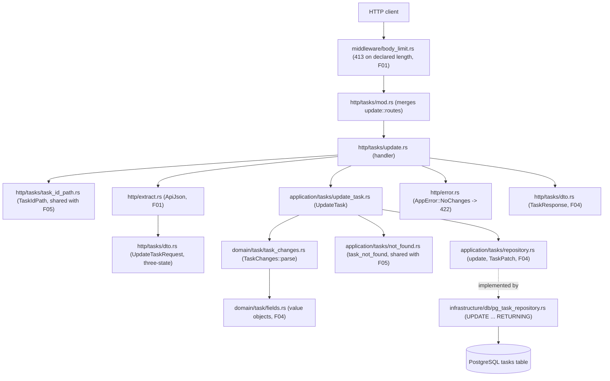

# Spec: Update Task

## 1. Technical Overview

**What:** Add `PATCH /tasks/{id}`, a partial update that returns the full updated task.

- **HTTP:** an `UpdateTaskRequest` whose fields are three-state (absent / `null` / value), so a missing field and an explicit `null` can be told apart. Wrongly typed values still produce the extractor's `400 invalid_json` naming the field.
- **Domain:** `TaskChanges::parse(RawTaskChanges)` applies the PATCH rules and reports every invalid field at once:
  - absent means unchanged;
  - `null` clears `description`/`due_date` and is rejected for `title`/`status`/`priority`;
  - F04's value-object rules apply to every value;
  - a body with no updatable field is rejected.
- **Errors:** new `DomainError::NoChanges` / `AppError::NoChanges` variants carry the empty-payload case to `422` with the PRD message.
- **Application:** an `UpdateTask` use case converts `TaskChanges` into the existing `TaskPatch` and calls `TaskRepository::update`. When no row matches, it reports `task_not_found`.
- **SQL:** the F04 update statement changes one line, so `updated_at` always moves forward by at least one millisecond.

**Why:** F04 already delivered the `update` port, the `TaskPatch`/`FieldPatch` types and the single-statement `UPDATE … RETURNING`, and its value objects own the validation messages "shared with F07". F07 adds what F04 left open:
- the PATCH-specific null and empty rules;
- the three-state request body;
- a visible guarantee that `updated_at` strictly increases even though responses show millisecond precision;
- the endpoint itself, which reuses the shared id-parsing and not-found helpers defined in the F05 spec.

**Scope:**

**Included:**
- Domain: `RawTaskChanges` / `RawField` (absent, null, value), `TaskChanges::parse` (field order `title`, `description`, `status`, `priority`, `due_date`), message constant `cannot be null`, `DomainError::NoChanges`.
- Application: `AppError::NoChanges` (+ conversion from `DomainError::NoChanges`), `UpdateTask` use case, the shared `task_not_found` helper (created here if F05 has not merged it yet; identical to the F05 spec).
- Infrastructure: the `PgTaskRepository::update` statement sets `updated_at` to the later of `now()` and the previous `updated_at` plus 1 ms; `.sqlx/` regenerated.
- HTTP: `UpdateTaskRequest` (three-state fields) in `dto.rs`; `PATCH /tasks/{id}` handler; mapping `AppError::NoChanges` to `422 validation_error` with message `At least one updatable field must be provided` and `details: []`; the shared `TaskIdPath` extractor (created here if F05 has not merged it yet; identical to the F05 spec).
- Tests: domain, use-case, DTO and extractor unit tests; `tests/tasks_update.rs` in-process integration tests.

**Excluded (owned elsewhere):**
- `GET /tasks/{id}` (F05), `GET /tasks` (F06), `DELETE /tasks/{id}` (F08), OpenAPI documentation of `UpdateTaskRequest` (F10).
- Optimistic concurrency (ETags, version columns) — concurrent updates are last-write-wins (PRD §7).
- Changing `id` or `created_at`, status-transition rules, `completed_at` tracking.

**Input contracts (Consumes):**
- F04: the persisted task record and `TaskRepository::update` (single `UPDATE … RETURNING`, `None` for an unknown id); `TaskPatch` / `FieldPatch`; the task value objects `TaskTitle`, `TaskDescription`, `TaskStatus`, `TaskPriority`, `DueDate` with their messages (title 1–200 characters after trimming, description ≤ 5,000, status and priority values, `YYYY-MM-DD` dates); `TaskResponse`.
- F01: `ApiJson` (415/413/400), `ApiError` / `AppError` / `DomainError`, `map_sqlx_error`, the `/__test/slow?hold_db=true` route, the `#[sqlx::test]` harness.

**Output contracts (Provides):**
- Update endpoint definition for F10: `PATCH /tasks/{id}`; `UpdateTaskRequest` fields with nullability (`description`, `due_date` nullable; `title`, `status`, `priority` non-nullable; all optional, at least one required); responses `200` (`Task`), `400` (`invalid_id`, `invalid_json`), `404`, `413`, `415`, `422`, plus the cross-cutting `503`/`500`.

## 2. Architecture Impact

**Affected components:**
- Modified: `src/domain/shared/errors.rs`, `src/domain/task/mod.rs`, `src/application/errors.rs`, `src/application/tasks/mod.rs`, `src/infrastructure/db/pg_task_repository.rs`, `src/http/error.rs`, `src/http/tasks/dto.rs`, `src/http/tasks/mod.rs`, `README.md`, `CLAUDE.md`
- New: `src/domain/task/task_changes.rs`, `src/application/tasks/update_task.rs`, `src/http/tasks/update.rs`
- Shared with F05 (new unless F05 merged first, then reused unchanged): `src/http/tasks/task_id_path.rs`, `src/application/tasks/not_found.rs`, and `Display` for `TaskId` in `src/domain/task/task_entity.rs`
- New tests: `tests/tasks_update.rs`
- Regenerated: `.sqlx/query-*.json` (the changed update statement)
- Unchanged: `AppState`, `build_router`, `main.rs`, `TaskRepository` signature, migrations



**Request flow (`PATCH /tasks/{id}`)** — each step stops the request on failure, in this order:
1. Body-limit middleware: a declared `Content-Length` over 65,536 gives `413`, before routing.
2. `TaskIdPath`: a malformed id gives `400 invalid_id`.
3. `ApiJson<UpdateTaskRequest>`: a missing or wrong `Content-Type` gives `415`, a streamed body over the limit gives `413`, and malformed JSON or wrong types give `400 invalid_json`.
4. `UpdateTask::execute`: `TaskChanges::parse` gives `422` for field errors or no changes, without touching the database.
5. `TaskRepository::update`, a single `UPDATE … RETURNING`. No matching row gives `404`. A matching row becomes `200` with the `TaskResponse`.
6. Pool failures give `503`. Anything else gives `500`.

## 3. Technical Decisions

| Decision | Chosen Approach | Alternative Considered | Trade-off |
|----------|----------------|----------------------|-----------|
| Where PATCH validation lives | Domain `TaskChanges::parse(RawTaskChanges)` returning `DomainError`, mirroring `NewTask::parse`; the use case maps the result to `TaskPatch` (interview answer) | Build `TaskPatch` inside the use case | Business rules stay in the domain and are unit-tested without HTTP. The domain cannot reuse the application's `FieldPatch`, so it keeps its own keep/set/clear representation |
| Empty-payload error | New `DomainError::NoChanges` and `AppError::NoChanges`; `http/error.rs` maps it to `422 validation_error`, message `At least one updatable field must be provided`, `details: []` (interview answer) | Check emptiness in the handler | Keeps the rule in the domain. Edits three shared error files, which the F05/F06/F08 specs do not edit |
| `updated_at` monotonicity | `updated_at = GREATEST(now(), updated_at + interval '1 millisecond')` in the existing update statement (interview answer) | Keep `now()`, rely on timing | The value shown at millisecond precision always strictly increases, even for back-to-back PATCHes or a clock step. Successive updates may run up to 1 ms "ahead" of wall-clock time |
| Error precedence | Cheap checks first: 413 (declared length) → 400 `invalid_id` → 415/413/400 `invalid_json` → 422 → 404 (interview answer) | Look up existence before validating | No extra query and the single-statement guarantee holds. A nonexistent id with an invalid body reports 422, not 404 |
| Three-state body fields | Each `UpdateTaskRequest` field defaults to "absent" when missing, becomes "null" for JSON `null`, and "value" for a string; implemented with serde `default` plus a small field-level deserializer that keeps `serde_path_to_error` paths | `Option<String>` (cannot tell absent from null); a `serde_json::Value` body parsed by hand | No new crate. Wrong JSON types still produce `400 invalid_json` naming the field |
| Shared helpers with F05 | Reuse `TaskIdPath` and `task_not_found` exactly as specified in F05's spec; if F05 has not merged yet, add identical files | F07-private copies | One id-parsing and 404 implementation for GET/PATCH/DELETE. If both features add the files in parallel, the merge keeps one copy |
| Verification of "untouched" rows | Read the stored row directly with SQL (as the F04 contract does) | A follow-up `GET /tasks/{id}` | `GET /tasks/{id}` belongs to F05, a sibling outside F07's dependency closure. The stored row is the stronger observation anyway |
| Contract surfaces | `HTTP API` only | Service items for `UpdateTask` | No consumer outside this feature calls the use case |

### 3.1 Assumptions and Decisions

Items 1–5 are interview answers. The rest are assumptions for review.

1. **Quality gates confirmed** (interview): `cargo fmt --check`, `cargo clippy --all-targets -- -D warnings`, `cargo test`, `SQLX_OFFLINE=true cargo build`.
2. **Domain `TaskChanges`** (interview): `RawField` is absent, null or a string value. `RawTaskChanges` holds one `RawField` per updatable field. `TaskChanges` keeps, sets or clears each field.
3. **`NoChanges` variants** (interview): `DomainError::NoChanges` converts to `AppError::NoChanges`, and `ApiError` maps it to `422 validation_error` with message `At least one updatable field must be provided` and `details: []`. The message constant `MSG_NO_CHANGES` lives in `src/http/error.rs` next to the other API messages.
4. **`updated_at` guarantee** (interview): set to the later of `now()` and the previous `updated_at` plus 1 ms. `created_at` and `id` are never written.
5. **Precedence** (interview): as in Section 2.
6. **Field rules:**

   | Field | absent | `null` | string value |
   |---|---|---|---|
   | `title` | unchanged | `cannot be null` | trimmed, 1–200 characters (`must be between 1 and 200 characters`) |
   | `description` | unchanged | cleared | trimmed, ≤ 5,000 characters (`must be at most 5000 characters`); blank after trimming clears it (as on create) |
   | `status` | unchanged | `cannot be null` | exactly `todo` / `in_progress` / `done` (`must be one of: todo, in_progress, done`) |
   | `priority` | unchanged | `cannot be null` | exactly `low` / `medium` / `high` (`must be one of: low, medium, high`) |
   | `due_date` | unchanged | cleared | valid `YYYY-MM-DD` calendar date, past allowed (`must be a valid date in YYYY-MM-DD format`) |

7. **All field errors are reported together** in the order `title`, `description`, `status`, `priority`, `due_date`, with top-level message `Request validation failed`. The no-changes rule only applies when every field is absent. A body containing only `null`s for non-nullable fields reports those field errors, not "no changes".
8. **Unknown fields are ignored.** A body with only unknown fields counts as empty (`NoChanges`). `id`, `created_at` and `updated_at` in the body are unknown fields for PATCH and are ignored.
9. **Non-object JSON bodies** (`null`, `[]`, `"done"`, `5`) are `400 invalid_json` with `details: []`, from the extractor.
10. **Nothing is written on any non-2xx response:** validation precedes the single update statement, and a failed statement changes nothing.
11. **A PATCH that sets a field to its current value is still a successful update:** it returns 200 and `updated_at` advances.
12. **Response:** `200` with the F04 `TaskResponse`, with no `Location` header.
13. **Shared helpers:** if F05 is merged first, F07 uses its `TaskIdPath` and `task_not_found` unchanged. Otherwise F07 adds them exactly as described in `docs/F05-get-task-by-id/spec.md`:
    - only the 36-character hyphenated form is accepted;
    - `400` with message `Task id must be a valid UUID`;
    - `404` with message `Task <lowercase id> not found`.
14. **Routing:** `PATCH /tasks/{id}` merges with F05's `GET` and F08's `DELETE` on the same path (axum 0.8.9 merges method routers). A method with no handler gets `405 method_not_allowed`.
15. **Concurrency:** last write wins. There is no locking beyond the single statement.
16. **Test conventions** come from F01/F04: `#[sqlx::test]`, `tests/common::{test_router, send, request_with, assert_uniform_error, stored_task, count_tasks}`, `.env.test`. There are no fixture files and no mocks.
17. **Scope:** full feature. There is no Core/Full split, and F04 is merged.

## 4. Component Overview

**Domain:**

| File Path | New/Modified | Purpose | Key Responsibilities |
|-----------|--------------|---------|---------------------|
| `src/domain/task/task_changes.rs` | New | Update aggregate | `RawField`, `RawTaskChanges`, `TaskChanges::parse` (rules in Section 3.1, aggregated errors, `NoChanges` when every field is absent), `CANNOT_BE_NULL_MESSAGE` |
| `src/domain/task/mod.rs` | Modified | Task facade | declare and re-export `task_changes` |
| `src/domain/shared/errors.rs` | Modified | Domain errors | add `DomainError::NoChanges` |
| `src/domain/task/task_entity.rs` | Modified only if F05 has not merged | Entity | `Display` for `TaskId` (lowercase hyphenated), as in the F05 spec |

**Application:**

| File Path | New/Modified | Purpose | Key Responsibilities |
|-----------|--------------|---------|---------------------|
| `src/application/errors.rs` | Modified | Application errors | add `AppError::NoChanges`; convert `DomainError::NoChanges` |
| `src/application/tasks/update_task.rs` | New | Use case | `UpdateTask::new(Arc<dyn TaskRepository>)`, `execute(TaskId, RawTaskChanges)`: parse, map to `TaskPatch`, `update`, `None` → `task_not_found` |
| `src/application/tasks/not_found.rs` | New only if F05 has not merged | Shared helper | `task_not_found(TaskId)` as in the F05 spec |
| `src/application/tasks/mod.rs` | Modified | Tasks facade | declare and re-export `UpdateTask` (and `task_not_found` if added here) |

**Infrastructure:**

| File Path | New/Modified | Purpose | Key Responsibilities |
|-----------|--------------|---------|---------------------|
| `src/infrastructure/db/pg_task_repository.rs` | Modified | Adapter | update statement sets `updated_at` to the later of `now()` and the previous value plus 1 ms; everything else unchanged |

**HTTP:**

| File Path | New/Modified | Purpose | Key Responsibilities |
|-----------|--------------|---------|---------------------|
| `src/http/tasks/dto.rs` | Modified | DTOs | `UpdateTaskRequest` with three-state fields and its conversion to `RawTaskChanges` |
| `src/http/tasks/update.rs` | New | Handler | `PATCH /tasks/{id}`: `TaskIdPath` → `ApiJson<UpdateTaskRequest>` → `UpdateTask` → `200 Json<TaskResponse>`; its own `routes()` |
| `src/http/tasks/task_id_path.rs` | New only if F05 has not merged | Path extractor | `TaskIdPath` as in the F05 spec |
| `src/http/tasks/mod.rs` | Modified | Route module | declare `update` (and `task_id_path` if added here); merge `update::routes()` |
| `src/http/error.rs` | Modified | Error mapping | `MSG_NO_CHANGES`; map `AppError::NoChanges` to `ApiError::validation(MSG_NO_CHANGES, [])` |

**Project files:**

| File Path | New/Modified | Purpose | Key Responsibilities |
|-----------|--------------|---------|---------------------|
| `README.md` | Modified | Developer docs | document `PATCH /tasks/{id}` field semantics with examples (200, clear with `null`, 422 empty, 422 null) |
| `CLAUDE.md` | Modified | Project guidance | status line (F07 done); note `TaskChanges` as the PATCH validator and the `updated_at` rule |
| `.sqlx/query-*.json` | Regenerated | Offline metadata | `cargo sqlx prepare -- --all-targets` after the SQL change |

**Tests:**

| File Path | New/Modified | Purpose | Key Responsibilities |
|-----------|--------------|---------|---------------------|
| `tests/tasks_update.rs` | New | HTTP integration tests | every `PATCH /tasks/{id}` success, validation, rejection and precedence path |
| `tests/task_repository.rs` | Modified | Repository tests | add a test that back-to-back updates strictly increase `updated_at` |

**Database:** no migrations.

## 5. API Contracts

**Endpoint: Update task**
- **Method:** PATCH
- **Path:** `/tasks/{id}` (`id`: 36-character hyphenated UUID)
- **Authentication:** none

**Request** (`Content-Type: application/json`, body ≤ 65,536 bytes, at least one updatable field):

| Field | Type | Required | Validation | Description |
|-------|------|----------|------------|-------------|
| `title` | `string` | No | not `null`; trimmed; 1–200 characters | New title |
| `description` | `string` or `null` | No | trimmed; ≤ 5,000 characters; blank or `null` clears | New description |
| `status` | `string` | No | not `null`; `todo` \| `in_progress` \| `done` | New status |
| `priority` | `string` | No | not `null`; `low` \| `medium` \| `high` | New priority |
| `due_date` | `string` or `null` | No | `YYYY-MM-DD` calendar date; `null` clears | New due date |

Absent fields are unchanged. Unknown fields are ignored.

**Request Examples:**
```json
{ "status": "done" }
```
```json
{ "due_date": null, "description": null }
```

**Response (Success, 200):** the F04 task representation.

```json
{
  "id": "3f2b6f0e-6d4a-4c8e-9a0f-1b2c3d4e5f60",
  "title": "Write PRD",
  "description": null,
  "status": "done",
  "priority": "high",
  "due_date": "2026-12-01",
  "created_at": "2026-11-21T18:11:00.123Z",
  "updated_at": "2026-11-23T09:30:12.456Z"
}
```

**Empty payload (422):**
```json
{
  "error": {
    "code": "validation_error",
    "message": "At least one updatable field must be provided",
    "details": []
  }
}
```

**Null for a non-nullable field plus another invalid field (422):**
```json
{
  "error": {
    "code": "validation_error",
    "message": "Request validation failed",
    "details": [
      { "field": "title", "message": "cannot be null" },
      { "field": "priority", "message": "must be one of: low, medium, high" }
    ]
  }
}
```

**Error Codes:**

| Code | HTTP Status | Description |
|------|-------------|-------------|
| `invalid_id` | 400 | `{id}` is not a 36-character hyphenated UUID |
| `invalid_json` | 400 | Malformed JSON, non-object body, or a wrongly typed field (named in `details` when known) |
| `not_found` | 404 | No task with that id (`Task <id> not found`); nothing written |
| `method_not_allowed` | 405 | Method without a handler on `/tasks/{id}` |
| `payload_too_large` | 413 | Body over 65,536 bytes |
| `unsupported_media_type` | 415 | Missing or non-JSON `Content-Type` |
| `validation_error` | 422 | Field rule violations / `null` for a non-nullable field (`Request validation failed`, one detail per field) or empty payload (`At least one updatable field must be provided`, no details) |
| `service_unavailable` | 503 | Database unavailable; the single statement guarantees no partial modification |
| `internal_error` | 500 | Unexpected failure; cause logged server-side only |

## 6. Data Model

No schema changes. The only SQL change is the `updated_at` assignment in the existing update statement (`src/infrastructure/db/pg_task_repository.rs`). The rest of the statement is unchanged: `COALESCE` for `title`/`status`/`priority`, `CASE` flags for set/clear of `description`/`due_date`, `WHERE id = $1`, `RETURNING` all columns. The `CHECK` constraints on `tasks` (F01) still back the domain rules.

| Column | Write rule on PATCH |
|--------|---------------------|
| `title`, `status`, `priority` | new value when given, otherwise unchanged |
| `description`, `due_date` | new value, `NULL` when cleared, otherwise unchanged |
| `updated_at` | `GREATEST(now(), updated_at + interval '1 millisecond')` |
| `id`, `created_at` | never written |

## 7. Testing Strategy

**Test File Structure:**

| Test File | Test Type | Target | Coverage Goal |
|-----------|-----------|--------|---------------|
| `src/domain/task/task_changes.rs` (`#[cfg(test)]`) | Unit | PATCH rules | every row of the field-rules table, ordering, no-changes |
| `src/application/tasks/update_task.rs` (`#[cfg(test)]`) | Unit (in-memory fake repository) | use-case flow | validation short-circuit, mapping to `TaskPatch`, not found, error propagation |
| `src/application/errors.rs` (`#[cfg(test)]`) | Unit | conversion | `DomainError::NoChanges` → `AppError::NoChanges` |
| `src/http/error.rs` (`#[cfg(test)]`) | Unit | mapping | `AppError::NoChanges` → exact 422 body |
| `src/http/tasks/dto.rs` (`#[cfg(test)]`) | Unit | three-state deserialization | absent / null / value / wrong type |
| `tests/task_repository.rs` | Integration | `PgTaskRepository::update` | `updated_at` strictly increases on back-to-back updates |
| `tests/tasks_update.rs` | Integration (in-process router, `#[sqlx::test]`) | `PATCH /tasks/{id}` | every success, validation, rejection and precedence path |

**`src/domain/task/task_changes.rs` unit tests:**

| Test Function | Description | Assertions |
|---------------|-------------|------------|
| `all_absent_is_no_changes` | every field absent | `DomainError::NoChanges` |
| `single_field_is_set_others_kept` | only `status` | status set, rest keep |
| `nullable_fields_can_be_cleared` | `description` / `due_date` null | clear |
| `blank_description_clears` | `"   "` | clear |
| `non_nullable_nulls_are_rejected` | `title`, `status`, `priority` null | `cannot be null` for each |
| `values_use_creation_rules` | 201-char title, 5,001-char description, `DONE`, `urgent`, `2026-13-01` | F04 messages |
| `title_is_trimmed` | `"  Ship it  "` | `Ship it` |
| `errors_follow_field_order` | every field invalid | `title`, `description`, `status`, `priority`, `due_date` |
| `nulls_only_report_field_errors_not_no_changes` | `{"title":null}` | one `title` error, not `NoChanges` |

**`src/application/tasks/update_task.rs` unit tests:**

| Test Function | Description | Assertions |
|---------------|-------------|------------|
| `invalid_input_never_reaches_the_repository` | invalid changes | validation error, zero `update` calls |
| `no_changes_never_reaches_the_repository` | all absent | `AppError::NoChanges`, zero calls |
| `changes_map_to_patch` | set / clear / keep mix | `TaskPatch` with `Set`, `Clear`, `Keep` as expected |
| `unknown_id_is_not_found` | fake returns `None` | `NotFound("Task <id> not found")` |
| `repository_errors_are_propagated` | fake returns `Unavailable` | same variant |

**`src/http/tasks/dto.rs` unit tests:**

| Test Function | Description | Assertions |
|---------------|-------------|------------|
| `missing_null_and_value_are_distinct` | `{}`, `{"due_date":null}`, `{"due_date":"2026-12-01"}` | absent, null, value |
| `wrong_type_names_the_field` | `{"title":5}` through `ApiJson` parsing | `invalid_json` detail `title` |

**`tests/tasks_update.rs`** (in-process router against a per-test database; "row unchanged" is asserted with `stored_task`):

| Test Function | Description | Assertions |
|---------------|-------------|------------|
| `status_only_patch_changes_only_status` | `{"status":"done"}` | 200, other fields equal the stored-before row |
| `updated_at_strictly_increases_and_created_at_is_kept` | create then PATCH immediately | body and stored `updated_at` greater; `created_at` equal |
| `back_to_back_patches_increase_updated_at` | two PATCHes without delay | second `updated_at` > first |
| `all_fields_patch` | every field | trimmed values returned and stored |
| `same_value_patch_still_updates` | `{"status":"todo"}` on a `todo` task | 200, `updated_at` greater |
| `null_clears_description_and_due_date` | each, and both together | `null` in body, `NULL` stored, other fields kept |
| `blank_description_clears` | `"   "` | `null` |
| `null_for_non_nullable_fields_returns_422` | `title`, `status`, `priority` | exact body each, row unchanged |
| `empty_or_unknown_only_body_returns_422` | `{}`, `{"color":"red"}` | exact no-changes body, row unchanged |
| `partially_valid_payload_writes_nothing` | `{"title":"Valid","priority":"urgent"}` | 422, stored title unchanged |
| `invalid_values_return_422` | 201-char title, 5,001-char description, `2026-13-01`, `""` title, `DONE` | 422 naming the field, row unchanged |
| `all_errors_are_reported_in_order` | mixed invalid body | details in field order |
| `unknown_id_returns_404` | random v4 | exact `not_found` body, row count unchanged |
| `unknown_id_with_invalid_body_returns_422` | random v4 + `{"title":""}` | 422 |
| `malformed_id_returns_400` | `/tasks/abc`, valid and malformed bodies | `invalid_id` in both cases |
| `malformed_json_returns_400` | `{"status":` | `invalid_json`, row unchanged |
| `wrong_type_returns_400_naming_field` | `{"title":5}` | detail `title` |
| `non_object_body_returns_400` | `null` | `invalid_json` |
| `missing_content_type_returns_415` | no header | exact 415 body, row unchanged |
| `oversized_body_returns_413` | 65,537 bytes | exact 413 body, row unchanged |
| `unavailable_database_returns_503_and_writes_nothing` | pool of 1 held by `/__test/slow?hold_db=true` | 503 within 2.5 s, row unchanged after release |
| `unsupported_method_returns_405` | `PUT /tasks/{id}` | uniform `method_not_allowed` |

**Harness rules:**
- Every database test is `#[sqlx::test]`.
- Pool-holding tests use `(PgPoolOptions, PgConnectOptions)` for a 1-connection pool with a 1 s acquire timeout.
- After changing the update statement, run `cargo sqlx prepare -- --all-targets` and commit `.sqlx/`.
