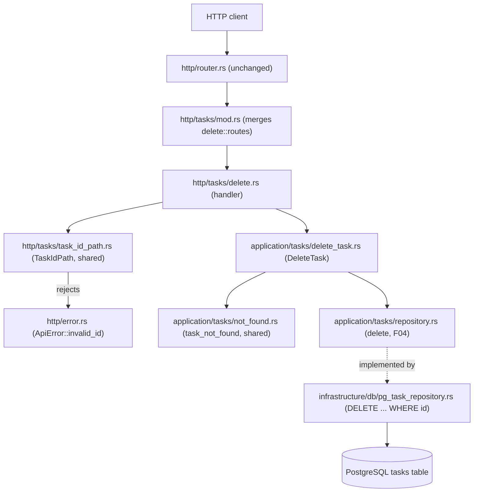

# Spec: Delete Task

## 1. Technical Overview

**What:** Add `DELETE /tasks/{id}`, which permanently removes one task and returns `204 No Content` with an empty body.

- **Application:** a `DeleteTask` use case calls the existing `TaskRepository::delete`, a single `DELETE … WHERE id = $1` that reports whether a row was removed. When nothing was removed, it reports the shared `task_not_found` error (`404 not_found`, `Task <id> not found`).
- **HTTP:** the shared `TaskIdPath` extractor rejects malformed ids with `400 invalid_id` before any database access.
- **Persistence:** no change.

**Why:** F04 delivered the delete operation and its SQL so the wave-3 features would not edit the same adapter. F05's spec defined the id-parsing and not-found helpers so `GET`, `PATCH` and `DELETE` share identical 400/404 bodies. F08 adds only the use case, the handler and the route. With it, every task endpoint the PRD lists exists.

**Scope:**

**Included:**
- Application: `DeleteTask` use case (`execute(TaskId) -> Result<(), AppError>`); the shared `task_not_found` helper (created here if F05 has not merged it yet; identical to the F05 spec).
- HTTP: `DELETE /tasks/{id}` returning `204` with an empty body; a `delete` route file merged into `src/http/tasks/mod.rs`; the shared `TaskIdPath` extractor (created here if F05 has not merged it yet; identical to the F05 spec).
- Database errors on the delete map through the existing classification (`503` when the pool cannot provide a connection, `500` otherwise; the cause is logged inside the request's span).
- Tests: use-case unit tests with an in-memory fake repository, and `tests/tasks_delete.rs` in-process integration tests.

**Excluded (owned elsewhere):**
- `GET /tasks/{id}` (F05), `GET /tasks` (F06), `PATCH /tasks/{id}` (F07), OpenAPI documentation of the delete operation (F10).
- Soft delete, trash, restore, bulk delete (PRD §7).
- Repository or schema changes (none needed).

**Input contracts (Consumes):**
- F04: the persisted task identifier and `TaskRepository::delete` (single statement; `true` when a row was removed).
- F01: `ApiError` / `AppError`, `map_sqlx_error`, router fallbacks, the body-limit middleware, `/__test/slow?hold_db=true`, the `#[sqlx::test]` harness.

**Output contracts (Provides):**
- Delete endpoint definition for F10: `DELETE /tasks/{id}`, path parameter `id` (`string`, `format: uuid`, hyphenated), responses `204` (empty body), `400` (`invalid_id`), `404` (`not_found`), plus the cross-cutting `503`/`500`.

## 2. Architecture Impact

**Affected components:**
- Modified: `src/application/tasks/mod.rs`, `src/http/tasks/mod.rs`, `README.md`, `CLAUDE.md`
- New: `src/application/tasks/delete_task.rs`, `src/http/tasks/delete.rs`
- Shared with F05/F07 (new unless F05 merged first, then reused unchanged): `src/http/tasks/task_id_path.rs`, `src/application/tasks/not_found.rs`, and `Display` for `TaskId` in `src/domain/task/task_entity.rs`
- New tests: `tests/tasks_delete.rs`
- Unchanged: `AppState`, `build_router`, `main.rs`, `TaskRepository`, `PgTaskRepository`, error types, migrations, `.sqlx/` (no new compile-checked statements; tests reuse `tests/common::{count_tasks, stored_task}`)



**Request flow (`DELETE /tasks/{id}`):**
1. The router's outer layers run first: request context, panic containment, body limit (a declared `Content-Length` over 65,536 gives `413`).
2. `TaskIdPath`: a malformed id gives `400 invalid_id`, and no query is executed.
3. `DeleteTask::execute(id)` calls `TaskRepository::delete`. `false` becomes `task_not_found(id)` and `404`. `true` becomes `204` with an empty body.
4. Pool failures give `503` with the row left intact. Anything else gives `500`, with the cause logged inside the request span.

## 3. Technical Decisions

| Decision | Chosen Approach | Alternative Considered | Trade-off |
|----------|----------------|----------------------|-----------|
| Shared helpers with F05/F07 | Reuse `TaskIdPath` and `task_not_found` exactly as specified in F05's spec; if F05 has not merged yet, add identical files | F08-private copies | One id-parsing and 404 implementation for GET/PATCH/DELETE. Parallel additions merge to one copy |
| Use case | `DeleteTask` struct built in the handler from `state.tasks` (same pattern as `CreateTask`) | Call the repository from the handler | Keeps `http → application → port`. No new `AppState` field |
| Existence check | The delete statement's affected-row count decides 204 vs 404 | `SELECT` then `DELETE` | One statement, no race between check and delete. A repeated delete naturally returns 404 |
| Request body | Ignored. The handler has no body extractor, so neither `Content-Type` nor a JSON body is required | Reject bodies on DELETE | Matches common HTTP practice. The body-limit middleware still applies to declared lengths |
| Verifying "no longer listed / no longer found" | Read the `tasks` table directly (row gone, row count down by one) | Call `GET /tasks/{id}` / `GET /tasks` | Those endpoints belong to F05/F06, siblings outside F08's dependency closure (same approach as F07) |
| Contract surfaces | `HTTP API` only | Service items for `DeleteTask` | No consumer outside this feature calls the use case |

### 3.1 Assumptions and Decisions

Item 1 is an interview answer. The rest are assumptions for review.

1. **Quality gates confirmed** (interview): `cargo fmt --check`, `cargo clippy --all-targets -- -D warnings`, `cargo test`, `SQLX_OFFLINE=true cargo build`.
2. **Success response** is `204` with no body and no `Content-Type` header.
3. **Hard delete:** the row is physically removed. There is no soft-delete column, and nothing else changes.
4. **Repeated deletes** of the same id return `404 not_found` after the first `204`.
5. **Id rules come from F05's spec:**
   - only the 36-character hyphenated form is accepted;
   - hex is case-insensitive and any version is allowed;
   - `400` with message `Task id must be a valid UUID` and `details: []`;
   - `404` with message `Task <lowercase id> not found` and `details: []`.
6. **Malformed ids never reach the database:** the parts extractor rejects them before the handler runs.
7. **Database errors:** pool exhaustion or an unreachable database gives `503 service_unavailable`. The single statement leaves the row intact. Any other SQL error gives `500 internal_error`, with the cause logged server-side by the existing `ApiError` conversion (inside the request span, so the log carries the request ID when F02 is present) and never returned.
8. **Routing:** `DELETE /tasks/{id}` merges with F05's `GET` and F07's `PATCH` on the same path. A method with no handler on `/tasks/{id}` (e.g. `POST`) gets `405 method_not_allowed`. `DELETE /tasks` (collection) is not supported and gets `405`, because `/tasks` has only `GET` (F06) and `POST` (F04).
9. **Concurrency:** two concurrent deletes of the same id give one `204` and one `404`. The database decides which.
10. **Test conventions** come from F01/F04: `#[sqlx::test]`, `tests/common::{test_router, send, request_with, assert_uniform_error, count_tasks, stored_task}`, `.env.test`. There are no fixture files and no mocks. No new SQL, so `.sqlx/` is unchanged.
11. **Scope:** full feature. There is no Core/Full split, and F04 is merged.

## 4. Component Overview

**Application:**

| File Path | New/Modified | Purpose | Key Responsibilities |
|-----------|--------------|---------|---------------------|
| `src/application/tasks/delete_task.rs` | New | Use case | `DeleteTask::new(Arc<dyn TaskRepository>)`, `execute(TaskId)`: `delete`, `false` → `task_not_found`, errors propagated unchanged |
| `src/application/tasks/not_found.rs` | New only if F05 has not merged | Shared helper | `task_not_found(TaskId)` as in the F05 spec |
| `src/application/tasks/mod.rs` | Modified | Tasks facade | declare and re-export `DeleteTask` (and `task_not_found` if added here) |

**Domain:**

| File Path | New/Modified | Purpose | Key Responsibilities |
|-----------|--------------|---------|---------------------|
| `src/domain/task/task_entity.rs` | Modified only if F05 has not merged | Entity | `Display` for `TaskId` (lowercase hyphenated), as in the F05 spec |

**HTTP:**

| File Path | New/Modified | Purpose | Key Responsibilities |
|-----------|--------------|---------|---------------------|
| `src/http/tasks/delete.rs` | New | Handler | `DELETE /tasks/{id}`: `TaskIdPath` → `DeleteTask` → `204`; its own `routes()` |
| `src/http/tasks/task_id_path.rs` | New only if F05 has not merged | Path extractor | `TaskIdPath` as in the F05 spec |
| `src/http/tasks/mod.rs` | Modified | Route module | declare `delete` (and `task_id_path` if added here); merge `delete::routes()` |

**Project files:**

| File Path | New/Modified | Purpose | Key Responsibilities |
|-----------|--------------|---------|---------------------|
| `README.md` | Modified | Developer docs | document `DELETE /tasks/{id}` with 204/400/404 examples |
| `CLAUDE.md` | Modified | Project guidance | status line (F08 done) |

**Tests:**

| File Path | New/Modified | Purpose | Key Responsibilities |
|-----------|--------------|---------|---------------------|
| `tests/tasks_delete.rs` | New | HTTP integration tests | every `DELETE /tasks/{id}` success and rejection path, in-process |

**Database:** no migrations and no new statements.

## 5. API Contracts

**Endpoint: Delete task**
- **Method:** DELETE
- **Path:** `/tasks/{id}`
- **Authentication:** none

**Path parameter:**

| Field | Type | Required | Validation | Description |
|-------|------|----------|------------|-------------|
| `id` | `string` (uuid) | Yes | exactly 36 characters, hyphenated 8-4-4-4-12, hex case-insensitive, any version | Task identifier |

No query parameters or request body are read.

**Request Example:**
```
DELETE /tasks/3f2b6f0e-6d4a-4c8e-9a0f-1b2c3d4e5f60
```

**Response (Success, 204):** empty body, no `Content-Type`.

**Unknown or already-deleted id (404):**
```json
{
  "error": {
    "code": "not_found",
    "message": "Task 3f2b6f0e-6d4a-4c8e-9a0f-1b2c3d4e5f60 not found",
    "details": []
  }
}
```

**Malformed id (400):**
```json
{
  "error": {
    "code": "invalid_id",
    "message": "Task id must be a valid UUID",
    "details": []
  }
}
```

**Error Codes:**

| Code | HTTP Status | Description |
|------|-------------|-------------|
| `invalid_id` | 400 | `{id}` is not a 36-character hyphenated UUID; no query executed |
| `not_found` | 404 | No task with that id (including one already deleted) |
| `method_not_allowed` | 405 | Method without a handler on `/tasks/{id}` |
| `payload_too_large` | 413 | Declared body length over 65,536 bytes (F01 middleware) |
| `service_unavailable` | 503 | Database unavailable; the row is left intact |
| `internal_error` | 500 | Unexpected SQL error; cause logged server-side only |

## 6. Data Model

No schema changes. The endpoint calls `PgTaskRepository::delete` (F04): `DELETE FROM tasks WHERE id = $1`. The affected-row count decides between `204` and `404`. The primary-key index makes the cost independent of table size.

## 7. Testing Strategy

**Test File Structure:**

| Test File | Test Type | Target | Coverage Goal |
|-----------|-----------|--------|---------------|
| `src/application/tasks/delete_task.rs` (`#[cfg(test)]`) | Unit (in-memory fake repository) | use-case flow | removed, not found, error propagation |
| `src/http/tasks/task_id_path.rs`, `src/application/tasks/not_found.rs` (`#[cfg(test)]`) | Unit | shared helpers | only when created by F08; the unit tests listed in the F05 spec |
| `tests/tasks_delete.rs` | Integration (in-process router, `#[sqlx::test]`) | `DELETE /tasks/{id}` | every success and rejection path |

**`src/application/tasks/delete_task.rs` unit tests:**

| Test Function | Description | Assertions |
|---------------|-------------|------------|
| `removed_task_returns_ok` | fake returns `true` | `Ok(())`, one `delete` call |
| `missing_task_is_not_found_with_message` | fake returns `false` | `NotFound("Task <id> not found")` |
| `unavailable_error_is_propagated` | fake returns `Unavailable` | same variant |
| `internal_error_is_propagated` | fake returns `Internal` | same variant (maps to the 500 body) |

**`tests/tasks_delete.rs`** (in-process router against a per-test database; three rows seeded through the repository):

| Test Function | Description | Assertions |
|---------------|-------------|------------|
| `existing_task_returns_204_with_empty_body` | delete one row | 204, zero-byte body, no `Content-Type` |
| `deleted_row_is_gone_and_count_drops_by_one` | delete one of three | `stored_task` is `None`, `count_tasks` is 2 |
| `other_tasks_are_untouched` | delete one of three | the other two rows equal their values before |
| `uppercase_id_deletes_the_task` | id uppercased | 204, row gone |
| `request_body_is_ignored` | JSON body, no `Content-Type` | 204 |
| `second_delete_returns_404` | delete twice | 404 with the id in the message |
| `unknown_id_returns_404_and_deletes_nothing` | random v4 | exact `not_found` body, three rows remain |
| `unknown_uppercase_id_reports_lowercase` | random v4 uppercased | message uses lowercase |
| `malformed_ids_return_400` | `abc`, 32-hex simple form | exact `invalid_id` body, three rows remain |
| `malformed_id_does_not_touch_the_database` | pool of 1 held by `/__test/slow?hold_db=true`, then `/tasks/abc` | 400 within 500 ms |
| `unavailable_database_returns_503_and_keeps_the_row` | pool of 1 held | exact `service_unavailable` body within 2.5 s; row present after release |
| `unsupported_method_returns_405` | `POST /tasks/{id}` | uniform `method_not_allowed` |

**Harness rules:** every database test is `#[sqlx::test]`. Pool-holding tests use `(PgPoolOptions, PgConnectOptions)` for a 1-connection pool with a 1 s acquire timeout.
