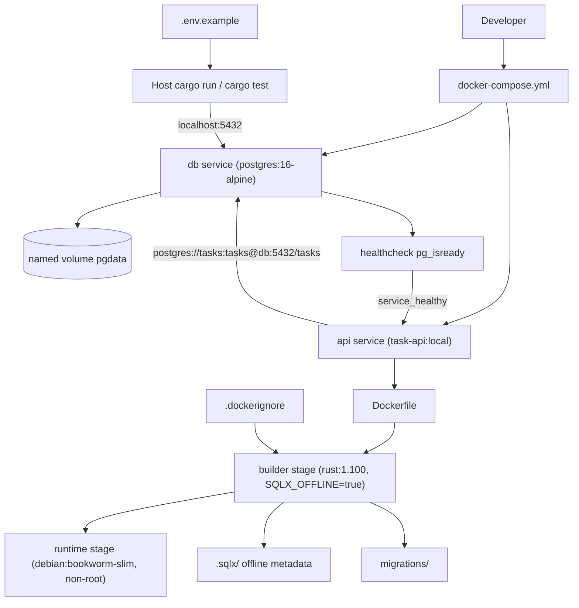

# Spec: Docker Compose Local Environment

## 1. Technical Overview

**What:** Add the container tooling that starts the whole stack with one command: a multi-stage `Dockerfile` that builds the `task-api` binary offline (`SQLX_OFFLINE=true`, using the committed `.sqlx/` metadata) and ships it in a non-root `debian:bookworm-slim` image under 150 MB; a `docker-compose.yml` with a `db` service (`postgres:16-alpine`, database/user/password `tasks`, port `5432`, named volume `pgdata`, `pg_isready` healthcheck) and an `api` service (built from the Dockerfile, `DATABASE_URL` pointing at `db`, port `8080`, started only after `db` is healthy, `restart: unless-stopped`); a `.dockerignore`; and a completed `.env.example`. `docker compose up db` starts only Postgres for host-based `cargo run` / `cargo test`; `docker compose down` keeps data and `docker compose down -v` wipes it. No Rust source changes.

**Why:** A new developer should reach a running API and database in minutes without installing PostgreSQL, and the same Postgres should be usable from the host for development and tests. Deterministic image and container names, a healthcheck-gated start order and explicit shutdown grace keep the stack predictable.

**Scope:**

**Included:**
- `Dockerfile` (multi-stage, dependency-layer caching, non-root runtime, exec-form entrypoint).
- `docker-compose.yml` (`db` and `api` services, `pgdata` volume, project name and image tag pinned).
- `.dockerignore` (excludes `target/`, `.git/`, local env files, `graft/`, `docs/`; never excludes `.sqlx/` or `migrations/`).
- `.env.example` completed with `LOG_FORMAT` and `LOG_LEVEL` (interview answer), so it lists all seven variables named by the PRD plus `ENABLE_TEST_ROUTES`.
- Static repository tests (`tests/docker_files.rs`) that guard the shape of these files inside `cargo test`.
- README and CLAUDE.md updates (commands, port requirements, running tests against the compose database).

**Excluded (owned elsewhere):**
- Rust code, migrations, endpoints, logging behavior (F01–F08). The logging variables are only documented here; their behavior is F02's.
- A container healthcheck for `api` (needs `/health`, F03).
- CI pipelines, registry publishing, Kubernetes manifests, TLS, secrets management (out of PRD scope).

**Input contracts (Consumes):** none declared in the PRD. F09 relies on F01's binary (`task-api`), its environment variables, the committed `.sqlx/` metadata and `migrations/`, and its startup behavior (applies migrations, binds `HOST:PORT`, exits 0 on SIGTERM within about 10 seconds).

**Output contracts (Provides):** none declared in the PRD.

## 2. Architecture Impact

**Affected components:**
- New: `Dockerfile`, `docker-compose.yml`, `.dockerignore`, `tests/docker_files.rs`
- Modified: `.env.example`, `README.md`, `CLAUDE.md`
- Unchanged on purpose: all of `src/`, `Cargo.toml`, `migrations/`, `.sqlx/`

**Startup flow:** `docker compose up --build` → build `api` image → start `db` → wait for its healthcheck (every 5 s, timeout 3 s, up to 10 retries) → start `api` → the service connects, applies migrations, logs `listening on 0.0.0.0:8080` → port 8080 published on the host. `docker compose up db` starts only the `db` service and publishes 5432.

## 3. Technical Decisions

| Decision | Chosen Approach | Alternative Considered | Trade-off |
|----------|----------------|----------------------|-----------|
| `/health` acceptance criterion | The contract proves the stack is up with a request F01 already serves (`GET /` → uniform 404) instead of `/health` (interview answer) | Assert `/health` returns 200 literally | Verifiable with F01 alone, so F09 does not depend on F03; the literal wording is covered once F03 exists |
| `.env.example` content | F09 delivers all seven lines, including `LOG_FORMAT=json` and `LOG_LEVEL=info` (interview answer) | Leave the two variables to F02 | The criterion is satisfiable by F09 alone; F02 adds the same two lines, so whichever PR merges second has a trivial conflict |
| Base images | Builder `rust:1.100`, runtime `debian:bookworm-slim` (as the PRD states) | Distroless / Alpine (musl) | Familiar glibc runtime with a shell for debugging; ~80 MB base, well under the 150 MB budget |
| Build caching | Dependencies are compiled in their own layer from the manifests and lockfile before the sources are copied | Single `COPY . .` build | Warm rebuilds recompile only the application, which keeps `up --build` inside the 120-second criterion once layers are cached |
| Start ordering | `depends_on: db: condition: service_healthy` | Retry loop in the application only | Compose enforces the order the PRD requires; F01's connection retries remain a second line of defense |
| Stable names | `name: task-api` project name and `image: task-api:local` for the `api` service | Directory-derived names | Container, network and volume names do not depend on the checkout directory, so scripts and checks can rely on them |
| Shutdown | `stop_grace_period: 15s` on `api` | Compose default (10 s) | The service drains for up to 10 s then closes the pool; 15 s avoids a `SIGKILL` race |

### 3.1 Assumptions and Decisions

Items 1–3 are interview answers; the rest are assumptions for review.

1. **Quality gates confirmed** (interview): `cargo fmt --check`, `cargo clippy --all-targets -- -D warnings`, `cargo test`, `SQLX_OFFLINE=true cargo build`. No wrapper script exists.
2. **Readiness probe** (interview): `GET /` answering the uniform 404 JSON body proves the API is listening; `/health` is the natural probe after F03.
3. **`.env.example`** (interview): F09 adds `LOG_FORMAT` and `LOG_LEVEL`.
4. **Scope:** full feature; F09 has no Core/Full split. Foundation state: F02 is still pending; the user accepted the parallel wave-2 conflict risk.
5. **Compose project name** `task-api`, image tag `task-api:local`, container names derived by Compose (`task-api-db-1`, `task-api-api-1`).
6. **`db` service:** `POSTGRES_DB=tasks`, `POSTGRES_USER=tasks`, `POSTGRES_PASSWORD=tasks`; port mapping `5432:5432`; volume `pgdata` mounted at the Postgres data directory; healthcheck command `pg_isready -U tasks -d tasks`, `interval: 5s`, `timeout: 3s`, `retries: 10`, no start period. The role created by the image is a superuser, so it can create and drop databases (needed by `#[sqlx::test]`).
7. **`api` service:** `DATABASE_URL=postgres://tasks:tasks@db:5432/tasks`, `HOST=0.0.0.0`, `PORT=8080` set explicitly; port mapping `8080:8080`; `restart: unless-stopped`; `stop_grace_period: 15s`; no `ENABLE_TEST_ROUTES` (the diagnostic routes stay off); no healthcheck (F03).
8. **`.env` is not read by Compose services:** the compose file uses explicit `environment:` entries only, so copying `.env.example` to `.env` (for host-based runs) never changes the containers.
9. **Runtime image:** non-root user `app` (uid 10001, no login shell), binary at `/usr/local/bin/task-api`, `EXPOSE 8080`, exec-form `ENTRYPOINT` so SIGTERM reaches the process; no `ca-certificates` or other packages are installed (the stack uses a plain-TCP database connection); `HOST` and `PORT` default to `0.0.0.0` and `8080` in the image environment.
10. **Builder:** `cargo build --release --locked` with `SQLX_OFFLINE=true` set in the image and no `DATABASE_URL`; the build context supplies `Cargo.toml`, `Cargo.lock`, `build.rs`, `src/`, `.sqlx/` and `migrations/`.
11. **`.dockerignore`** also excludes `.env`, `.env.*`, `graft/` and `docs/` beyond the PRD's two entries (keeps secrets and unrelated files out of the build context).
12. **Host port requirements:** 5432 and 8080 must be free on the host; this is documented in the README. Changing the host mapping is a manual edit.
13. **Running tests against the compose database:** with only `db` running, the dev database has no `tasks` table for compile-time query checking, so the documented command is `SQLX_OFFLINE=true cargo test` with `DATABASE_URL` taken from `.env.example`.
14. **Image size budget:** "150 MB" is measured as 150,000,000 bytes reported by `docker image inspect`.
15. **Static tests:** `tests/docker_files.rs` uses plain file reads and line checks (no YAML parser dependency); it complements, and does not replace, running Docker.

## 4. Component Overview

**Project files:**

| File Path | New/Modified | Purpose | Key Responsibilities |
|-----------|--------------|---------|---------------------|
| `Dockerfile` | New | Image build | multi-stage build (builder `rust:1.100` with dependency-layer caching and `SQLX_OFFLINE=true`; runtime `debian:bookworm-slim`); non-root user; exposes 8080; exec-form entrypoint `task-api` |
| `docker-compose.yml` | New | Local stack | project `task-api`; `db` and `api` services as in Section 3.1; named volume `pgdata`; healthcheck-gated start order |
| `.dockerignore` | New | Build context filter | exclude `target/`, `.git/`, `.env`, `.env.*`, `graft/`, `docs/`; keep `.sqlx/`, `migrations/`, `Cargo.lock` |
| `.env.example` | Modified | Configuration documentation | add `LOG_FORMAT=json` and `LOG_LEVEL=info` with defaults and valid values; keep the F01 variables |
| `README.md` | Modified | Developer docs | Docker section: `docker compose up --build`, `up db`, `down`, `down -v`, port requirements, running tests against the compose database |
| `CLAUDE.md` | Modified | Project guidance | status line, Docker commands, image/compose conventions |

**Tests:**

| File Path | New/Modified | Purpose | Key Responsibilities |
|-----------|--------------|---------|---------------------|
| `tests/docker_files.rs` | New | Static checks | guard the shape of `Dockerfile`, `docker-compose.yml`, `.dockerignore` and `.env.example` |

**Backend / Database:** no source or schema changes; no migrations; no `.sqlx/` changes.

## 5. API Contracts

F09 adds no HTTP endpoints. It publishes two network ports from the stack:

| Port | Service | Purpose |
|------|---------|---------|
| `5432` | `db` | PostgreSQL for host-based `cargo run` / `cargo test`; user, password and database all `tasks` |
| `8080` | `api` | The Task API as served by the `task-api` binary |

Compose interface:

| Command | Effect |
|---------|--------|
| `docker compose up --build` | Build `api`, start `db`, wait for healthy, start `api` |
| `docker compose up db` | Start only `db` (host port 5432) |
| `docker compose down` | Stop and remove containers; keep volume `pgdata` |
| `docker compose down -v` | As above and remove `pgdata` |

## 6. Data Model

No database changes: no tables, columns, indexes or migrations. The `pgdata` named volume persists the PostgreSQL data directory across `down` / `up`; `down -v` deletes it. Migrations are applied by the `api` service when it starts.

## 7. Testing Strategy

**Test File Structure:**

| Test File | Test Type | Target | Coverage Goal |
|-----------|-----------|--------|---------------|
| `tests/docker_files.rs` | Static (file reads) | `Dockerfile`, `docker-compose.yml`, `.dockerignore`, `.env.example` | every structural requirement that can be checked without Docker |

Behavior that needs the Docker daemon (stack startup order, persistence, image size, non-root process, offline build) is verified by running the commands themselves (see the contract); it is intentionally not part of `cargo test`.

**`tests/docker_files.rs`:**

| Test Function | Description | Assertions |
|---------------|-------------|------------|
| `dockerfile_is_multi_stage_with_required_bases` | read `Dockerfile` | at least two `FROM` lines; builder base is `rust:` with version ≥ 1.100; final base is `debian:bookworm-slim` |
| `dockerfile_builds_offline` | read `Dockerfile` | sets `SQLX_OFFLINE=true`; copies `.sqlx` and `migrations`; never sets `DATABASE_URL` |
| `dockerfile_runs_as_non_root` | read `Dockerfile` | a `USER` instruction after the final `FROM` that is neither `root` nor `0` |
| `dockerfile_uses_exec_form_entrypoint` | read `Dockerfile` | `ENTRYPOINT` is a JSON array starting with `task-api` (path allowed) |
| `compose_defines_db_service` | read `docker-compose.yml` | image `postgres:16-alpine`; `POSTGRES_DB`/`USER`/`PASSWORD` all `tasks`; `5432:5432`; volume `pgdata`; healthcheck with `pg_isready`, `interval: 5s`, `timeout: 3s`, `retries: 10` |
| `compose_defines_api_service` | read `docker-compose.yml` | build from `.`; `DATABASE_URL=postgres://tasks:tasks@db:5432/tasks`; `8080:8080`; `restart: unless-stopped`; `condition: service_healthy` |
| `compose_declares_named_volume` | read `docker-compose.yml` | top-level `volumes:` contains `pgdata` |
| `dockerignore_excludes_target_and_git` | read `.dockerignore` | contains `target/` and `.git/` |
| `dockerignore_keeps_build_inputs` | read `.dockerignore` | does not exclude `.sqlx`, `migrations` or `Cargo.lock` |
| `env_example_lists_all_variables` | read `.env.example` | assigns `DATABASE_URL`, `HOST`, `PORT`, `DATABASE_MAX_CONNECTIONS`, `DATABASE_ACQUIRE_TIMEOUT_SECS`, `LOG_LEVEL`, `LOG_FORMAT` |
| `env_example_documents_defaults` | read `.env.example` | `LOG_FORMAT=json`, `LOG_LEVEL=info`, `PORT=8080` |

**Harness rules:** the tests read files relative to `CARGO_MANIFEST_DIR`, need no database or Docker, and use no new dependencies.
