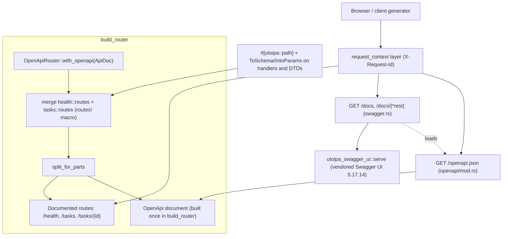

# Spec: OpenAPI Documentation and Swagger UI

## 1. Technical Overview

**What:** Generate an OpenAPI 3.1 document from code annotations (utoipa 5.x) for the six existing operations (`GET /health`, `POST /tasks`, `GET /tasks`, `GET /tasks/{id}`, `PATCH /tasks/{id}`, `DELETE /tasks/{id}`) and serve it at `GET /openapi.json`. Serve an interactive Swagger UI at `GET /docs`, with "Try it out" enabled, that loads `/openapi.json`. The document names nine schemas and carries field constraints, enum values, defaults, per-operation status codes and examples.

**Why:** Handlers and DTOs are the source of truth for request and response shapes. Annotating them, and registering routes through the same annotations, keeps the document in step with the router: a route cannot be served without being documented, and a test fails if one is. Doc-only schema types stay in the HTTP layer, so the domain stays free of framework code.

**Scope**

**Included:**
- `GET /openapi.json`: OpenAPI 3.1 JSON, `info.title = "Task API"`, `info.version` = crate version, tags `Tasks` (5 operations) and `Health` (1 operation), explicit `operationId`s.
- `GET /docs`, `GET /docs/` and `GET /docs/{*rest}`: vendored Swagger UI 5.17.14 assets served by our own handlers on top of `utoipa_swagger_ui::serve`. `/docs` answers 200 directly, with no redirect. Config: `url = "/openapi.json"`, `tryItOutEnabled = true`.
- Route registration through `utoipa_axum::router::OpenApiRouter` + `routes!` for every production route, so route paths come from `#[utoipa::path]`.
- Nine named component schemas: `Task`, `CreateTaskRequest`, `UpdateTaskRequest`, `TaskPage`, `TaskStatus`, `TaskPriority`, `ErrorResponse`, `ErrorDetail`, `HealthResponse`. Everything else is inline.
- Constraints: `minLength`/`maxLength` on titles, `maxLength: 5000` on descriptions, `format: uuid|date|date-time`, integer bounds, and defaults for `status`, `priority`, `sort`, `order`, `limit`, `offset`.
- Per-operation status codes (Section 3.1, item 3), request and response examples, and the `Location` header on `201`.
- Exclusion of `/openapi.json`, `/docs*` and `/__test/*` from the document.
- Integrated cross-cutting concerns: every docs response passes through the existing middleware stack, so it carries `X-Request-Id`, emits the completion log line, and gets the uniform `404`/`405` bodies.
- Guards: validation against the official OAS 3.1 JSON Schema, schema-versus-behavior conformance tests, and a static check that production routes go through `routes!`.

**Input contracts (Consumes, from the PRD):**
- F03: `GET /health`, fields `status`/`database`/`version`, statuses 200/503 (`src/http/health.rs`).
- F04: `POST /tasks`, create fields with defaults, task representation, statuses 201/400/415/422 (`src/http/tasks/create.rs`, `dto.rs`).
- F05: `GET /tasks/{id}`, UUID path parameter, statuses 200/400/404 (`get.rs`, `task_id_path.rs`).
- F06: `GET /tasks`, query parameters with allowed values and defaults, `TaskPage` envelope, statuses 200/400 (`list.rs`, `list_params.rs`, `page.rs`).
- F07: `PATCH /tasks/{id}`, patch fields with nullability rules, statuses 200/400/404/415/422 (`update.rs`, `dto.rs`).
- F08: `DELETE /tasks/{id}`, statuses 204/400/404 (`delete.rs`).

**Output contracts:** `GET /openapi.json` (machine-readable spec for client generators) and `GET /docs` (interactive explorer). No later feature consumes them.

**Excluded:** hand-written YAML/JSON specs; documenting `405` or global-middleware `413` on bodyless operations; `servers` entries (Try it out uses the page's own origin); authentication schemes (the API has none); a config flag to disable the docs routes (always on).

## 2. Architecture Impact

Affected components:
- `src/http/openapi/` (new): document root, doc-only schema types, docs routes, and Swagger UI handlers.
- `src/http/router.rs`: composes an `OpenApiRouter`, splits it into `(Router, OpenApi)`, and mounts the docs routes and test routes outside the documented part.
- `src/http/health.rs` and `src/http/tasks/*.rs`: `#[utoipa::path]` on handlers; `routes()` returns `OpenApiRouter<AppState>` and registers with `routes!`.
- `src/http/tasks/dto.rs`, `page.rs`, `list_params.rs`, `src/http/error.rs`, `src/http/health.rs`: `ToSchema`/`IntoParams` derives with field-level schema attributes.
- `tests/architecture.rs`, `tests/common/mod.rs`, new `tests/openapi.rs`, `tests/openapi_conformance.rs`, `tests/fixtures/openapi-3.1-schema.json`.



Dependency direction is unchanged: `utoipa` is referenced only under `src/http`. The domain and application layers never mention it, and `tests/architecture.rs` enforces this.

## 3. Technical Decisions

| Decision | Chosen Approach | Alternative Considered | Trade-off |
|----------|----------------|----------------------|-----------|
| Route ↔ spec drift (interview) | `utoipa-axum` `OpenApiRouter`: every production `routes()` registers handlers with `routes!(handler)`, so the axum path comes from `#[utoipa::path(path = …)]`. `build_router` calls `split_for_parts()`. A static guard in `tests/architecture.rs` rejects plain `.route(` / `.route_service(` / `.nest(` / `.nest_service(` in production `src/http` code outside `test_routes.rs` and `src/http/openapi/` | Keep axum `Router`, list handlers in `#[openapi(paths(…))]`, and probe a hand-written route table | Adds dependency `utoipa-axum 0.2` (built for axum 0.8 and utoipa 5). A route cannot be served undocumented without also tripping the guard, and there is no second list to maintain |
| `/docs` behaviour (interview) | Own handlers for `GET /docs`, `GET /docs/` and `GET /docs/{*rest}` using `utoipa_swagger_ui::serve`. For `index.html`, `<base href="/docs/">` is injected right after `<head>` so the relative asset URLs resolve under `/docs/` | Stock `Router::from(SwaggerUi::new("/docs"))`, which answers `/docs` with `303 → /docs/` | About 40 lines of our own code, but `GET /docs` is a literal 200, as the AC requires |
| Swagger UI assets | `utoipa-swagger-ui = { version = "9.0.2", features = ["axum", "vendored"] }`. The axum feature is used only for its types; routing is ours | Default build-time download of the Swagger UI zip from GitHub | Builds (local, CI, Docker) never reach GitHub. The binary grows by about 3 MB of embedded assets, well within the 150 MB image budget |
| Documented status codes (interview) | PRD "Provides" codes plus each operation's own operational codes (Section 3.1, item 3) | Exactly the Provides codes; or every code the stack can emit everywhere | Reflects real behavior (`413` on body endpoints, `503`/`500` on DB-backed endpoints) without listing path-level `405` or `413` on bodyless endpoints |
| Validator in tests (interview) | Dev-dependency `jsonschema 0.30` (`default-features = false`, so no HTTP or file resolution) validates the served document against the official OAS 3.1 schema `2022-10-07`, committed as `tests/fixtures/openapi-3.1-schema.json` | Structural asserts only | A real validator in `cargo test`. Verified in a scratch project: a utoipa 5.5 document passes and a document with `responses: "nope"` fails |
| Enum schemas | Doc-only HTTP types `TaskStatusSchema`/`TaskPrioritySchema` published as `TaskStatus`/`TaskPriority`. DTO `String` fields point to them with `value_type`. A unit test checks that every schema value parses with the domain parser and that counts match (3 and 3) | `ToSchema` on the domain enums | Domain stays framework-free (clean-arch). Drift is caught by the unit test |
| Schema names | Rust types keep their names; published names are set with `#[schema(as = …)]`: `TaskResponse → Task`, `TaskPageResponse → TaskPage`, `ErrorEnvelope → ErrorResponse`. `components.schemas` holds exactly the nine PRD names. `ErrorBody`, `ErrorCode`, health enums, and `sort`/`order` enums are inline | Rename the Rust types | No churn in F04–F08 code. Exactly nine names gives a simple, exact test |
| Serialization ↔ schema single source | `ToSchema` is derived on the real response/error types (`TaskResponse`, `TaskPageResponse`, `ErrorEnvelope`/`ErrorBody`/`ErrorDetail`, `HealthResponse`). Only enums and `UpdateTaskRequest`'s three-state fields use `value_type` overrides | Parallel doc-only mirror structs | A field added to a response type appears in the document automatically |
| Comma-separated filters | `status`/`priority` query params documented as `type: array` (items → `TaskStatus`/`TaskPriority`), `style: form`, `explode: false` | `type: string` with a regex `pattern` | The idiomatic OpenAPI encoding of `status=todo,in_progress`. Swagger UI and client generators build the comma-joined form |
| Operation IDs and tags | `operationId`s `createTask`, `listTasks`, `getTask`, `updateTask`, `deleteTask`, `getHealth`; top-level `tags` `[Tasks, Health]` in that order | utoipa defaults (handler function names) | Stable names for generated clients, independent of Rust function names |
| `servers` | Omitted | `http://localhost:8080` | Try it out targets the origin that served `/docs`, so it works on any host and port (cargo run, Compose) |
| Cross-feature ACs (interview) | The five PRD §9 cross-feature ACs that name F10 are covered by F10's contract with schema-versus-behavior items | Drop them, as earlier features did | F10 is the only feature whose deliverable they verify, and every feature they mention is in F10's dependency closure |
| Contract surfaces (interview) | `HTTP API` + `UI` (headless browser) + `Build` (route guard and manifest facts, following the F01/F09 precedent) | HTTP only | Real rendering and Try-it-out checks. `cargo test` covers the HTTP side only; no browser crate is added |

### 3.1 Assumptions and Decisions

Items 1–7 are interview answers. The rest are assumptions for review.

1. **Quality gates confirmed** (interview): `cargo fmt --check`, `cargo clippy --all-targets -- -D warnings`, `cargo test`, `SQLX_OFFLINE=true cargo build`. No wrapper script exists in the repo.
2. **`/docs` answers 200 directly** (interview). `/docs/` returns the same HTML. Unknown files under `/docs/` return the uniform `404 not_found` "Route not found". A `serve` error (corrupt embedded asset) returns `500 internal_error`, with the cause logged.
3. **Documented status codes** (interview):

   | Operation | Documented responses |
   |---|---|
   | `GET /health` | 200, 503 (both `HealthResponse`) |
   | `POST /tasks` | 201, 400, 413, 415, 422, 500, 503 |
   | `GET /tasks` | 200, 400, 500, 503 |
   | `GET /tasks/{id}` | 200, 400, 404, 500, 503 |
   | `PATCH /tasks/{id}` | 200, 400, 404, 413, 415, 422, 500, 503 |
   | `DELETE /tasks/{id}` | 204, 400, 404, 500, 503 |

   Every 4xx/5xx of a task operation has `application/json` content with `$ref: ErrorResponse`. `204` has no content. `201` documents the `Location` header.
4. **Drift guard via utoipa-axum** (interview). The static guard skips comment lines and stops reading a file at its first `#[cfg(test)]` line (existing unit tests such as `task_id_path.rs` build plain routers inside test modules).
5. **Validator** (interview): `jsonschema` dev-dependency + fixture `tests/fixtures/openapi-3.1-schema.json` (official OAS 3.1 JSON Schema, `$id` `https://spec.openapis.org/oas/3.1/schema/2022-10-07`, committed verbatim).
6. **Cross-feature ACs in F10** (interview).
7. **Surfaces HTTP API + UI** (interview), plus `Build` for repository-level facts.
8. **New dependencies** (justified per CLAUDE.md): `utoipa = { version = "5.5", features = ["uuid"] }` (`uuid` enables `KnownFormat::Uuid`), `utoipa-axum = "0.2"`, `utoipa-swagger-ui = { version = "9.0.2", features = ["axum", "vendored"] }`. Dev: `jsonschema = { version = "0.30", default-features = false }`. All resolve to a single `axum 0.8.x` (checked in a scratch project). `tests/architecture.rs::manifest_pins_the_mandated_stack` is unaffected.
9. **Constraint wording:** JSON Schema cannot express "after trimming". `title`'s `description` says "1–200 characters after trimming whitespace"; the numeric constraints are the bounds of the trimmed value. `UpdateTaskRequest` has no `minProperties`: unknown fields do not count, so the "at least one updatable field" rule goes in the schema `description`.
10. **Create-request nullability:** `status` and `priority` are documented as non-nullable with defaults. The server's tolerance of `null` (treated as absent) is not advertised. `description` and `due_date` admit `null`. `title` is `required` and non-nullable.
11. **Task schema:** all eight properties `required`. `description` and `due_date` admit `null`. Timestamps are `format: date-time`, with "RFC 3339 UTC, millisecond precision" in their descriptions.
12. **Examples:** POST request `{"title":"Write PRD","priority":"high","due_date":"2026-12-01"}` (PRD F04 Experience); PATCH request `{"status":"done"}` (PRD F07 Experience); every success response with a body has an example; DELETE carries an example on its `404` response and on the `id` parameter; every example validates against its schema.
13. **Doc routes accept GET only.** Other methods get the uniform `405` from the existing `method_not_allowed_fallback`. `/openapi.json` is serialized from the document built once in `build_router` (held in an `Arc`), with `Content-Type: application/json`.
14. **Spec independent of `ENABLE_TEST_ROUTES`.** Test routes are merged after `split_for_parts`, so the document is byte-identical with the flag on or off.
15. **No `servers`, no `security`, no `license`** in the document. `info.description` comes from the crate description (utoipa default).
16. **Docker:** no Dockerfile change. `vendored` embeds the assets from crates.io, and `tests/docker_files.rs` still holds.

## 4. Component Overview

**HTTP — new**

| File Path | New/Modified | Purpose | Key Responsibilities |
|-----------|--------------|---------|---------------------|
| `src/http/openapi/mod.rs` | New | Document root and docs routes | `ApiDoc` (`#[derive(OpenApi)]`: info title, tags `Tasks`/`Health` with descriptions, `components(schemas(…))` for the nine names); `docs_routes(OpenApi) -> Router<AppState>` mounting `GET /openapi.json` (serves the `Arc` document) and the Swagger UI routes |
| `src/http/openapi/schemas.rs` | New | Doc-only schema types | `TaskStatusSchema` (as `TaskStatus`), `TaskPrioritySchema` (as `TaskPriority`), inline `HealthState {ok, degraded}`, `DatabaseState {up, down}`, `SortFieldSchema`, `SortOrderSchema`; unit test: schema enum values == domain-accepted values |
| `src/http/openapi/swagger.rs` | New | Swagger UI handlers | `Arc<utoipa_swagger_ui::Config>` (`url = "/openapi.json"`, `try_it_out_enabled(true)`); handlers for `/docs`, `/docs/`, `/docs/{*rest}` mapping `serve` results to 200 (with the file's content type), uniform 404 (`None`) or uniform 500 (`Err`, logged); `<base href="/docs/">` injection into `index.html`; unit tests for the injection |

**HTTP — modified**

| File Path | New/Modified | Purpose | Key Responsibilities |
|-----------|--------------|---------|---------------------|
| `src/http/mod.rs` | Modified | Module tree | `pub mod openapi;` |
| `src/http/router.rs` | Modified | Composition | `OpenApiRouter::with_openapi(ApiDoc::openapi())` → merge `health::routes()`, `tasks::routes()` → `split_for_parts()` → merge `openapi::docs_routes(doc)` → optional `test_routes::routes()` → existing fallbacks and layers (order unchanged). `build_router` signature unchanged |
| `src/http/health.rs` | Modified | Health operation | `#[utoipa::path(get, path = "/health", tag = "Health", operation_id = "getHealth", responses(200, 503 → HealthResponse with examples))]`; `HealthResponse: ToSchema` (inline enums via `value_type`); `routes() -> OpenApiRouter<AppState>` via `routes!(health)` |
| `src/http/tasks/mod.rs` | Modified | Task routes | `routes() -> OpenApiRouter<AppState>` merging the five endpoint routers |
| `src/http/tasks/create.rs` | Modified | POST operation | `#[utoipa::path(post, path = "/tasks", tag = "Tasks", operation_id = "createTask", request_body(content = CreateTaskRequest, example = …), responses(201 Task + Location header, 400, 413, 415, 422, 500, 503))]`; `routes!` |
| `src/http/tasks/list.rs` | Modified | List operation | `#[utoipa::path(get, path = "/tasks", operation_id = "listTasks", params(ListTasksQuery), responses(200 TaskPage, 400, 500, 503))]`; `routes!` |
| `src/http/tasks/get.rs` | Modified | Get operation | `operation_id = "getTask"`, `params(("id" = String, Path, format = Uuid, example = …))`, responses 200/400/404/500/503; `routes!` |
| `src/http/tasks/update.rs` | Modified | Patch operation | `operation_id = "updateTask"`, id param, `request_body(UpdateTaskRequest, example = {"status":"done"})`, responses 200/400/404/413/415/422/500/503; `routes!` |
| `src/http/tasks/delete.rs` | Modified | Delete operation | `operation_id = "deleteTask"`, id param, responses 204 (no body)/400/404 (with example)/500/503; `routes!` |
| `src/http/tasks/dto.rs` | Modified | Request/response schemas | `ToSchema` on `CreateTaskRequest`, `UpdateTaskRequest` (three-state fields via `value_type`; no `required`), `TaskResponse` (`as = Task`) with the constraints in Section 5.3 |
| `src/http/tasks/page.rs` | Modified | Envelope schema | `TaskPageResponse: ToSchema` (`as = TaskPage`), integer bounds on `total`/`limit`/`offset` |
| `src/http/tasks/list_params.rs` | Modified | Query param docs | Doc-only `ListTasksQuery: IntoParams` (`parameter_in = Query`) with the six optional parameters; a unit test checks that its documented bounds and defaults equal the parser constants (`LIMIT_MIN`…`OFFSET_MAX`, `TaskQuery::default()`) |
| `src/http/error.rs` | Modified | Error schemas | `ErrorEnvelope: ToSchema` (`as = ErrorResponse`), `ErrorBody` inline, `ErrorCode` inline string enum (10 values), `ErrorDetail: ToSchema` |

**Build / docs**

| File Path | New/Modified | Purpose | Key Responsibilities |
|-----------|--------------|---------|---------------------|
| `Cargo.toml` / `Cargo.lock` | Modified | Dependencies | the four crates in Section 3.1, item 8 |
| `README.md` | Modified | Developer docs | "API documentation" section: `/docs`, `/openapi.json`, client-generation hint; new endpoints must use `#[utoipa::path]` + `routes!` |
| `CLAUDE.md` | Modified | Project guidance | status line (F10), `src/http/openapi/` in Architecture, route-registration convention and guard |

**Tests**

| File Path | New/Modified | Purpose | Key Responsibilities |
|-----------|--------------|---------|---------------------|
| `tests/fixtures/openapi-3.1-schema.json` | New | Validator schema | official OAS 3.1 JSON Schema `2022-10-07`, verbatim |
| `tests/common/mod.rs` | Modified | Helpers | `openapi_spec(&Router) -> Value`; `resolve(&spec, "$ref") -> &Value`; `validate_against(&spec, "Task", &body) -> Result<(), Vec<String>>` (root = spec plus top-level `$ref` to the component, compiled with `jsonschema`) |
| `tests/openapi.rs` | New | Document tests (no DB) | Section 7 |
| `tests/openapi_conformance.rs` | New | Schema ↔ behavior (`#[sqlx::test]`) | Section 7 |
| `tests/architecture.rs` | Modified | Static guards | `domain` and `application` do not reference `utoipa`; production routes go through `routes!` |

## 5. API Contracts

### 5.1 `GET /openapi.json`

- **Method/Path:** `GET /openapi.json` · **Auth:** none · **Request:** none
- **200:** `Content-Type: application/json`, body = the OpenAPI document. Carries `X-Request-Id`.
- **Errors:** other methods → `405 method_not_allowed` (uniform body); body > 64 KB → `413` (global middleware).

Excerpt of the expected document:

```json
{
  "openapi": "3.1.0",
  "info": { "title": "Task API", "version": "0.1.0", "description": "Task API: a small REST service for managing tasks (axum + sqlx + PostgreSQL)" },
  "tags": [
    { "name": "Tasks", "description": "Create, read, list, update and delete tasks" },
    { "name": "Health", "description": "Service and database health" }
  ],
  "paths": {
    "/tasks/{id}": {
      "patch": {
        "tags": ["Tasks"],
        "operationId": "updateTask",
        "parameters": [{ "name": "id", "in": "path", "required": true, "schema": { "type": "string", "format": "uuid" }, "example": "3f2b6a1c-8d4e-4f7a-9b2c-1e5d7a9c0b3f" }],
        "requestBody": { "required": true, "content": { "application/json": { "schema": { "$ref": "#/components/schemas/UpdateTaskRequest" }, "example": { "status": "done" } } } },
        "responses": {
          "200": { "description": "Updated task", "content": { "application/json": { "schema": { "$ref": "#/components/schemas/Task" }, "example": { "…": "…" } } } },
          "400": { "description": "Malformed id or JSON", "content": { "application/json": { "schema": { "$ref": "#/components/schemas/ErrorResponse" } } } },
          "404": { "…": "…" }, "413": { "…": "…" }, "415": { "…": "…" }, "422": { "…": "…" }, "500": { "…": "…" }, "503": { "…": "…" }
        }
      }
    }
  },
  "components": {
    "schemas": {
      "Task": {
        "type": "object",
        "required": ["id", "title", "description", "status", "priority", "due_date", "created_at", "updated_at"],
        "properties": {
          "id": { "type": "string", "format": "uuid" },
          "title": { "type": "string", "minLength": 1, "maxLength": 200 },
          "description": { "type": ["string", "null"], "maxLength": 5000 },
          "status": { "$ref": "#/components/schemas/TaskStatus" },
          "priority": { "$ref": "#/components/schemas/TaskPriority" },
          "due_date": { "type": ["string", "null"], "format": "date" },
          "created_at": { "type": "string", "format": "date-time" },
          "updated_at": { "type": "string", "format": "date-time" }
        }
      },
      "TaskStatus": { "type": "string", "enum": ["todo", "in_progress", "done"] }
    }
  }
}
```

(Exact JSON layout, such as `allOf` wrapping a `$ref` that carries a `default`, is whatever utoipa emits. The contract states the semantic requirements.)

### 5.2 `GET /docs`, `GET /docs/`, `GET /docs/{*rest}`

| Request | Response |
|---|---|
| `GET /docs` | `200`, `text/html; charset=utf-8`, Swagger UI `index.html` with `<base href="/docs/">` injected after `<head>`; no `Location` header |
| `GET /docs/` | same as `/docs` |
| `GET /docs/swagger-initializer.js` | `200` JavaScript; embeds the config with `"url": "/openapi.json"` and `"tryItOutEnabled": true` |
| `GET /docs/swagger-ui.css`, `/docs/swagger-ui-bundle.js`, … | `200` with the content type guessed from the extension |
| `GET /docs/<unknown file>` | `404 {"error":{"code":"not_found","message":"Route not found","details":[]}}` |
| any other method | `405 method_not_allowed` |

All carry `X-Request-Id`. None appear in `/openapi.json`.

### 5.3 Documented schemas

| Schema | Shape and constraints |
|---|---|
| `TaskStatus` | `type: string`, `enum: [todo, in_progress, done]` |
| `TaskPriority` | `type: string`, `enum: [low, medium, high]` |
| `Task` | Section 5.1 excerpt; title description notes trimming; timestamps note millisecond UTC |
| `CreateTaskRequest` | `required: [title]`; `title` string 1–200; `description` string\|null ≤ 5000; `status` → `TaskStatus`, `default: todo`, non-null; `priority` → `TaskPriority`, `default: medium`, non-null; `due_date` string\|null `format: date`. Description: unknown fields ignored; `id`/timestamps server-generated |
| `UpdateTaskRequest` | no `required`; `title` string (non-null) 1–200; `description` string\|null ≤ 5000 (`null` clears); `status` → `TaskStatus` non-null; `priority` → `TaskPriority` non-null; `due_date` string\|null `format: date` (`null` clears). Description: at least one updatable field must be provided |
| `TaskPage` | `required: [items, total, limit, offset]`; `items` array of `Task`; `total` integer `minimum: 0`; `limit` integer 1–100; `offset` integer 0–10000 |
| `ErrorResponse` | `required: [error]`; `error` inline object `required: [code, message, details]`; `code` string enum of the 10 codes in `error.rs`; `message` string; `details` array of `ErrorDetail` |
| `ErrorDetail` | `required: [field, message]`, both strings |
| `HealthResponse` | `required: [status, database, version]`; `status` enum `[ok, degraded]`; `database` enum `[up, down]`; `version` string |

### 5.4 Parameters

| Operation | Name | In | Required | Schema |
|---|---|---|---|---|
| `GET /tasks` | `status` | query | no | `array`, items → `TaskStatus`; `style: form`, `explode: false` |
| `GET /tasks` | `priority` | query | no | `array`, items → `TaskPriority`; `style: form`, `explode: false` |
| `GET /tasks` | `sort` | query | no | string enum `[created_at, updated_at, due_date, priority]`, `default: created_at` |
| `GET /tasks` | `order` | query | no | string enum `[asc, desc]`, `default: desc` |
| `GET /tasks` | `limit` | query | no | integer `minimum: 1`, `maximum: 100`, `default: 20` |
| `GET /tasks` | `offset` | query | no | integer `minimum: 0`, `maximum: 10000`, `default: 0` |
| `GET/PATCH/DELETE /tasks/{id}` | `id` | path | yes | string `format: uuid`; description "36-character hyphenated UUID" |

### 5.5 Error codes introduced

None. Docs routes reuse `not_found` (404, unknown asset), `method_not_allowed` (405), `payload_too_large` (413) and `internal_error` (500, asset serve failure).

## 6. Data Model

No changes. No migration, no query, no `.sqlx/` regeneration (the conformance tests insert rows only through the HTTP API, or through the existing compile-checked helpers if needed).

## 7. Testing Strategy

| Test File | Test Type | Target | Coverage Goal |
|-----------|-----------|--------|---------------|
| `src/http/openapi/schemas.rs` (`#[cfg(test)]`) | Unit | enum schemas vs domain parsers | every value |
| `src/http/openapi/swagger.rs` (`#[cfg(test)]`) | Unit | base-href injection, serve mapping | index, asset, missing file |
| `src/http/tasks/list_params.rs` (`#[cfg(test)]`) | Unit | doc bounds/defaults vs parser constants | all six params |
| `tests/openapi.rs` | Integration, in-process (`test_router`; `#[sqlx::test]` or a lazily connected pool — no query runs) | document content, docs routes | every rule in Section 5 |
| `tests/openapi_conformance.rs` | Integration, `#[sqlx::test]` | schema ↔ live behavior | every cross-feature claim |
| `tests/architecture.rs` | Static | layer isolation, route guard | all production `src/http` files |

**`tests/openapi.rs`**

| Test Function | Description | Assertions |
|---------------|-------------|------------|
| `openapi_json_is_openapi_3_1_json` | GET /openapi.json | 200, `application/json`, `openapi == "3.1.0"`, `X-Request-Id` present |
| `info_title_and_version` | info block | title `Task API`, version == `CARGO_PKG_VERSION` |
| `document_validates_against_oas_3_1_schema` | fixture validation | zero `jsonschema` errors |
| `every_ref_resolves` | walk all `$ref`s | each points to an existing `#/components/schemas/*` |
| `docs_and_test_routes_are_excluded` | router with `test_routes = true` | paths == `{/health, /tasks, /tasks/{id}}`; document equals the `test_routes = false` one |
| `exactly_six_operations` | method × path set | the six pairs, nothing else |
| `tags_and_operation_ids` | tags | `[Tasks, Health]`; per-op tags; the six operationIds |
| `documented_statuses_per_operation` | responses keys | table in Section 3.1, item 3 |
| `error_responses_reference_error_response` | content refs | 4xx/5xx → `ErrorResponse`; health → `HealthResponse`; 204 no content; 201 `Location` header |
| `exactly_nine_component_schemas` | components | the nine names |
| `enum_schemas` | TaskStatus/TaskPriority | exact values |
| `task_schema_constraints` / `create_request_schema` / `update_request_schema_nullability` / `task_page_schema` / `error_and_health_schemas` | Section 5.3 | each property's type, nullability, bounds, format, default |
| `list_query_parameters` / `id_path_parameter` | Section 5.4 | names, `in`, required, schema, style/explode |
| `every_operation_has_an_example` / `request_examples` / `examples_validate_against_schemas` | examples | presence, PRD values, each validates |
| `docs_returns_html_without_redirect` / `docs_slash_returns_html` | /docs, /docs/ | 200, `text/html`, `id="swagger-ui"`, no `Location`, `X-Request-Id` |
| `initializer_points_to_openapi_json_with_try_it_out` | initializer JS | `/openapi.json`, `tryItOutEnabled: true` |
| `referenced_assets_are_served` / `unknown_docs_asset_is_404` / `docs_routes_reject_post` | assets, errors | 200 + content types; uniform 404; uniform 405 |

**`tests/openapi_conformance.rs`** (`#[sqlx::test]`; uses `validate_against`)

| Test Function | Description | Assertions |
|---------------|-------------|------------|
| `every_documented_operation_is_routed` | send each documented op (DELETE last) | no `Route not found`, no 405, status ∈ documented set |
| `health_200_and_503_match_schema` | normal pool, then a 1-connection pool held via `/__test/slow?hold_db=true` | 200/503 bodies validate against `HealthResponse`; keys == properties |
| `post_example_from_spec_returns_201` | POST the spec's request example verbatim | 201, `Location`, echoed fields |
| `task_response_matches_task_schema_and_defaults` | POST `{"title":"Write PRD"}` | keys == `Task` properties; validates; status/priority == documented defaults |
| `documented_boundaries_are_accepted` / `values_outside_documented_constraints_are_rejected` | 200/5000 chars accepted; 201/5001, `DONE`, `urgent`, `2026-02-30` rejected | 201; 422 with five details in field order |
| `get_and_delete_statuses_are_documented` | 200/400/404 and 204/400/404 | each observed status is documented; error bodies validate against `ErrorResponse` |
| `list_defaults_match_documented_defaults` / `documented_sort_and_order_values_are_accepted` / `undocumented_values_are_rejected` / `comma_separated_filters_work_as_documented` | GET /tasks | echoed limit/offset == defaults; 200 for every documented value; 400 with six details; filtered `total` |
| `patch_nullable_fields_clear` / `patch_non_nullable_fields_reject_null` | PATCH | 200 with nulls; 422 `cannot be null` ×3, row unchanged |

**`tests/architecture.rs` additions:** `domain_and_application_do_not_reference_utoipa`; `production_routes_are_registered_through_routes_macro` (scan `src/http/**/*.rs` except `test_routes.rs` and `openapi/`, skip comments, stop at `#[cfg(test)]`, fail on `.route(`, `.route_service(`, `.nest(`, `.nest_service(`, naming file:line).

**UI (not in `cargo test`):** a headless browser opens `/docs`, checks the title, version, the two tag groups and their operation counts, then runs the POST example through Try it out and expects 201 (see contract `UI-*` items).
