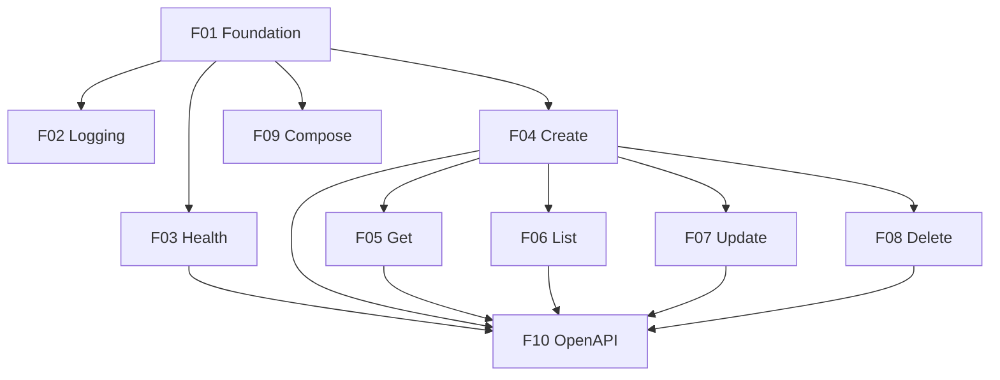

# Task API

## 1. Executive Summary

Task API is a small, self-contained REST service for managing a single shared list of tasks. It is written in Rust on top of axum, uses sqlx for compile-time-checked SQL, and persists data in PostgreSQL. Clients can create, read, list, partially update, and delete tasks. Each task carries a title, an optional description, a workflow status (`todo`, `in_progress`, `done`), a priority (`low`, `medium`, `high`), and an optional due date.

The product serves two audiences. Developers building frontends, scripts, or integrations get a predictable JSON API with filtering, sorting, pagination, consistent error responses, and interactive OpenAPI documentation. Rust backend developers get a clean, layered reference service that they can run locally with one command, extend safely, and use as a template for future sqlx + Postgres services.

At a high level, the service starts from environment configuration, connects to PostgreSQL, and applies its schema migrations automatically. It then exposes 5 task endpoints, a health endpoint, and API documentation over HTTP. Every response carries a request ID, every request produces a structured JSON log line, and the entire stack (API + database) starts with `docker compose up`.

## 2. Problem and Opportunity

### The Problem

**No simple programmatic task store**
- Lightweight task tracking often lives in spreadsheets, chat messages, or notes apps that offer no HTTP interface for scripts or custom frontends.
- Hosted task tools come with accounts, workspaces, and rate-limited APIs. That overhead is excessive for a single team's or a single tool's internal list.
- Without a stable API contract, every consumer re-implements parsing and error handling for ad-hoc formats.

**High boilerplate cost for new Rust + sqlx + Postgres services**
- Wiring axum, sqlx pooling, migrations, configuration, error mapping, and graceful shutdown from scratch typically takes 1–2 developer-days before the first business endpoint ships.
- Without a reference layout, domain logic, SQL, and HTTP concerns get mixed in handlers, making services hard to test and extend.
- Compile-time-checked queries (`sqlx::query!`) are often abandoned because the offline build setup (`.sqlx/` metadata) is unfamiliar, which loses one of sqlx's main safety benefits.

**Bad data from weak validation**
- APIs that accept any string for status or priority accumulate inconsistent values (`"Done"`, `"finished"`, `"DONE"`) that break filters and reports.
- Validation that stops at the first error forces clients into multiple round trips to fix a single payload.
- Without database-level constraints, any bug in application code can persist invalid rows.

**Opaque, undiscoverable services**
- Without request IDs and structured logs, a failing client request cannot be correlated with server-side logs.
- Without machine-readable API docs, consumers guess at field names, enums, and error formats, and break when they change.
- Without a health endpoint, orchestration tools and developers cannot tell "API up but DB down" from "API down".

### The Opportunity

- **No simple programmatic task store** → A focused REST API for tasks with full CRUD, filtering by status and priority, sorting, and paginated listing, with no accounts or tenancy overhead.
- **High boilerplate cost** → A clean-architecture Rust service (domain / application / infrastructure / HTTP layers) with config, pooling, automatic migrations, graceful shutdown, compile-time-checked queries with committed offline metadata, and a one-command Docker Compose environment. It doubles as a template for future services.
- **Bad data** → Strict enums, length limits, and date formats are enforced both in the domain layer and by PostgreSQL `CHECK` constraints. Validation reports every invalid field in a single response.
- **Opaque services** → JSON structured logs with per-request IDs echoed in an `X-Request-Id` header, a `/health` endpoint that reports database reachability, and a generated OpenAPI 3.1 spec with Swagger UI at `/docs`.

## 3. Target Audience

### Primary Users

**API Consumer Developer**
- Builds a frontend, CLI script, or integration that reads and writes tasks over HTTP.
- Needs a stable JSON contract with documented fields, enums, and error codes so they can code against it without reading the Rust source.
- Relies on filtering, sorting, and pagination to render task lists efficiently, and on request IDs to report problems.

**Rust Backend Maintainer**
- Owns, extends, and operates the service. Comfortable with Rust, async, and SQL, but wants a consistent structure to follow.
- Needs a local environment that starts in minutes, integration tests that run against real PostgreSQL, and strict linting (`cargo fmt`, `cargo clippy -D warnings`).
- Uses the service as a reference when starting other axum + sqlx + Postgres services.

### Behavioral Profile

Both personas are technical and work mostly from a terminal, an HTTP client (curl, HTTPie, Postman), and an IDE. They expect fast feedback: the API runs locally via Docker Compose, errors are explicit and machine-readable, and documentation is available at a URL rather than in a wiki. They value predictability over features, and prefer a small, correct API to a large, inconsistent one.

## 4. Objectives

### Product Objectives

1. **Deliver** complete task management over HTTP: create, get, list (with filter, sort, paginate), partial update, and delete.
2. **Guarantee** data integrity so that no task with an invalid title, status, priority, or due date can be persisted.
3. **Enable** a new developer to run the full stack locally and perform a first successful request with a single command.
4. **Keep** the service fast for typical single-team volumes.
5. **Make** the service observable and self-documenting: every request is traceable and every endpoint is documented.

### Success Metrics

| Objective | Metric | Measurement condition |
|---|---|---|
| Deliver | 100% of the 5 task endpoints and 1 health endpoint pass their HTTP integration tests | `cargo test` against a real PostgreSQL 16 instance |
| Guarantee | 0 invalid rows accepted; every validation rule (≥ 8 rules) has at least 1 rejecting test at the API level and the DB rejects direct inserts that violate `CHECK` constraints | Integration test suite plus a SQL-level constraint test |
| Enable | ≤ 5 minutes from `git clone` to a successful `POST /tasks` (excluding first-time Docker image downloads) | Fresh clone on a machine with Docker installed, following README instructions only |
| Keep | p95 latency < 50 ms for single-task operations and < 100 ms for `GET /tasks` with 10,000 rows | Local release build, 10,000 seeded tasks, 1,000 sequential requests per endpoint |
| Make | 100% of HTTP responses (including 4xx/5xx and unknown routes) carry `X-Request-Id`; 100% of routes appear in `/openapi.json` | Integration tests asserting header presence on every route, plus a test comparing router routes to spec paths |

## 5. User Stories

### F01. Project Foundation and Database Setup
- As a backend maintainer, I want the service to read `DATABASE_URL`, `HOST`, `PORT`, and pool settings from environment variables so that I can run it in any environment without code changes.
- As a backend maintainer, I want database migrations to be applied automatically at startup so that the schema is always up to date.
- As a backend maintainer, I want the service to exit with a clear error message when the database is unreachable or a migration fails so that misconfiguration is obvious.
- As an API consumer developer, I want every error response to use one JSON shape with a stable `code` so that I can handle errors generically.
- As a backend maintainer, I want the service to finish in-flight requests on SIGTERM/SIGINT before exiting so that deploys and restarts do not drop requests.
- As a backend maintainer, I want an integration-test harness that runs each test against an isolated, migrated PostgreSQL database so that tests are reliable and independent.

### F02. Structured Logging and Request IDs
- As a backend maintainer, I want one JSON log line per HTTP request with method, path, status, latency, and request ID so that I can search and aggregate logs.
- As an API consumer developer, I want every response to include an `X-Request-Id` header so that I can quote it when reporting a problem.
- As an API consumer developer, I want my own `X-Request-Id` to be reused when I send a valid one so that I can correlate my client logs with server logs.
- As a backend maintainer, I want to control log verbosity and format via `LOG_LEVEL` and `LOG_FORMAT` so that I get readable logs locally and JSON logs in containers.

### F03. Health Check
- As a backend maintainer, I want `GET /health` to report whether the API and the database are reachable so that I can diagnose outages quickly.
- As the system, I want the health endpoint to return HTTP 503 when the database is unreachable so that container orchestrators can detect a degraded instance.

### F04. Create Task
- As an API consumer developer, I want to create a task by sending a title and optional description, status, priority, and due date so that it is stored.
- As an API consumer developer, I want omitted status and priority to default to `todo` and `medium` so that minimal payloads work.
- As an API consumer developer, I want all validation errors returned in a single response, listed by field, so that I can fix my payload in one attempt.
- As an API consumer developer, I want the response to include the created task and a `Location` header so that I can reference the new task immediately.

### F05. Get Task by ID
- As an API consumer developer, I want to fetch a single task by its ID so that I can display its details.
- As an API consumer developer, I want a clear 404 error when the task does not exist and a 400 when the ID is malformed so that I can tell the two cases apart.

### F06. List Tasks
- As an API consumer developer, I want to list tasks with `limit` and `offset` plus a total count so that I can render paginated views.
- As an API consumer developer, I want to filter tasks by one or more statuses and priorities so that I can show, for example, only open high-priority work.
- As an API consumer developer, I want to sort by creation date, update date, due date, or priority in either direction so that lists match my UI needs.
- As an API consumer developer, I want invalid query parameters rejected with a descriptive error so that I do not silently get unfiltered results.

### F07. Update Task
- As an API consumer developer, I want to update only the fields I send via `PATCH` so that I do not have to resend the whole task.
- As an API consumer developer, I want to clear the description or due date by sending `null` so that I can remove optional data.
- As an API consumer developer, I want `updated_at` refreshed automatically on every successful update so that I can show when a task last changed.
- As an API consumer developer, I want updates validated with the same rules as creation so that a task can never become invalid.

### F08. Delete Task
- As an API consumer developer, I want to permanently delete a task by ID so that obsolete tasks disappear from all lists.
- As an API consumer developer, I want a 404 when deleting a task that does not exist so that I know whether my delete did anything.

### F09. Docker Compose Local Environment
- As a backend maintainer, I want to start PostgreSQL and the API with `docker compose up --build` so that I can run the full stack without installing Postgres locally.
- As a backend maintainer, I want the API container to wait until PostgreSQL is healthy so that startup does not fail due to ordering.
- As a backend maintainer, I want to start only the database (`docker compose up db`) so that I can run `cargo run` and `cargo test` against it from my host.
- As a backend maintainer, I want task data to persist across container restarts so that my local data survives `docker compose down` / `up`.

### F10. OpenAPI Documentation and Swagger UI
- As an API consumer developer, I want a machine-readable OpenAPI 3.1 spec at `/openapi.json` so that I can generate clients and validate requests.
- As an API consumer developer, I want an interactive Swagger UI at `/docs` so that I can explore and try every endpoint from the browser.
- As an API consumer developer, I want field constraints (max lengths, enums, formats, defaults) documented in the schemas so that I know valid values before sending requests.

## 6. Functionalities

### F01. Project Foundation and Database Setup

**Capabilities:**
- **Stack:** Rust stable ≥ 1.100 (edition 2024), tokio, axum 0.8.9, sqlx 0.9.1 (features: `postgres`, `runtime-tokio`, `tls-rustls`, `uuid`, `chrono`, `migrate`, `macros`), serde, thiserror, PostgreSQL 16.
- **Layered structure** (clean architecture): `domain` (task entity, value objects, validation, domain errors), `application` (use cases and a repository trait), `infrastructure` (sqlx repository, row mapping, migrations, DB pool), `http` (routes, handlers, DTOs, error-to-response mapping), and a composition root in `main.rs`. Domain code has no dependency on axum or sqlx.
- **Configuration** via environment variables (a `.env` file is loaded if present):
  - `DATABASE_URL` — required; no default.
  - `HOST` — default `0.0.0.0`.
  - `PORT` — default `8080`; valid range 1–65535.
  - `DATABASE_MAX_CONNECTIONS` — default `10`; valid range 1–100.
  - `DATABASE_ACQUIRE_TIMEOUT_SECS` — default `5`.
  - Invalid or missing required values abort startup with exit code `1` and a message naming the variable.
- **Database connection at startup:** up to 5 attempts, 2 seconds apart. If all fail, the service logs the error and exits with code `1`.
- **Migrations:** sqlx migrations live in `migrations/` and are embedded with `sqlx::migrate!` and applied at startup before the HTTP listener binds. A failed migration exits with code `1`; the listener never starts with a partial schema.
- **Schema — table `tasks`:**
  - `id UUID PRIMARY KEY DEFAULT gen_random_uuid()`
  - `title VARCHAR(200) NOT NULL CHECK (char_length(btrim(title)) BETWEEN 1 AND 200)`
  - `description TEXT NULL CHECK (description IS NULL OR char_length(description) <= 5000)`
  - `status TEXT NOT NULL DEFAULT 'todo' CHECK (status IN ('todo','in_progress','done'))`
  - `priority TEXT NOT NULL DEFAULT 'medium' CHECK (priority IN ('low','medium','high'))`
  - `due_date DATE NULL`
  - `created_at TIMESTAMPTZ NOT NULL DEFAULT now()`
  - `updated_at TIMESTAMPTZ NOT NULL DEFAULT now()`
  - Indexes on `status`, `priority`, `due_date`, `created_at`.
- **Queries:** written with the compile-time-checked macros (`sqlx::query!` / `query_as!`). Offline metadata is committed in `.sqlx/` so `cargo build` works with `SQLX_OFFLINE=true` and no live database.
- **Uniform error body** for every non-2xx response:
  `{"error": {"code": "<code>", "message": "<human text>", "details": [{"field": "<name>", "message": "<text>"}]}}`. `details` is an empty array when not applicable.
  - Codes and statuses: `invalid_json` (400), `invalid_id` (400), `invalid_query` (400), `not_found` (404), `method_not_allowed` (405), `unsupported_media_type` (415), `payload_too_large` (413), `validation_error` (422), `service_unavailable` (503), `internal_error` (500).
- **Request limits:** JSON request bodies are capped at 64 KB (413 above that). Requests with a body must use `Content-Type: application/json` (415 otherwise).
- **Unknown routes:** return 404 with code `not_found` and message `"Route not found"`.
- **Graceful shutdown:** on SIGTERM or SIGINT the server stops accepting connections, waits up to 10 seconds for in-flight requests to finish, closes the DB pool, and exits with code `0`.
- **Quality gates:** `cargo fmt --check` and `cargo clippy --all-targets -- -D warnings` pass with zero findings.
- **Test harness:** integration tests use `#[sqlx::test]`, which creates an isolated database per test and applies migrations. They exercise the real axum router in-process (`tower::ServiceExt::oneshot`). A `README.md` documents how to run the service and the tests.

**Experience:**
1. The maintainer sets `DATABASE_URL` and runs `cargo run`.
2. Logs show "connecting to database", "applied N migrations", and "listening on 0.0.0.0:8080".
3. Requests to any route return JSON. Errors always follow the uniform error body, so clients branch on `error.code`, never on message text.
4. On Ctrl+C, the log shows "shutdown signal received" and "server stopped", and the process exits cleanly.

**Error Handling:**
- `DATABASE_URL` missing → exit code 1, log: `"configuration error: DATABASE_URL is required"`.
- Database unreachable after 5 attempts → exit code 1, log: `"could not connect to database after 5 attempts: <cause>"`.
- Migration failure (e.g., checksum mismatch on an applied migration) → exit code 1, log: `"migration failed: <version> <cause>"`; no HTTP listener is started.
- Unexpected internal error during a request (e.g., an unmapped SQL error) → HTTP 500, code `internal_error`, message `"An unexpected error occurred"`. Internal details are logged server-side only and never returned to the client.
- Database pool exhausted or DB lost during a request (acquire timeout of 5 s exceeded) → HTTP 503, code `service_unavailable`, message `"Database temporarily unavailable, please retry"`.

### F02. Structured Logging and Request IDs

**Capabilities:**
- **Logging:** uses `tracing` + `tracing-subscriber`, writing to stdout.
  - `LOG_FORMAT`: `json` (default) or `pretty`.
  - `LOG_LEVEL`: an `EnvFilter` directive; default `info`.
  - Invalid values abort startup with exit code `1`.
- **One completion log line per request**, with fields `timestamp` (RFC 3339 UTC), `level`, `request_id`, `method`, `path`, `status`, `latency_ms`.
  - Level is `error` for 5xx, `warn` for 4xx, and `info` otherwise.
  - Query strings, request bodies, and response bodies are never logged.
- **Request ID** middleware applies to every route, including unknown routes and error responses:
  - If the incoming `X-Request-Id` is 1–128 characters from `[A-Za-z0-9._-]`, it is reused.
  - Otherwise a new UUID v4 is generated; an invalid incoming value is replaced, not rejected.
  - The ID is echoed in the `X-Request-Id` response header and attached to all log events emitted while handling the request.
- **Log volume:** `GET /health` requests are logged at `debug` instead of `info` to avoid log noise from orchestrator probes.

**Experience:**
1. A client sends `GET /tasks` with no request ID.
2. The response includes `X-Request-Id: 3f2b…`, and stdout gets one JSON line, for example `{"timestamp":"…","level":"INFO","request_id":"3f2b…","method":"GET","path":"/tasks","status":200,"latency_ms":4}`.
3. If the client sends `X-Request-Id: client-abc-123`, the same value is echoed back and appears in the log line.
4. Setting `LOG_FORMAT=pretty` switches to human-readable colored output for local development.

### F03. Health Check

**Provides:**
- Health endpoint definition: path `GET /health`, response fields (`status`, `database`, `version`), and status codes 200/503 (used by F10)

**Capabilities:**
- `GET /health` runs `SELECT 1` against the pool with a 2-second timeout.
- **Healthy:** HTTP 200 with `{"status":"ok","database":"up","version":"<crate version>"}`.
- **Database failure or timeout:** HTTP 503 with `{"status":"degraded","database":"down","version":"<crate version>"}`. This is a health payload, not the uniform error body, so probes can parse both cases identically.
- No authentication, no query parameters, `Cache-Control: no-store`.
- Responds in < 50 ms p95 when the database is up.

**Experience:**
1. The maintainer runs `curl -i localhost:8080/health` and sees 200 with `database: up`.
2. After stopping the Postgres container, the same call returns 503 with `database: down` within 2 seconds, without hanging.
3. After Postgres restarts, the next call returns 200 again with no API restart, because the pool reconnects automatically.

### F04. Create Task

**Provides:**
- Persisted task record — `id` (UUID), `title`, `description`, `status`, `priority`, `due_date`, `created_at`, `updated_at` — and the repository operations to store, load, query, update, and remove it (used by F05, F06, F07, F08)
- Task validation rules: title 1–200 characters after trimming, description ≤ 5,000 characters, status values `todo`/`in_progress`/`done`, priority values `low`/`medium`/`high`, due date in `YYYY-MM-DD` (used by F07)
- Create endpoint definition: `POST /tasks`, create payload fields with defaults, task representation fields, status codes 201/400/415/422 (used by F10)

**Capabilities:**
- `POST /tasks` with JSON body:
  - `title` — string, **required**. Trimmed; must be 1–200 characters after trimming.
  - `description` — string or null, optional. Trimmed; max 5,000 characters; an empty string after trimming is stored as `null`.
  - `status` — one of `todo`, `in_progress`, `done`; optional; default `todo`. Case-sensitive.
  - `priority` — one of `low`, `medium`, `high`; optional; default `medium`. Case-sensitive.
  - `due_date` — string `YYYY-MM-DD` (a valid calendar date) or null; optional. Past dates are allowed.
- Unknown fields are ignored. `id`, `created_at`, and `updated_at` are server-generated; client-supplied values for them are ignored.
- **Validation** runs in the domain layer and reports all failing fields at once in `details` (e.g., both `title` and `priority` in one response).
- **Success:** HTTP 201 with the full task representation and the header `Location: /tasks/{id}`.
- **Task representation:** `{"id","title","description","status","priority","due_date","created_at","updated_at"}`. `description` and `due_date` are `null` when absent. Timestamps are RFC 3339 UTC with millisecond precision. On creation, `created_at` equals `updated_at`.

**Experience:**
1. The client sends `POST /tasks` with `{"title":"Write PRD","priority":"high","due_date":"2026-12-01"}`.
2. The API returns 201 with `{"id":"…","title":"Write PRD","description":null,"status":"todo","priority":"high","due_date":"2026-12-01","created_at":"…","updated_at":"…"}` and `Location: /tasks/…`.
3. Sending `{"title":"   ","priority":"urgent"}` returns 422 `validation_error` with details `[{"field":"title","message":"must be between 1 and 200 characters"},{"field":"priority","message":"must be one of: low, medium, high"}]`.

**Error Handling:**
- Malformed JSON or wrong JSON types (e.g., `"title": 5`) → 400 `invalid_json`, message `"Request body is not valid JSON for this endpoint"`, with the offending field in `details` when known.
- Missing or wrong `Content-Type` → 415 `unsupported_media_type`, message `"Content-Type must be application/json"`.
- Field rule violations → 422 `validation_error`, message `"Request validation failed"`, with one `details` entry per invalid field.
- Body larger than 64 KB → 413 `payload_too_large`, message `"Request body exceeds 64 KB"`.
- Database unavailable during insert → 503 `service_unavailable`; no partial row is persisted because the insert is a single statement.

### F05. Get Task by ID

**Consumes:**
- F04: persisted task record (`id`, `title`, `description`, `status`, `priority`, `due_date`, `created_at`, `updated_at`) and the repository operation to load it

**Provides:**
- Get endpoint definition: `GET /tasks/{id}`, path parameter format (UUID), status codes 200/400/404 (used by F10)

**Capabilities:**
- `GET /tasks/{id}`, where `{id}` must be a valid UUID (any version, hyphenated form).
- **Success:** HTTP 200 with the task representation defined in F04.
- **Malformed ID** (e.g., `/tasks/abc`): HTTP 400 `invalid_id`, message `"Task id must be a valid UUID"`.
- **Nonexistent ID:** HTTP 404 `not_found`, message `"Task <id> not found"`.
- p95 latency < 50 ms with 10,000 tasks (primary key lookup).

**Experience:**
1. The client copies the `id` from the create response and calls `GET /tasks/{id}`. It receives the identical representation.
2. A typo in the ID yields 400, and a valid UUID that does not exist yields 404, so the client can tell the two apart.

### F06. List Tasks

**Consumes:**
- F04: persisted task records (`id`, `status`, `priority`, `due_date`, `created_at`, `updated_at`, plus all representation fields) and the repository operation to query them

**Provides:**
- List endpoint definition: `GET /tasks`, query parameters (`status`, `priority`, `sort`, `order`, `limit`, `offset`) with allowed values and defaults, page envelope fields (`items`, `total`, `limit`, `offset`), status codes 200/400 (used by F10)

**Capabilities:**
- **Query parameters** (all optional):
  - `status` — comma-separated subset of `todo,in_progress,done` (e.g., `status=todo,in_progress`); OR semantics within the parameter.
  - `priority` — comma-separated subset of `low,medium,high`; OR semantics within the parameter.
  - `status` and `priority` combine with AND.
  - `sort` — `created_at` (default), `updated_at`, `due_date`, `priority`.
  - `order` — `asc` or `desc` (default `desc`).
  - `limit` — integer 1–100, default 20.
  - `offset` — integer 0–10,000, default 0.
- **Sorting rules:**
  - `priority` sorts semantically (`low` < `medium` < `high`), not alphabetically.
  - For `due_date`, tasks with a null due date always come last, in both directions.
  - `id ASC` is always the final tiebreaker, so pagination is stable.
- **Response:** HTTP 200 `{"items":[<task>…],"total":<int>,"limit":<int>,"offset":<int>}`.
  - `total` counts all tasks matching the filters, ignoring `limit`/`offset`.
  - An offset beyond `total` returns `items: []` with the correct `total`.
- **Invalid parameters** (unknown enum value, non-integer, out-of-range, unknown `sort` field): HTTP 400 `invalid_query`, with one `details` entry per invalid parameter. Unknown parameter names are ignored.
- **Performance:** p95 < 100 ms with 10,000 tasks for any filter/sort combination with `limit=100`.

**Experience:**
1. The client calls `GET /tasks` and receives the 20 most recently created tasks plus `total`.
2. The client calls `GET /tasks?status=todo,in_progress&priority=high&sort=due_date&order=asc&limit=50` and receives open high-priority tasks, earliest due first, with undated tasks at the end.
3. The client pages forward by adding `limit` to `offset` until `offset >= total`.
4. `GET /tasks?status=closed&limit=500` returns 400 with details for both `status` and `limit`.

### F07. Update Task

**Consumes:**
- F04: persisted task record (`id`, `title`, `description`, `status`, `priority`, `due_date`, `created_at`, `updated_at`) and the repository operations to load and store it
- F04: task validation rules (title 1–200 characters after trimming, description ≤ 5,000 characters, status values, priority values, due date format)

**Provides:**
- Update endpoint definition: `PATCH /tasks/{id}`, patch payload fields with nullability rules, status codes 200/400/404/415/422 (used by F10)

**Capabilities:**
- `PATCH /tasks/{id}` with a JSON body containing any non-empty subset of `title`, `description`, `status`, `priority`, `due_date`.
- **Field semantics:**
  - A field that is absent stays unchanged.
  - `description: null` or `due_date: null` clears the value.
  - `title`, `status`, and `priority` cannot be `null` (422 `validation_error` with field detail `"cannot be null"`).
- **Validation:** identical rules to F04, reported all at once.
- **Empty body:** an empty object `{}` (or one with only unknown fields) returns 422 `validation_error`, message `"At least one updatable field must be provided"`.
- **Timestamps:** on success, `updated_at` is set to the current time and is strictly greater than its previous value. `created_at` and `id` never change.
- **Response:** HTTP 200 with the full updated task representation.
- **Atomicity:** the update runs as a single SQL `UPDATE … RETURNING`. Concurrent updates are last-write-wins; no optimistic locking.
- **Errors:** malformed ID returns 400 `invalid_id`; a nonexistent ID returns 404 `not_found`.

**Experience:**
1. The client sends `PATCH /tasks/{id}` with `{"status":"done"}` and receives 200 with `status: "done"`, every other field unchanged, and a newer `updated_at`.
2. Sending `{"due_date":null}` clears the due date.
3. Sending `{"title":""}` returns 422, and the stored task is untouched.

**Error Handling:**
- Nonexistent task → 404 `not_found`, message `"Task <id> not found"`; nothing is written.
- Invalid field values → 422 `validation_error` with per-field details; nothing is written, so a partially valid payload never applies its valid fields.
- `null` for a non-nullable field → 422 `validation_error`, field detail `"cannot be null"`.
- Malformed JSON or wrong `Content-Type` → 400 `invalid_json` or 415 `unsupported_media_type`.
- Database unavailable mid-request → 503 `service_unavailable`; the single-statement update guarantees no partial modification.

### F08. Delete Task

**Consumes:**
- F04: persisted task record identifier (`id`) and the repository operation to remove it

**Provides:**
- Delete endpoint definition: `DELETE /tasks/{id}`, status codes 204/400/404 (used by F10)

**Capabilities:**
- `DELETE /tasks/{id}` permanently removes the row (hard delete). There is no undo, trash, or soft-delete column.
- **Success:** HTTP 204 with an empty body.
- **Malformed ID:** 400 `invalid_id`. **Nonexistent or already-deleted ID:** 404 `not_found`, so repeated deletes of the same ID return 404 after the first 204.
- After deletion, the task no longer appears in `GET /tasks/{id}` (404), in `GET /tasks`, or in `total`.

**Experience:**
1. The client calls `DELETE /tasks/{id}` and receives 204.
2. A follow-up `GET /tasks/{id}` returns 404, and the list `total` has decreased by 1.
3. Calling `DELETE` again returns 404.

**Error Handling:**
- Nonexistent task → 404 `not_found`, message `"Task <id> not found"`.
- Malformed ID → 400 `invalid_id`, message `"Task id must be a valid UUID"`; no query is executed.
- Database unavailable → 503 `service_unavailable`; the row is left intact because the delete is a single statement.
- Unexpected SQL error → 500 `internal_error`, with the cause logged together with the request ID.

### F09. Docker Compose Local Environment

**Capabilities:**
- **`docker-compose.yml`** with two services:
  - `db` — `postgres:16-alpine`, with:
    - database `tasks`, user `tasks`, password `tasks`
    - port `5432` exposed to the host
    - named volume `pgdata` for persistence
    - healthcheck `pg_isready` every 5 s, timeout 3 s, 10 retries
  - `api` — built from the repository `Dockerfile`, with:
    - `DATABASE_URL=postgres://tasks:tasks@db:5432/tasks`
    - port `8080` exposed
    - `depends_on: db: condition: service_healthy`
    - `restart: unless-stopped`
- **Multi-stage `Dockerfile`:**
  - Builder stage on `rust:1.100` (or newer stable), compiling with `SQLX_OFFLINE=true` using the committed `.sqlx/` metadata.
  - Runtime stage on `debian:bookworm-slim`, running as a non-root user.
  - Final image < 150 MB.
- **`.env.example`** documents every environment variable from F01 and F02 with its default.
- **`.dockerignore`** excludes `target/` and `.git/`.
- **Commands:**
  - `docker compose up --build` starts the full stack.
  - `docker compose up db` starts only Postgres for host-based `cargo run` / `cargo test`.
  - `docker compose down` keeps data; `docker compose down -v` wipes it.

**Experience:**
1. A new developer clones the repo, copies `.env.example` to `.env`, and runs `docker compose up --build`.
2. Within 2 minutes (after images are cached), logs show Postgres healthy, migrations applied, and the API listening.
3. `curl localhost:8080/health` returns 200.
4. After `docker compose down` and `docker compose up`, previously created tasks are still listed.

### F10. OpenAPI Documentation and Swagger UI

**Consumes:**
- F03: health endpoint definition (path, response fields `status`/`database`/`version`, status codes 200/503)
- F04: create endpoint definition (create payload fields with defaults, task representation fields, status codes)
- F05: get endpoint definition (UUID path parameter, status codes)
- F06: list endpoint definition (query parameters with allowed values and defaults, page envelope fields, status codes)
- F07: update endpoint definition (patch payload fields with nullability rules, status codes)
- F08: delete endpoint definition (status codes)

**Capabilities:**
- The spec is generated from code annotations with `utoipa` 5.x. Swagger UI is served by `utoipa-swagger-ui`. The spec is not hand-written YAML.
- `GET /openapi.json` returns an OpenAPI 3.1 document with `info.title = "Task API"` and `info.version` = crate version.
- `GET /docs` serves Swagger UI loading `/openapi.json`, with "Try it out" enabled.
- **Documented operations (6):** `GET /health`, `POST /tasks`, `GET /tasks`, `GET /tasks/{id}`, `PATCH /tasks/{id}`, `DELETE /tasks/{id}`, each with every documented response status from F03–F08.
- **Documented schemas:** `Task`, `CreateTaskRequest`, `UpdateTaskRequest`, `TaskPage`, `TaskStatus` (enum), `TaskPriority` (enum), `ErrorResponse`, `ErrorDetail`, `HealthResponse`.
  - Constraints are included: `maxLength: 200` / `minLength: 1` for title, `maxLength: 5000` for description, `format: date` for `due_date`, `format: uuid` for `id`, `format: date-time` for timestamps, and defaults for status, priority, limit, offset, sort, and order.
  - Each operation includes at least one request/response example.
- `/openapi.json` and `/docs` are excluded from their own spec.

**Experience:**
1. The developer opens `http://localhost:8080/docs` and sees the "Task API" title with 2 groups: Tasks (5 operations) and Health (1 operation).
2. The developer expands `POST /tasks`, sees the example body, clicks "Try it out", executes it, and gets a real 201 response.
3. A client generator pointed at `/openapi.json` produces typed models whose enums match `todo`/`in_progress`/`done` and `low`/`medium`/`high`.

## 7. Out of Scope

**Identity and access**
- Authentication, API keys, user accounts, roles, and per-user task ownership. The API is open and single-tenant.
- Rate limiting and CORS policy configuration beyond framework defaults.

**Domain features**
- Projects, lists, tags, labels, subtasks, comments, attachments, and assignees.
- Full-text or substring search over title and description.
- Recurring tasks, reminders, notifications, and webhooks.
- Automatic `completed_at` tracking or status transition rules (any status may change to any other status).

**Data lifecycle**
- Soft delete, trash, restore, change history, and audit logs.
- Bulk create, update, or delete endpoints, and import/export (CSV, JSON dumps).
- Optimistic concurrency control (ETags, version columns). Concurrent updates are last-write-wins.
- Cursor-based pagination. Only limit/offset is supported.

**Interfaces**
- Any web or mobile user interface other than Swagger UI.
- GraphQL, gRPC, and WebSocket/streaming APIs.

**Operations**
- CI/CD pipelines (e.g., GitHub Actions), cloud deployment, Kubernetes manifests, TLS termination, and backups.
- Metrics endpoints (Prometheus), distributed tracing export (OpenTelemetry), and alerting.
- Horizontal scaling concerns beyond the stateless API design.

## 8. Dependency Graph

| # | Feature | Priority | Dependencies |
|---|---------|----------|--------------|
| F01 | Project Foundation and Database Setup | 1 | None |
| F02 | Structured Logging and Request IDs | 2 | F01 |
| F03 | Health Check | 2 | F01 |
| F04 | Create Task | 1 | F01 |
| F05 | Get Task by ID | 1 | F04 |
| F06 | List Tasks | 1 | F04 |
| F07 | Update Task | 1 | F04 |
| F08 | Delete Task | 1 | F04 |
| F09 | Docker Compose Local Environment | 2 | F01 |
| F10 | OpenAPI Documentation and Swagger UI | 2 | F03, F04, F05, F06, F07, F08 |

### Foundation Features
These features set up shared project infrastructure. In a greenfield project they must be implemented sequentially before or alongside any feature that depends on them:
- **F01 Project Foundation and Database Setup** — scaffolds the Cargo project and clean-architecture layers, axum server and router composition root, environment configuration, sqlx pool, embedded migrations with the `tasks` table, the uniform JSON error type, graceful shutdown, quality gates, and the `#[sqlx::test]` integration-test harness
- **F02 Structured Logging and Request IDs** — installs the global tracing subscriber and the cross-cutting request-ID and request-logging middleware applied to every route

### Execution Waves
Features within the same wave can be built in parallel. A wave starts only after every feature in earlier waves is complete.

**Note:** Foundation features (see "Foundation Features" above) cannot run in parallel in a greenfield project even if they appear together in a wave — they share scaffolding files and must be implemented sequentially until the base is in place.

- **Wave 1**: F01
- **Wave 2**: F04, F02, F03, F09
- **Wave 3**: F05, F06, F07, F08
- **Wave 4**: F10

### Priority levels
- **1** = Essential — product does not work without it
- **2** = Important — significant value addition
- **3** = Desirable — incremental improvement

## 9. Acceptance Criteria

### F01. Project Foundation and Database Setup
- [ ] With a valid `DATABASE_URL`, `cargo run` applies all migrations, binds to `HOST:PORT` (default `0.0.0.0:8080`), and logs the listening address.
- [ ] Starting without `DATABASE_URL` exits with code 1 and logs a message containing `DATABASE_URL`.
- [ ] Starting with an unreachable database makes exactly 5 connection attempts and then exits with code 1.
- [ ] `PORT=70000` aborts startup with exit code 1 and a message naming `PORT`.
- [ ] After startup, table `tasks` exists with the 8 specified columns, defaults, and indexes on `status`, `priority`, `due_date`, `created_at`.
- [ ] A direct SQL `INSERT` with `status = 'archived'` or `priority = 'urgent'` is rejected by a `CHECK` constraint, and one with a 201-character title is rejected by the `VARCHAR(200)` column type (SQLSTATE `22001`).
- [ ] `GET /does-not-exist` returns 404 with body `{"error":{"code":"not_found","message":"Route not found","details":[]}}`.
- [ ] A `POST /tasks` body larger than 64 KB returns 413 `payload_too_large`.
- [ ] Every non-2xx response in the test suite matches the uniform error body shape.
- [ ] An induced unexpected SQL error returns 500 `internal_error` and does not expose SQL text or stack traces in the body.
- [ ] Sending SIGTERM while a request is in flight lets that request complete with its normal response, and the process exits with code 0 within 10 seconds.
- [ ] `cargo build` succeeds with `SQLX_OFFLINE=true` and no database available.
- [ ] `cargo fmt --check` and `cargo clippy --all-targets -- -D warnings` report zero issues.
- [ ] `cargo test` runs all integration tests, each against an isolated `#[sqlx::test]` database, and all pass.
- [ ] The domain module compiles without importing `axum` or `sqlx`.

### F02. Structured Logging and Request IDs
- [ ] Every response (2xx, 4xx, 5xx, and unknown routes) includes a non-empty `X-Request-Id` header.
- [ ] A request without `X-Request-Id` receives a header value that parses as a UUID v4.
- [ ] A request with `X-Request-Id: client-abc-123` receives exactly `client-abc-123` back.
- [ ] A request with an invalid `X-Request-Id` (e.g., 200 characters, or containing spaces) receives a newly generated UUID instead, and the request still succeeds.
- [ ] With `LOG_FORMAT=json`, each request emits exactly one completion log line that parses as JSON and contains `timestamp`, `level`, `request_id`, `method`, `path`, `status`, `latency_ms`.
- [ ] The `request_id` in the log line equals the `X-Request-Id` response header.
- [ ] A 404 request is logged at `WARN`, and an induced 500 is logged at `ERROR`.
- [ ] Request bodies (e.g., a task title sent in `POST /tasks`) never appear in log output.
- [ ] `LOG_FORMAT=xml` aborts startup with exit code 1.

### F03. Health Check
- [ ] With the database up, `GET /health` returns 200 with `{"status":"ok","database":"up","version":"<crate version>"}`.
- [ ] With the database stopped, `GET /health` returns 503 with `{"status":"degraded","database":"down",…}` within 2.5 seconds.
- [ ] After the database is restarted, `GET /health` returns 200 again without restarting the API.
- [ ] The response includes `Cache-Control: no-store`.

### F04. Create Task
- [ ] `POST /tasks` with `{"title":"Write PRD"}` returns 201 with `status:"todo"`, `priority:"medium"`, `description:null`, `due_date:null`, a UUID `id`, and `created_at == updated_at`.
- [ ] The response includes `Location: /tasks/{id}` matching the returned `id`.
- [ ] A payload with all fields (`title`, `description`, `status:"in_progress"`, `priority:"high"`, `due_date:"2026-12-01"`) is persisted and returned with exactly those values.
- [ ] A title of `"  Trim me  "` is stored and returned as `"Trim me"`.
- [ ] A title of exactly 200 characters is accepted, and 201 characters returns 422 with a `details` entry for `title`.
- [ ] A missing title, `""`, or `"   "` each returns 422 with a `details` entry for `title`.
- [ ] A description of 5,001 characters returns 422 with a `details` entry for `description`, and `"   "` is stored as `null`.
- [ ] `status:"DONE"` and `priority:"urgent"` each return 422 with the corresponding field in `details`.
- [ ] `due_date:"2026-02-30"` and `due_date:"12/01/2026"` each return 422 with a `details` entry for `due_date`.
- [ ] A payload with both an invalid title and an invalid priority returns a single 422 listing both fields.
- [ ] Client-supplied `id` and `created_at` are ignored; the server generates its own values.
- [ ] Malformed JSON returns 400 `invalid_json`, and a missing `Content-Type: application/json` returns 415.
- [ ] No row is inserted for any request that returns a non-2xx status.

### F05. Get Task by ID
- [ ] `GET /tasks/{id}` for an existing task returns 200 with all 8 representation fields.
- [ ] `GET /tasks/not-a-uuid` returns 400 `invalid_id`.
- [ ] `GET /tasks/{random-uuid}` for a nonexistent task returns 404 `not_found` with the ID in the message.
- [ ] p95 latency < 50 ms over 1,000 requests with 10,000 seeded tasks (release build, local).

### F06. List Tasks
- [ ] `GET /tasks` on an empty database returns `{"items":[],"total":0,"limit":20,"offset":0}`.
- [ ] With 25 tasks, `GET /tasks` returns 20 items ordered by `created_at` descending with `total: 25`, and `?offset=20` returns the remaining 5.
- [ ] `?status=todo,in_progress` returns only tasks with those statuses, and `total` reflects the filtered count.
- [ ] `?status=todo&priority=high` returns only tasks matching both conditions.
- [ ] `?sort=priority&order=desc` returns all `high` tasks before `medium` before `low`.
- [ ] `?sort=due_date&order=asc` and `?sort=due_date&order=desc` both place tasks with a `null` due date last.
- [ ] Tasks with identical sort values are ordered by `id` ascending, and paging through all results with `limit=7` returns every task exactly once.
- [ ] `?limit=0`, `?limit=101`, `?offset=-1`, `?offset=10001`, `?status=closed`, `?sort=title`, and `?order=up` each return 400 `invalid_query` naming the parameter.
- [ ] A request with 2 invalid parameters returns a single 400 with 2 `details` entries.
- [ ] `?offset=1000` with 25 tasks returns `items: []` and `total: 25`.
- [ ] p95 latency < 100 ms for `?status=todo&sort=due_date&limit=100` with 10,000 seeded tasks (release build, local).

### F07. Update Task
- [ ] `PATCH /tasks/{id}` with `{"status":"done"}` returns 200 with `status:"done"`, and all other fields except `updated_at` are unchanged.
- [ ] After any successful PATCH, `updated_at` is strictly greater than before, and `created_at` is unchanged.
- [ ] `{"description":null}` and `{"due_date":null}` clear those fields to `null`.
- [ ] `{"title":null}`, `{"status":null}`, and `{"priority":null}` each return 422 with a "cannot be null" detail.
- [ ] `{}` returns 422 with message `"At least one updatable field must be provided"`.
- [ ] `{"title":"Valid","priority":"urgent"}` returns 422, and a follow-up GET shows the title unchanged.
- [ ] A 201-character title, a 5,001-character description, and `due_date:"2026-13-01"` are each rejected with 422.
- [ ] PATCH on a nonexistent UUID returns 404, and PATCH on `/tasks/abc` returns 400 `invalid_id`.
- [ ] Malformed JSON returns 400 `invalid_json`, and a missing JSON content type returns 415.

### F08. Delete Task
- [ ] `DELETE /tasks/{id}` for an existing task returns 204 with an empty body.
- [ ] After the delete, `GET /tasks/{id}` returns 404 and the task is absent from `GET /tasks`, whose `total` has decreased by 1.
- [ ] A second `DELETE` of the same ID returns 404 `not_found`.
- [ ] `DELETE /tasks/abc` returns 400 `invalid_id`.
- [ ] Deleting one task does not affect any other task.

### F09. Docker Compose Local Environment
- [ ] On a machine with Docker and cached images, `docker compose up --build` results in `GET localhost:8080/health` returning 200 within 120 seconds.
- [ ] The `api` container starts only after the `db` healthcheck reports healthy (verified via `docker compose ps` / event order).
- [ ] `docker compose up db` alone exposes Postgres on `localhost:5432`, and `cargo test` passes against it with `DATABASE_URL` from `.env.example`.
- [ ] A task created before `docker compose down` and `docker compose up` is still returned afterwards, and `docker compose down -v` removes it.
- [ ] The built API image is < 150 MB and its process runs as a non-root user.
- [ ] `.env.example` lists `DATABASE_URL`, `HOST`, `PORT`, `DATABASE_MAX_CONNECTIONS`, `DATABASE_ACQUIRE_TIMEOUT_SECS`, `LOG_LEVEL`, `LOG_FORMAT`.
- [ ] The Docker build succeeds without network access to a database (`SQLX_OFFLINE=true`).

### F10. OpenAPI Documentation and Swagger UI
- [ ] `GET /openapi.json` returns 200 with a valid OpenAPI 3.1 document (passes an OpenAPI validator) titled "Task API".
- [ ] `GET /docs` returns 200 HTML that renders Swagger UI loading `/openapi.json`.
- [ ] The spec contains exactly the 6 operations `GET /health`, `POST /tasks`, `GET /tasks`, `GET /tasks/{id}`, `PATCH /tasks/{id}`, `DELETE /tasks/{id}`, and an automated test fails if a router route is missing from the spec.
- [ ] `TaskStatus` and `TaskPriority` are enums with exactly the allowed values; `title` has `minLength: 1`/`maxLength: 200`; `description` has `maxLength: 5000`; `due_date` has `format: date`; `id` has `format: uuid`.
- [ ] Every operation documents each status code its feature can return (e.g., `PATCH /tasks/{id}` lists 200, 400, 404, 415, 422).
- [ ] Executing `POST /tasks` via Swagger UI's "Try it out" with the provided example returns 201.

### Cross-Feature Integration
- [ ] A task created via `POST /tasks` (F04) is returned by `GET /tasks/{id}` (F05) with byte-identical field values.
- [ ] Tasks created via F04 with mixed statuses, priorities, and due dates appear in `GET /tasks` (F06), and the `status`, `priority`, and `due_date` filters and sorts operate on exactly the values stored by F04.
- [ ] `total` in `GET /tasks` (F06) equals the number of tasks created via F04 that match the filters.
- [ ] A task created via F04 can be modified via `PATCH` (F07), and the change is visible in both `GET /tasks/{id}` (F05) and `GET /tasks` (F06).
- [ ] The validation rules in F04 and F07 match: a 201-character title, `priority:"urgent"`, `status:"DONE"`, and `due_date:"2026-02-30"` are rejected with the same 422 field details by both `POST /tasks` and `PATCH /tasks/{id}`.
- [ ] A task created via F04 and deleted via F08 is no longer returned by F05 (404), F06, or F07 (PATCH returns 404).
- [ ] The `HealthResponse` schema in `/openapi.json` (F10) matches the fields and status codes returned by `GET /health` (F03).
- [ ] The `Task` and `CreateTaskRequest` schemas in `/openapi.json` (F10) match the fields, defaults, and constraints enforced by `POST /tasks` (F04).
- [ ] The `GET /tasks/{id}` (F05) and `DELETE /tasks/{id}` (F08) operations in the spec (F10) document the UUID path parameter and the status codes actually returned (200/400/404 and 204/400/404).
- [ ] The `GET /tasks` query parameters (allowed values and defaults) and `TaskPage` envelope in the spec (F10) match what F06 accepts and returns.
- [ ] The `UpdateTaskRequest` schema in the spec (F10) marks `description` and `due_date` as nullable and `title`, `status`, `priority` as non-nullable, matching F07 behavior.
